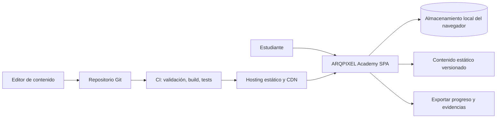

# TODO_LO_QUE_DEBE_TENER_ESTA_APP.md

> **Documento rector de requisitos, arquitectura, experiencia y auditoría de ARQPIXEL Academy**  
> **Versión del producto evaluada:** v1.7.0 · **Idioma:** español · **Enfoque:** Arquitectura de Software y Senior Mode  
> **Fuente de referencia visual:** GoPixel Academy (solo concepto educativo y experiencia; identidad ARQPIXEL independiente).  
> **Identidad oficial:** ArquiBot, robot blanco, azul y cian. **No usar TerraBot morado de Terraform** como mascota principal.  
> **Naturaleza:** especificación viva + inventario del estado real + contratos de calidad y entrega.  
> **Política de release:** lo que figure como `PENDIENTE` NO se anuncia como implementado.

---

## CÓMO USAR ESTE DOCUMENTO

1. **Antes de programar:** leer las secciones de visión, diseño, contratos y criterios de aceptación.
2. **Al cambiar código:** actualizar la tabla de estado, pruebas y archivos; nunca borrar código/recursos anteriores sin una decisión de migración y copia conservada.
3. **Antes de empaquetar:** ejecutar controles de tipos, build, tests, navegador, seguridad y extracción limpia del ZIP. Adjuntar evidencias.
4. **Antes de anunciar «completo»:** cumplir todos los requisitos obligatorios, no solo que la UI se vea bonita; registrar cualquier `NO VERIFICADO`.
5. **Si el plan original difiere de lo actual:** las secciones «Estado real v1.7» mandan para describir qué está entregado; el anexo conserva la visión inicial, sin convertir una expectativa en implementación existente.
6. **Cambios futuros:** mantener un historial de requisitos y preservar el nombre de este archivo en todas las releases.

### Convenciones obligatorias

- **[IMPLEMENTADO / VERIFICADO LOCALMENTE]:** hay código, recurso y prueba local reproducible.
- **[IMPLEMENTADO / PENDIENTE DE E2E REAL]:** existe el flujo, pero no se comprobó con despliegue/red real.
- **[PARCIAL]:** funciona con limitaciones explícitas, como editor C4 no semántico.
- **[PENDIENTE]:** falta código, cobertura, calidad o validación formal.
- **[FUERA DEL MVP]:** capacidad que no forma parte de esta versión; no omitirla silenciosamente si fue prometida.
- **[REQUIERE REVISIÓN HUMANA]:** juicio de arquitectura no reducible a una puntuación de texto.

**Decisión fundamental:** «totalmente documentado» no equivale a «100 % implementado». Este archivo describe ambas cosas de manera distinguible.

## 1. DEFINICIÓN DEL PRODUCTO Y OBJETIVOS NO NEGOCIABLES

### 1.1 Qué es ARQPIXEL

Una academia web interactiva, en español, que enseña a **diseñar sistemas**, estructurar software, justificar decisiones y evaluar riesgos, desde conceptos básicos hasta situaciones complejas de arquitecto Senior. **No** se limita a memorizar SOLID o identificar patrones de diseño: la experiencia va de problema de negocio → restricciones → alternativas → diagrama/código/decisión → verificación → retroalimentación → evidencia.

### 1.2 Usuario objetivo y resultados

- **Principiante:** diferenciar arquitectura de software, diseño detallado, código, requisitos funcionales y atributos de calidad; identificar frontend, API, dominio e infraestructura.
- **Junior:** representar sistemas C4, evitar ciclos y acoplamiento, explicar responsabilidades y aplicar patrones con criterio.
- **Intermedio:** separar capas y puertos; SOLID, GoF, DDD, bounded contexts, APIs y monolitos modulares.
- **Avanzado:** evaluar escalabilidad, consistencia, eventos, resiliencia, seguridad, SLO, despliegues y modernización.
- **Senior:** realizar diagnósticos, modelar opciones, construir ADR, verificar supuestos, responder incidentes y explicar las consecuencias de un cambio de requisitos.

### 1.3 Reglas pedagógicas

- Todo concepto debe responder **qué es, para qué sirve, cuándo usarlo, cuándo evitarlo, cómo comprobarlo y errores comunes**.
- Las decisiones se comparan por requisitos y restricciones, no por dogmas («siempre microservicios», «siempre CQRS», «más interfaces es mejor»).
- Los ejemplos se fundamentan preferentemente en **NexoShop** (ecommerce ficticio común a lecciones, laboratorios y Senior).
- Los minijuegos son didácticos, con explicaciones de errores, no certificaciones profesionales.
- Toda simulación anuncia sus supuestos, escala, datos sintéticos y límites.
- Un ADR completo a nivel de plantilla **no garantiza** un ADR correcto; siempre mostrar `REQUIRES_REVIEW` en calidad técnica abierta.
- Una misión nunca debe aprobarse por pulsar «Evaluar» sin terminar el flujo mínimo.
- Un alumno debe poder exportar sus evidencias y restaurar su progreso sin usar cuentas.

### 1.4 Alcance actual frente a aspiración

| Capacidad | Situación comprobable de v1.7 | Condición para declararla plena |
|---|---|---|
| 36 lecciones B/I/A | Implementadas, una pregunta y contenido específico por tema | Más ejemplos ejecutables, actividades multimedia y revisión editorial profunda |
| 18 misiones S01–S18 | Implementadas con seis actividades centrales | Validaciones semánticas profundas y pruebas de escenarios expertos |
| Senior Mode | Variantes, seis actividades, ADR, resultados, expediente, DevSecOps/STRIDE bonus | Evaluador humano opcional, escenarios de mayor realismo y evidencias técnicas de proyectos ejecutables |
| 8 laboratorios | Accesibles con motores didácticos | Ampliar los ocho editores semánticos y escenarios negativos |
| 5 minijuegos | Implementados, seis decisiones cada uno (30) | Equilibrio pedagógico y pruebas de usabilidad con estudiantes reales |
| C4 Studio | Contenedores/relaciones y exportación JSON/Mermaid/SVG/PNG | C4 niveles 1–4, edición gráfica avanzada, validación semántica y diagramas accesibles completos |
| Senior contextual por lección | Disponible en 24 lecciones I/A | Casos por módulo revisados por expertos; 12 B no aplica deliberadamente |
| Persistencia | localStorage; exportar/importar | Sincronización por cuentas opcional, con backend y privacidad diseñados |
| UI Modern Pixel y ArquiBot | Implementación estática, azul/cian, responsive comprobado en vistas concretas | Auditoría accesibilidad WCAG formal, navegadores/lectores de pantalla representativos |
| TypeScript offline | Compila con TypeScript vendorizado | Migrar a Preact/Vite solo si se decide conservar stack original del master spec |
| Biome | Configuración y CI declarados | Ejecutarlo realmente con versión bloqueada; pasar `biome ci` |
| CI GitHub | Workflow presente | Ejecutar y revisar en runner real |
| DevSecOps | Scanner heurístico, headers estáticos, licencias, SBOM offline | SCA de CVEs real, threat review completo, hosting seguro verificado |
| Ejecución en producción | `dist/` servible estáticamente | Pruebas E2E sobre el dominio y encabezados reales; despliegue documentado |

## 2. IDENTIDAD, BRANDING Y SISTEMA DE DISEÑO

### 2.1 Identidad única

- Producto: **ARQPIXEL Academy**.
- Personaje: **ArquiBot**. Es un robot redondeado con pantalla facial azul oscuro, sonrisa cian, casco/cuerpo blanco y azul, detalles luminosos turquesa, mochila y plano de arquitectura. Es **diferente de TerraBot morado**.
- Logo conceptual: tres bloques/cubos azules vinculados; no convertirlo en el logo de Terraform.
- Voz: didáctica, precisa, amable, no infantilizar a profesionales. Usar «decisión», «riesgo», «trade-off», «evidencia» y «verificación» con sentido.
- Sello visual: **Modern Pixel**: 80 % UI técnica legible y 20 % personalidad pixel-art.

### 2.2 Tokens y temas

| Token | Dark / intención | Regla |
|---|---|---|
| Fondo | `#071327` | Oscuro profundo sin usar negro puro en toda la interfaz |
| Superficie | `#0d2038` | Tarjetas y paneles con jerarquía visual |
| Superficie elevada | `#122a46` | Editor, diálogo y popovers |
| Texto principal | `#f4f9ff` | Contraste claro sobre fondo oscuro |
| Texto secundario | `#a8bfd5` | Revisar contraste con fondos concretos |
| Cian marca | `#18d8ed` | Interacción/activo, no único indicador de acierto |
| Azul | `#338cff` | Links y acciones secundarias |
| Foco visible | `#ffe07b` | Navegación teclado inequívoca |
| Éxito | `#47d4a4` | Siempre acompañado de texto o icono |
| Aviso | `#ffbd60` | Restricciones, advertencias y riesgos |
| Error | `#ff7890` | Formulario, validación y feedback |
| Borde | `#294f71` | Delimitar paneles |
| Superficie light | `#ffffff` | Fondo claro recomendado `#f4f9ff` |

No introducir violeta Terraform como identidad principal. Los colores son tokens propuestos; verificar contraste y daltonismo con herramientas dedicadas antes de certificar WCAG.

### 2.3 Pantallas y comportamiento de diseño

- **Header:** marca, Inicio, Rutas, Laboratorios, Minijuegos, Recursos, Senior, Progreso; menú adaptable móvil.
- **Landing:** título «Arquitectura de Software», CTA «Explorar la ruta», CTA secundario «Laboratorios», imagen ArquiBot azul, arquitectura UI→API→Dominio→Datos/Cloud, estado actual.
- **Mapa de aprendizaje:** tres niveles B/I/A y el acceso a 18 misiones Senior; badges, progreso, prerrequisitos y accesibilidad.
- **Lecciones:** contenido, ejemplos, comparación, diagrama, pregunta, explicación, anotaciones, reto de transferencia y Senior contextual I/A.
- **Laboratorios:** contexto, instrucciones, herramienta interactiva, validaciones, evaluación honesta, exportación.
- **Minijuegos:** reglas, seis decisiones, pistas, retroalimentación, estrellas y mejor puntuación.
- **Senior dashboard:** 18 casos, dificultades, resumen, progreso, acceso a dossier; no presentar puntuación como título profesional.
- **Taller Senior:** escenarios reproducibles, selección guiada de componentes, grafo, código/contrato, ADR, capacidad, incidentes, riesgos y evidencia.
- **Perfil:** módulos aprobados, XP, insignias, progreso Senior, minijuegos, export/import/reset con confirmación.
- **Recursos:** glosario, patrones, comparativas, plantillas ADR, diagramas; buscar y filtrar en una evolución futura.
- **Error/404:** recuperar navegación, explicar qué falta, nunca dejar vista en blanco.

### 2.4 Componentes necesarios

`AppShell`, `NavBar`, `MobileMenu`, `ThemeToggle`, `Breadcrumbs`, `ArquiBotPanel`, `HeroDiagram`, `LevelCard`, `ModuleCard`, `LessonReader`, `ScenarioPanel`, `DecisionForm`, `DependencyCanvas`, `C4Canvas`, `DDDCanvas`, `PatternClinic`, `ApiContractClinic`, `CapacitySimulator`, `IncidentTimeline`, `ADRComposer`, `CodeReviewPanel`, `SeniorDashboard`, `SeniorMissionWorkspace`, `RubricPanel`, `EvidenceExporter`, `MiniGameFrame`, `ProgressPanel`, `BackupImport`, `BadgeCollection`, `LiveRegion`, `ErrorBoundary`, `SkipLink`.

Cada control requiere estados de foco, hover, deshabilitado, vacío, error, cargando y éxito cuando apliquen. Las acciones tienen que cambiar el estado real y mostrar una respuesta comprobable.

### 2.5 Reglas responsive y accesibilidad

- Breakpoints de ensayo: 320, 375, 768, 1024 y 1440 px; horizontal scroll solo en elementos que lo requieran y con aviso, no en la página.
- Menús y formularios por teclado; orden de tabulación visible; no interacciones exclusivamente drag-and-drop.
- Nombres accesibles para campos, imágenes y botones; mensajes de error entendibles; `aria-live` cuando proceda.
- Tamaño táctil cómodo; fuente legible; zoom 200 % sin pérdida de funciones clave.
- `prefers-reduced-motion`; respetar tema claro/oscuro; no señalar estado solo por color.
- Lienzos con resumen textual y exportación accesible de sus datos.
- **QA actual:** comprobaciones en Chromium de tamaños concretos ≠ auditoría formal WCAG ni lector de pantalla real.

### 2.6 Inventario de imágenes y branding

- `public/assets/arquibot.png`: ArquiBot azul/cian, recurso principal.
- `public/assets/arquibot-lab.png`: compañero del laboratorio, arquitectura holográfica.
- `public/assets/hero-reference.png`: recurso visual de referencia de hero.
- `docs/legacy/arquibot-v15-mascota-terraform.png`: recurso histórico preservado, no utilizado como mascota ARQPIXEL.
- En versiones futuras: PNG transparentes de ArquiBot en estados `saludo`, `pensando`, `explicando`, `programando`, `pista`, `error`, `éxito`, `laboratorio`, `sorprendido`, `descanso`, `experto`, `senior`.
- No duplicar archivos pesados sin necesidad; mantener atribución/licencias, tamaño optimizado, textos alternativos y versión de cada sprite.

## 3. ARQUITECTURA TECNOLÓGICA DE LA APLICACIÓN

### 3.1 Tecnología efectivamente usada por v1.7

- **Lenguaje:** TypeScript estricto, módulos ES compilados a `dist/`.
- **UI:** DOM nativo + CSS; sin backend.
- **Compilador:** TypeScript 5.8.3 conservado localmente en `tools/typescript/`.
- **Distribución:** HTML, JS, JSON, CSS y PNG estáticos en `dist/`; servidor HTTP local simple.
- **Contenido:** JSON tipado por código en `data/`.
- **Persistencia:** `localStorage` en el navegador, importación/exportación explícita de JSON.
- **Pruebas:** Node `node:test`; pruebas Chromium con Python/Playwright si está instalado.
- **Seguridad:** CSP y `_headers` para hosting compatible, scanner heurístico de secretos, política de licencias, SBOM generado.

### 3.2 Stack deseado del master spec (pendiente)

El plan original prevé **Preact + TypeScript + Vite** y composición por features. La v1.7 **no está migrada a ese stack**. Migración planificada y *no destructiva*: crear una rama/copia de trabajo, elaborar ADR de migración, sustituir bootstrap por Preact sin alterar URL/estado/catálogos, mantener pruebas de regresión, generar bundle reproducible y comparar dist funcional; conservar el código histórico por compatibilidad y auditoría. No introducir React/Next.js o backend sin necesidad ni afirmar que existen.

### 3.3 Flujo funcional real

`HTTP estático → index.html → app.js → catálogos JSON → rutas hash → pantallas → evaluación pura → localStorage → exportación (JSON/Markdown/SVG/PNG/Mermaid)`.

El flujo de Senior es `misión + seed → restricciones → 6 actividades → controles mecánicos → feedback + calidad requiere revisión humana → XP si procede → expediente/exportación`. Los bonus DevSecOps y STRIDE no sustituyen las seis actividades.

### 3.4 Contratos mínimos por módulo

- Toda regla de evaluación debe poder probarse sin DOM y rechazar entradas malformadas.
- El catálogo no debe depender de posiciones de respuesta (`correct: 0` como dogma); respuestas por variante reproducibles.
- Persistencia con límites razonables de tamaño; nunca ejecutar código importado.
- Import JSON debe validar estructura, IDs, tamaños, puntuaciones y versiones; ignorar IDs desconocidos, rechazar corrupción relevante.
- `schemaVersion` y migraciones futuras han de soportar borradores anteriores sin duplicar XP.
- Los componentes de UI no deben mutar directamente el catálogo fuente.
- Exportación debe ser determinista para la misma evidencia salvo marca temporal explícita.
- Los diagramas exportados escapan nombres controlados por usuario para prevenir inyección.

### 3.5 Estructura obligatoria del repositorio

```text
arqpixel-academy/
├── TODO_LO_QUE_DEBE_TENER_ESTA_APP.md       # Este contrato vivo
├── README.md                                # Inicio, comandos y límites
├── AUDIT_REPORT.md                          # Estado verificado por release
├── MANIFEST.md                              # Inventario, conservación y paquete
├── CHECKSUMS.sha256                         # Verificación de archivos de entrega
├── SECURITY.md                              # Riesgos y divulgación responsable
├── package.json, tsconfig.json, biome.json
├── index.html
├── src/
│   ├── app.ts, engine.ts, styles.css
│   ├── senior-suite.ts, senior-simulations.ts, senior-reviews.ts
│   ├── senior-impact.ts, senior-devsecops.ts, senior-threats.ts
│   ├── mini-games.ts, lesson-senior.ts, c4-studio.ts
├── data/
│   ├── modules.json, deep-dives.json, senior.json
│   ├── paths.json, lab-cases.json, mini-games.json
├── public/assets/                       # ArquiBot, panel y hero
├── public/_headers
├── scripts/                             # build/release/seguridad/SBOM
├── tests/                               # unitarios/integración/navegador
├── docs/                                # master spec + auditorías históricas
├── .github/workflows/                   # validación de CI declarada
├── security/                            # SBOM
├── tools/typescript/                    # compilador y licencia offline
├── dist/                                # aplicación estática compilada
└── iniciar-windows.bat, iniciar-linux-macos.sh
```

**Preservación:** si se renombra o retira un archivo, registrar su reemplazo, impacto, migración y comprobación en `MANIFEST.md`; no eliminar recursos históricos por comodidad. ZIP siempre con una sola raíz `arqpixel-academy/`.

## 4. CATÁLOGO EDUCATIVO COMPLETO: 54 ELEMENTOS

Regla curricular: los **54 elementos** son **36 lecciones** de niveles Básico/Intermedio/Avanzado y **18 misiones Senior**. No se anuncian «54 lecciones de teoría» porque los dieciocho últimos son retos profesionales. Cada lección debe enseñar *problema, concepto, caso, contraejemplo, comparación, verificación, ejercicio y transferencia*, y el estado actual se identifica a continuación.

### 4.1 Las 36 lecciones B/I/A, con práctica y evidencia obligatoria

#### Nivel Básico (B01–B12)

##### B01 — ¿Qué es arquitectura de software?

- **Conceptos:** Estructura, decisiones, atributos de calidad, restricciones.
- **Actividad obligatoria:** Identificar decisiones en una app.
- **Ejemplo de la versión actual:** Para NexoShop, decide qué responsabilidades pertenecen al frontend, API y dominio; documenta al menos un trade-off..
- **Comparación didáctica:** Decisión arquitectónica vs elección cosmética. **Por qué importa:** La estructura influye en capacidad de cambio, despliegue y fallos; el color de un botón casi nunca delimita el sistema..
- **Métrica o criterio de verificación:** Tiempo necesario para implementar una nueva capacidad sin cambiar módulos ajenos..
- **Reto de transferencia:** Describe dos decisiones difíciles de revertir para una aplicación de reservas..
- **Definition of Done específico:** mostrar el problema, una solución apropiada, una alternativa menos apropiada, una evaluación con explicación; guardar la respuesta y la nota; realizar prueba de carga de contenido y navegación; añadir demostración visual/code review al ampliar.
- **Estado v1.7:** teoría, caso, comparación, reto, pregunta y persistencia **implementados**; ejercicio de proyecto ejecutable/validación profesional aún **parcial**.

##### B02 — Requisitos funcionales y no funcionales

- **Conceptos:** Casos de uso, escenarios de calidad, stakeholders.
- **Actividad obligatoria:** Separar RF/RNF y priorizar.
- **Ejemplo de la versión actual:** Convierte “que sea rápido” en “p95 de checkout por debajo de 350 ms con 500 usuarios concurrentes”..
- **Comparación didáctica:** Deseo ambiguo vs escenario medible. **Por qué importa:** “Rápido” no permite verificar nada; “p95 de búsqueda < 350 ms con 500 usuarios” sí..
- **Métrica o criterio de verificación:** p95, porcentaje de disponibilidad, tiempo de recuperación y carga observada..
- **Reto de transferencia:** Convierte tres deseos ambiguos en estímulo, entorno, respuesta y medida..
- **Definition of Done específico:** mostrar el problema, una solución apropiada, una alternativa menos apropiada, una evaluación con explicación; guardar la respuesta y la nota; realizar prueba de carga de contenido y navegación; añadir demostración visual/code review al ampliar.
- **Estado v1.7:** teoría, caso, comparación, reto, pregunta y persistencia **implementados**; ejercicio de proyecto ejecutable/validación profesional aún **parcial**.

##### B03 — Componentes, módulos y responsabilidades

- **Conceptos:** Cohesión, acoplamiento, límites.
- **Actividad obligatoria:** Organizar un ecommerce simple.
- **Ejemplo de la versión actual:** Separa Catálogo, Pedido y Pagos sin forzar dependencias circulares..
- **Comparación didáctica:** Componentes cohesionados vs funciones dispersas. **Por qué importa:** La misma regla de reserva no debería replicarse entre controlador, persistencia y frontend..
- **Métrica o criterio de verificación:** Cantidad de módulos editados por cambio de regla de negocio..
- **Reto de transferencia:** Diseña responsabilidades para Reserva, Cobro y Notificaciones sin duplicar reglas..
- **Definition of Done específico:** mostrar el problema, una solución apropiada, una alternativa menos apropiada, una evaluación con explicación; guardar la respuesta y la nota; realizar prueba de carga de contenido y navegación; añadir demostración visual/code review al ampliar.
- **Estado v1.7:** teoría, caso, comparación, reto, pregunta y persistencia **implementados**; ejercicio de proyecto ejecutable/validación profesional aún **parcial**.

##### B04 — Diagramas de arquitectura

- **Conceptos:** C4 L1/L2, flujo y secuencia intro.
- **Actividad obligatoria:** Dibujar contexto y contenedores.
- **Ejemplo de la versión actual:** Modela al cliente, NexoShop, pasarela de pagos y proveedor de correo..
- **Comparación didáctica:** Diagrama bonito vs vista con audiencia. **Por qué importa:** C4 Contexto expone actores; Contenedores explica responsabilidades, interfaces y almacenamiento..
- **Métrica o criterio de verificación:** ¿Un nuevo miembro puede reconocer los límites y flujos sin conocer el repositorio?.
- **Reto de transferencia:** Traza contexto y contenedores de un sistema de citas y explica sus diferencias..
- **Definition of Done específico:** mostrar el problema, una solución apropiada, una alternativa menos apropiada, una evaluación con explicación; guardar la respuesta y la nota; realizar prueba de carga de contenido y navegación; añadir demostración visual/code review al ampliar.
- **Estado v1.7:** teoría, caso, comparación, reto, pregunta y persistencia **implementados**; ejercicio de proyecto ejecutable/validación profesional aún **parcial**.

##### B05 — Cliente-servidor y web moderna

- **Conceptos:** UI, API, datos, redes.
- **Actividad obligatoria:** Seguir flujo de una compra.
- **Ejemplo de la versión actual:** Sigue una solicitud POST /pedidos desde el navegador hasta el registro del pedido..
- **Comparación didáctica:** Petición HTTP vs lógica de negocio. **Por qué importa:** El cliente representa intención; el servidor valida autoridad y reglas; el almacenamiento es un detalle de infraestructura..
- **Métrica o criterio de verificación:** P95 de solicitud, errores por dependencia y uso de recursos..
- **Reto de transferencia:** Define qué ocurre cuando una reserva se confirma pero el navegador pierde conexión..
- **Definition of Done específico:** mostrar el problema, una solución apropiada, una alternativa menos apropiada, una evaluación con explicación; guardar la respuesta y la nota; realizar prueba de carga de contenido y navegación; añadir demostración visual/code review al ampliar.
- **Estado v1.7:** teoría, caso, comparación, reto, pregunta y persistencia **implementados**; ejercicio de proyecto ejecutable/validación profesional aún **parcial**.

##### B06 — Arquitectura en capas

- **Conceptos:** Presentación, aplicación, dominio, infraestructura.
- **Actividad obligatoria:** Armar diagrama de dependencias.
- **Ejemplo de la versión actual:** Evita que el dominio importe el controlador HTTP o un ORM..
- **Comparación didáctica:** Dependencias hacia dentro vs imports circulares. **Por qué importa:** El dominio no debe importar controladores HTTP ni un ORM para calcular reglas de reserva..
- **Métrica o criterio de verificación:** Ciclos en el grafo de imports y pruebas aisladas del dominio..
- **Reto de transferencia:** Dibuja dependencias permitidas y prohibidas entre presentación, aplicación, dominio e infraestructura..
- **Definition of Done específico:** mostrar el problema, una solución apropiada, una alternativa menos apropiada, una evaluación con explicación; guardar la respuesta y la nota; realizar prueba de carga de contenido y navegación; añadir demostración visual/code review al ampliar.
- **Estado v1.7:** teoría, caso, comparación, reto, pregunta y persistencia **implementados**; ejercicio de proyecto ejecutable/validación profesional aún **parcial**.

##### B07 — MVC y separación de concerns

- **Conceptos:** Modelo/vista/controlador y límites.
- **Actividad obligatoria:** Refactorizar responsabilidades.
- **Ejemplo de la versión actual:** Identifica qué ocurre si el controlador ejecuta SQL y aplica descuentos..
- **Comparación didáctica:** MVC vs arquitectura completa. **Por qué importa:** MVC ayuda a separar interacción, pero no decide cómo se protegen invariantes o bounded contexts..
- **Métrica o criterio de verificación:** Cantidad de responsabilidades ajenas presentes en controllers y views..
- **Reto de transferencia:** Extrae del controller la regla “no permitir reservas superpuestas”..
- **Definition of Done específico:** mostrar el problema, una solución apropiada, una alternativa menos apropiada, una evaluación con explicación; guardar la respuesta y la nota; realizar prueba de carga de contenido y navegación; añadir demostración visual/code review al ampliar.
- **Estado v1.7:** teoría, caso, comparación, reto, pregunta y persistencia **implementados**; ejercicio de proyecto ejecutable/validación profesional aún **parcial**.

##### B08 — POO para arquitectos

- **Conceptos:** Encapsulación, composición, interfaces.
- **Actividad obligatoria:** Detectar clases con demasiadas tareas.
- **Ejemplo de la versión actual:** Aísla una política de impuestos detrás de una interfaz..
- **Comparación didáctica:** Objeto con comportamiento vs bolsa de datos. **Por qué importa:** Una entidad protegida expone métodos que preservan invariantes en vez de permitir modificaciones arbitrarias..
- **Métrica o criterio de verificación:** Número de estados inválidos posibles mediante API pública..
- **Reto de transferencia:** Diseña una entidad Reserva con transición confirmar/cancelar y precondiciones..
- **Definition of Done específico:** mostrar el problema, una solución apropiada, una alternativa menos apropiada, una evaluación con explicación; guardar la respuesta y la nota; realizar prueba de carga de contenido y navegación; añadir demostración visual/code review al ampliar.
- **Estado v1.7:** teoría, caso, comparación, reto, pregunta y persistencia **implementados**; ejercicio de proyecto ejecutable/validación profesional aún **parcial**.

##### B09 — Cohesión, acoplamiento y modularidad

- **Conceptos:** Cambios locales, módulos estables.
- **Actividad obligatoria:** Comparar dos diseños.
- **Ejemplo de la versión actual:** Evalúa un cambio de descuentos y cuántos módulos quedarían afectados..
- **Comparación didáctica:** Acoplamiento necesario vs accidental. **Por qué importa:** Duplicar una dependencia global reduce testabilidad; módulos orientados a una sola responsabilidad cambian juntos..
- **Métrica o criterio de verificación:** Change coupling: archivos impactados y tiempo de integración..
- **Reto de transferencia:** Identifica tres razones por las que el módulo Inventario dependería indebidamente de Pagos..
- **Definition of Done específico:** mostrar el problema, una solución apropiada, una alternativa menos apropiada, una evaluación con explicación; guardar la respuesta y la nota; realizar prueba de carga de contenido y navegación; añadir demostración visual/code review al ampliar.
- **Estado v1.7:** teoría, caso, comparación, reto, pregunta y persistencia **implementados**; ejercicio de proyecto ejecutable/validación profesional aún **parcial**.

##### B10 — Introducción a SOLID

- **Conceptos:** Cinco principios, aplicación contextual.
- **Actividad obligatoria:** Detectar violaciones básicas.
- **Ejemplo de la versión actual:** Sustituye un repositorio concreto por una abstracción en el caso de uso..
- **Comparación didáctica:** Abstracción útil vs sobreingeniería. **Por qué importa:** SOLID guía el aislamiento del cambio; una interfaz sin una necesidad de variación puede introducir complejidad sin beneficio..
- **Métrica o criterio de verificación:** Número de cambios de proveedor que requieren modificar los casos de uso..
- **Reto de transferencia:** Propón una interfaz pequeña para pagos y explica dónde no utilizarías una..
- **Definition of Done específico:** mostrar el problema, una solución apropiada, una alternativa menos apropiada, una evaluación con explicación; guardar la respuesta y la nota; realizar prueba de carga de contenido y navegación; añadir demostración visual/code review al ampliar.
- **Estado v1.7:** teoría, caso, comparación, reto, pregunta y persistencia **implementados**; ejercicio de proyecto ejecutable/validación profesional aún **parcial**.

##### B11 — Introducción a patrones

- **Conceptos:** Problema recurrente, patrón vs antipatrón.
- **Actividad obligatoria:** Elegir Strategy, Factory o Observer.
- **Ejemplo de la versión actual:** Usa Strategy al existir métodos de cálculo intercambiables..
- **Comparación didáctica:** Patrón por problema vs patrón por moda. **Por qué importa:** Strategy sirve si cambia el algoritmo; Adapter si una interfaz externa es incompatible; Decorator si añades comportamiento..
- **Métrica o criterio de verificación:** Cambios necesarios para integrar un nuevo proveedor..
- **Reto de transferencia:** Clasifica tres problemas y defiende un patrón o una solución simple..
- **Definition of Done específico:** mostrar el problema, una solución apropiada, una alternativa menos apropiada, una evaluación con explicación; guardar la respuesta y la nota; realizar prueba de carga de contenido y navegación; añadir demostración visual/code review al ampliar.
- **Estado v1.7:** teoría, caso, comparación, reto, pregunta y persistencia **implementados**; ejercicio de proyecto ejecutable/validación profesional aún **parcial**.

##### B12 — Proyecto básico: App de reservas

- **Conceptos:** Requisitos, C4, capas, ADR simple.
- **Actividad obligatoria:** Entregar diseño defendible.
- **Ejemplo de la versión actual:** Presenta un C4 de reservas, un contrato de API y un ADR sobre persistencia..
- **Comparación didáctica:** Aplicación de reservas monolítica vs módulos claros. **Por qué importa:** Usuarios, disponibilidad, reservas y cobros deben tener responsables y reglas explícitas antes de escalar..
- **Métrica o criterio de verificación:** Conflictos de reservas, tiempo de despliegue y pruebas de integración..
- **Reto de transferencia:** Presenta un C4 Contenedores, flujo de reserva y un ADR con riesgos..
- **Definition of Done específico:** mostrar el problema, una solución apropiada, una alternativa menos apropiada, una evaluación con explicación; guardar la respuesta y la nota; realizar prueba de carga de contenido y navegación; añadir demostración visual/code review al ampliar.
- **Estado v1.7:** teoría, caso, comparación, reto, pregunta y persistencia **implementados**; ejercicio de proyecto ejecutable/validación profesional aún **parcial**.

#### Nivel Intermedio (I01–I12)

##### I01 — SOLID aplicado

- **Conceptos:** DIP, ISP, OCP, SRP, LSP con límites.
- **Actividad obligatoria:** Reparar dependencias y tests.
- **Ejemplo de la versión actual:** Detecta una violación de ISP en una interfaz de notificaciones..
- **Comparación didáctica:** DIP vs contenedor de dependencias. **Por qué importa:** Inversión de dependencias es diseño de contratos, no simplemente registrar clases en un contenedor IoC..
- **Métrica o criterio de verificación:** Pruebas de casos de uso sin base de datos ni servicios HTTP..
- **Reto de transferencia:** Refactoriza un servicio de descuento que consulta directamente el ORM..
- **Definition of Done específico:** mostrar el problema, una solución apropiada, una alternativa menos apropiada, una evaluación con explicación; guardar la respuesta y la nota; realizar prueba de carga de contenido y navegación; añadir demostración visual/code review al ampliar.
- **Estado v1.7:** teoría, caso, comparación, reto, pregunta y persistencia **implementados**; ejercicio de proyecto ejecutable/validación profesional aún **parcial**.

##### I02 — Patrones creacionales

- **Conceptos:** Factory Method, Abstract Factory, Builder.
- **Actividad obligatoria:** Elegir según variación.
- **Ejemplo de la versión actual:** Separa la creación de conectores de pago de su utilización..
- **Comparación didáctica:** Factory Method vs Builder. **Por qué importa:** Factory decide el subtipo; Builder evita constructores ilegibles cuando un objeto tiene configuración compleja..
- **Métrica o criterio de verificación:** Complejidad del cliente que crea objetos y tests de invariantes..
- **Reto de transferencia:** Decide cómo crear conectores distintos para proveedores con credenciales configurables..
- **Definition of Done específico:** mostrar el problema, una solución apropiada, una alternativa menos apropiada, una evaluación con explicación; guardar la respuesta y la nota; realizar prueba de carga de contenido y navegación; añadir demostración visual/code review al ampliar.
- **Estado v1.7:** teoría, caso, comparación, reto, pregunta y persistencia **implementados**; ejercicio de proyecto ejecutable/validación profesional aún **parcial**.

##### I03 — Patrones estructurales

- **Conceptos:** Adapter, Facade, Decorator, Composite.
- **Actividad obligatoria:** Integrar API legado.
- **Ejemplo de la versión actual:** Integra un API legado de facturación mediante Adapter..
- **Comparación didáctica:** Adapter vs Facade. **Por qué importa:** Adapter convierte un contrato; Facade oculta la complejidad de un subsistema bajo una entrada más simple..
- **Métrica o criterio de verificación:** Cambios locales tras una actualización de SDK externo..
- **Reto de transferencia:** Aísla un proveedor de mensajería legado de tu puerto de notificación..
- **Definition of Done específico:** mostrar el problema, una solución apropiada, una alternativa menos apropiada, una evaluación con explicación; guardar la respuesta y la nota; realizar prueba de carga de contenido y navegación; añadir demostración visual/code review al ampliar.
- **Estado v1.7:** teoría, caso, comparación, reto, pregunta y persistencia **implementados**; ejercicio de proyecto ejecutable/validación profesional aún **parcial**.

##### I04 — Patrones de comportamiento

- **Conceptos:** Strategy, Observer, Command, State.
- **Actividad obligatoria:** Flujo de pagos extensible.
- **Ejemplo de la versión actual:** Usa Strategy para métodos de pago sin un switch gigante..
- **Comparación didáctica:** Strategy vs Observer. **Por qué importa:** Strategy intercambia algoritmos sin cambiar el cliente; Observer desacopla la publicación de eventos de consumidores..
- **Métrica o criterio de verificación:** Número de sitios tocados al agregar un descuento o un suscriptor..
- **Reto de transferencia:** Explica cuándo un evento de dominio no debe desencadenar un cobro directamente..
- **Definition of Done específico:** mostrar el problema, una solución apropiada, una alternativa menos apropiada, una evaluación con explicación; guardar la respuesta y la nota; realizar prueba de carga de contenido y navegación; añadir demostración visual/code review al ampliar.
- **Estado v1.7:** teoría, caso, comparación, reto, pregunta y persistencia **implementados**; ejercicio de proyecto ejecutable/validación profesional aún **parcial**.

##### I05 — Repository, Unit of Work y transacciones

- **Conceptos:** Persistencia vs dominio.
- **Actividad obligatoria:** Separar capa de acceso a datos.
- **Ejemplo de la versión actual:** Evita que las entidades conozcan Entity Framework o Hibernate..
- **Comparación didáctica:** Repository vs transacción. **Por qué importa:** Repository abstrae persistencia; una unidad de trabajo coordinada controla commit de invariantes en un límite transaccional..
- **Métrica o criterio de verificación:** Fallos parciales y cantidad de escrituras atómicas probadas..
- **Reto de transferencia:** Diseña una transacción que guarde Pedido y Outbox sin perder consistencia local..
- **Definition of Done específico:** mostrar el problema, una solución apropiada, una alternativa menos apropiada, una evaluación con explicación; guardar la respuesta y la nota; realizar prueba de carga de contenido y navegación; añadir demostración visual/code review al ampliar.
- **Estado v1.7:** teoría, caso, comparación, reto, pregunta y persistencia **implementados**; ejercicio de proyecto ejecutable/validación profesional aún **parcial**.

##### I06 — Clean Architecture

- **Conceptos:** Dependencias hacia reglas de negocio.
- **Actividad obligatoria:** Reordenar imports/capas.
- **Ejemplo de la versión actual:** Verifica que dominio no dependa de infraestructura..
- **Comparación didáctica:** Arquitectura limpia vs estructura de carpetas. **Por qué importa:** Clean Architecture exige dependencias de código hacia el núcleo; renombrar carpetas no invierte dependencias..
- **Métrica o criterio de verificación:** Importaciones hacia infraestructura desde dominio (objetivo: cero)..
- **Reto de transferencia:** Extrae el puerto RepositorioPedidos y prueba un caso de uso aislado..
- **Definition of Done específico:** mostrar el problema, una solución apropiada, una alternativa menos apropiada, una evaluación con explicación; guardar la respuesta y la nota; realizar prueba de carga de contenido y navegación; añadir demostración visual/code review al ampliar.
- **Estado v1.7:** teoría, caso, comparación, reto, pregunta y persistencia **implementados**; ejercicio de proyecto ejecutable/validación profesional aún **parcial**.

##### I07 — Arquitectura hexagonal

- **Conceptos:** Puertos, adaptadores, test doubles.
- **Actividad obligatoria:** Sustituir proveedor de pagos.
- **Ejemplo de la versión actual:** Reemplaza Stripe por un fake en tests sin cambiar el caso de uso..
- **Comparación didáctica:** Puerto de entrada vs adaptador de salida. **Por qué importa:** Un caso de uso habla su propio lenguaje; REST, CLI, SQL y colas son adaptadores intercambiables..
- **Métrica o criterio de verificación:** Pruebas de negocio ejecutables sin HTTP ni base real..
- **Reto de transferencia:** Sustituye Postgres por un repositorio en memoria sin tocar el caso de uso..
- **Definition of Done específico:** mostrar el problema, una solución apropiada, una alternativa menos apropiada, una evaluación con explicación; guardar la respuesta y la nota; realizar prueba de carga de contenido y navegación; añadir demostración visual/code review al ampliar.
- **Estado v1.7:** teoría, caso, comparación, reto, pregunta y persistencia **implementados**; ejercicio de proyecto ejecutable/validación profesional aún **parcial**.

##### I08 — DDD estratégico

- **Conceptos:** Dominio, subdominios, lenguaje ubicuo.
- **Actividad obligatoria:** Event storming básico.
- **Ejemplo de la versión actual:** Define vocabulario compartido en Ventas e Inventario..
- **Comparación didáctica:** Modelo compartido vs límites de lenguaje. **Por qué importa:** DDD estratégico descubre subdominios y límites donde las palabras tienen significado diferente..
- **Métrica o criterio de verificación:** Conflictos de nombres compartidos y cambios coordinados entre equipos..
- **Reto de transferencia:** Compara “producto” en Catálogo, Inventario y Facturación..
- **Definition of Done específico:** mostrar el problema, una solución apropiada, una alternativa menos apropiada, una evaluación con explicación; guardar la respuesta y la nota; realizar prueba de carga de contenido y navegación; añadir demostración visual/code review al ampliar.
- **Estado v1.7:** teoría, caso, comparación, reto, pregunta y persistencia **implementados**; ejercicio de proyecto ejecutable/validación profesional aún **parcial**.

##### I09 — Bounded Contexts y context mapping

- **Conceptos:** Upstream/downstream, anticorruption layer.
- **Actividad obligatoria:** Dividir ventas/inventario.
- **Ejemplo de la versión actual:** Traza relaciones entre Ventas, Catálogo, Inventario y Cobros..
- **Comparación didáctica:** Integración pública vs acceso a tablas de otro equipo. **Por qué importa:** Un context map define relaciones y traducciones; leer tablas externas genera acoplamiento oculto..
- **Métrica o criterio de verificación:** Número de esquemas externos usados directamente y versiones soportadas..
- **Reto de transferencia:** Diseña un anti-corruption layer entre Ventas y Contabilidad..
- **Definition of Done específico:** mostrar el problema, una solución apropiada, una alternativa menos apropiada, una evaluación con explicación; guardar la respuesta y la nota; realizar prueba de carga de contenido y navegación; añadir demostración visual/code review al ampliar.
- **Estado v1.7:** teoría, caso, comparación, reto, pregunta y persistencia **implementados**; ejercicio de proyecto ejecutable/validación profesional aún **parcial**.

##### I10 — DDD táctico

- **Conceptos:** Entidades, VO, agregados, domain services/events.
- **Actividad obligatoria:** Diseñar agregado Pedido.
- **Ejemplo de la versión actual:** Diseña Pedido para impedir transiciones de estado inválidas..
- **Comparación didáctica:** Entidad vs Value Object vs Aggregate. **Por qué importa:** Un Aggregate Root protege invariantes transaccionales; agrupar todo el dominio vuelve inmanejable la concurrencia..
- **Métrica o criterio de verificación:** Tasa de conflictos, estados inválidos y tamaño de transacción..
- **Reto de transferencia:** Decide si la reserva de stock debe ser parte del agregado Pedido..
- **Definition of Done específico:** mostrar el problema, una solución apropiada, una alternativa menos apropiada, una evaluación con explicación; guardar la respuesta y la nota; realizar prueba de carga de contenido y navegación; añadir demostración visual/code review al ampliar.
- **Estado v1.7:** teoría, caso, comparación, reto, pregunta y persistencia **implementados**; ejercicio de proyecto ejecutable/validación profesional aún **parcial**.

##### I11 — Diseño de APIs y contratos

- **Conceptos:** REST, HTTP, errores, versionado, OpenAPI.
- **Actividad obligatoria:** Revisar API de reservas.
- **Ejemplo de la versión actual:** Diseña POST /pedidos con idempotency-key..
- **Comparación didáctica:** Contrato estable vs endpoints accidentales. **Por qué importa:** Versiona cambios incompatibles, valida entradas y usa claves idempotentes para escrituras con reintentos..
- **Métrica o criterio de verificación:** Porcentaje de clientes compatibles; errores 4xx y operaciones duplicadas..
- **Reto de transferencia:** Diseña POST /pagos con Idempotency-Key y respuesta ante reintento..
- **Definition of Done específico:** mostrar el problema, una solución apropiada, una alternativa menos apropiada, una evaluación con explicación; guardar la respuesta y la nota; realizar prueba de carga de contenido y navegación; añadir demostración visual/code review al ampliar.
- **Estado v1.7:** teoría, caso, comparación, reto, pregunta y persistencia **implementados**; ejercicio de proyecto ejecutable/validación profesional aún **parcial**.

##### I12 — Proyecto intermedio: Monolito modular

- **Conceptos:** DDD + Clean/Hexagonal + ADR.
- **Actividad obligatoria:** Diseño modular con pruebas.
- **Ejemplo de la versión actual:** Construye el mapa de módulos de NexoShop y define propietarios..
- **Comparación didáctica:** Monolito modular vs monolito caótico. **Por qué importa:** Un proceso único puede tener límites de dominio verificables, despliegue sencillo y contratos internos estables..
- **Métrica o criterio de verificación:** Ciclos de paquetes, cobertura de pruebas por módulo y lead time..
- **Reto de transferencia:** Entrega mapa de módulos de NexoShop y dos ADR que argumenten límites..
- **Definition of Done específico:** mostrar el problema, una solución apropiada, una alternativa menos apropiada, una evaluación con explicación; guardar la respuesta y la nota; realizar prueba de carga de contenido y navegación; añadir demostración visual/code review al ampliar.
- **Estado v1.7:** teoría, caso, comparación, reto, pregunta y persistencia **implementados**; ejercicio de proyecto ejecutable/validación profesional aún **parcial**.

#### Nivel Avanzado (A01–A12)

##### A01 — System Design y estimación

- **Conceptos:** Carga, throughput, storage, latencia, presupuestos.
- **Actividad obligatoria:** Capacity planner de URLs.
- **Ejemplo de la versión actual:** Estima peticiones por segundo para 3 millones de visitas diarias..
- **Comparación didáctica:** Estimación rápida vs capacidad medida. **Por qué importa:** Dimensiona picos, tamaño de eventos, almacenamiento y ancho de banda con supuestos explícitos antes de elegir nodos..
- **Métrica o criterio de verificación:** RPS pico, throughput, CPU, p95, coste mensual y saturación..
- **Reto de transferencia:** Calcula carga de 20.000 usuarios activos con hipótesis documentadas..
- **Definition of Done específico:** mostrar el problema, una solución apropiada, una alternativa menos apropiada, una evaluación con explicación; guardar la respuesta y la nota; realizar prueba de carga de contenido y navegación; añadir demostración visual/code review al ampliar.
- **Estado v1.7:** teoría, caso, comparación, reto, pregunta y persistencia **implementados**; ejercicio de proyecto ejecutable/validación profesional aún **parcial**.

##### A02 — Monolito modular vs microservicios

- **Conceptos:** Límites, ownership, despliegue, costos.
- **Actividad obligatoria:** Árbol de decisión por contexto.
- **Ejemplo de la versión actual:** Justifica modularidad antes de fragmentar un equipo pequeño..
- **Comparación didáctica:** Servicios por equipos vs por tabla. **Por qué importa:** Separar un servicio añade red, observabilidad, despliegues y consistencia; busca autonomía real..
- **Métrica o criterio de verificación:** Frecuencia de coordinación, tasa de incidentes y coste operativo..
- **Reto de transferencia:** Define umbrales para extraer Pagos de un monolito modular..
- **Definition of Done específico:** mostrar el problema, una solución apropiada, una alternativa menos apropiada, una evaluación con explicación; guardar la respuesta y la nota; realizar prueba de carga de contenido y navegación; añadir demostración visual/code review al ampliar.
- **Estado v1.7:** teoría, caso, comparación, reto, pregunta y persistencia **implementados**; ejercicio de proyecto ejecutable/validación profesional aún **parcial**.

##### A03 — Comunicación síncrona y asíncrona

- **Conceptos:** HTTP/gRPC, mensajería, colas.
- **Actividad obligatoria:** Elegir protocolo para un flujo.
- **Ejemplo de la versión actual:** Elige mensajería para enviar confirmación sin bloquear checkout..
- **Comparación didáctica:** Síncrono vs asíncrono. **Por qué importa:** La llamada directa simplifica feedback inmediato; eventos desacoplan tiempos, pero requieren deduplicación y manejo de lag..
- **Métrica o criterio de verificación:** Latencia extremo a extremo, lag, reintentos y mensajes muertos..
- **Reto de transferencia:** Elige HTTP, evento o ambos para confirmar pedido y notificar a usuario..
- **Definition of Done específico:** mostrar el problema, una solución apropiada, una alternativa menos apropiada, una evaluación con explicación; guardar la respuesta y la nota; realizar prueba de carga de contenido y navegación; añadir demostración visual/code review al ampliar.
- **Estado v1.7:** teoría, caso, comparación, reto, pregunta y persistencia **implementados**; ejercicio de proyecto ejecutable/validación profesional aún **parcial**.

##### A04 — CQRS y Event-Driven

- **Conceptos:** Modelos de lectura/escritura, proyecciones.
- **Actividad obligatoria:** Diseñar read model.
- **Ejemplo de la versión actual:** Diseña proyección de lectura de historial de pedidos..
- **Comparación didáctica:** CQRS justificado vs complejidad gratuita. **Por qué importa:** Separar lecturas/escrituras beneficia modelos divergentes; introduces sincronización y consistencia eventual..
- **Métrica o criterio de verificación:** Lag de proyección y reconciliaciones de lectura/escritura..
- **Reto de transferencia:** Diseña una proyección de pedidos y su reconstrucción desde eventos..
- **Definition of Done específico:** mostrar el problema, una solución apropiada, una alternativa menos apropiada, una evaluación con explicación; guardar la respuesta y la nota; realizar prueba de carga de contenido y navegación; añadir demostración visual/code review al ampliar.
- **Estado v1.7:** teoría, caso, comparación, reto, pregunta y persistencia **implementados**; ejercicio de proyecto ejecutable/validación profesional aún **parcial**.

##### A05 — Consistencia y transacciones distribuidas

- **Conceptos:** Eventual consistency, outbox, saga, idempotencia.
- **Actividad obligatoria:** Resolver doble cobro.
- **Ejemplo de la versión actual:** Impide doble cobro frente a reintentos concurrentes..
- **Comparación didáctica:** Exactly-once aparente vs idempotencia observable. **Por qué importa:** Retries y entregas at-least-once exigen procesadores idempotentes y outbox transaccional..
- **Métrica o criterio de verificación:** Pagos duplicados, lag de outbox y porcentaje de reintentos seguros..
- **Reto de transferencia:** Diseña compensación de cobro fallido después de reservar inventario..
- **Definition of Done específico:** mostrar el problema, una solución apropiada, una alternativa menos apropiada, una evaluación con explicación; guardar la respuesta y la nota; realizar prueba de carga de contenido y navegación; añadir demostración visual/code review al ampliar.
- **Estado v1.7:** teoría, caso, comparación, reto, pregunta y persistencia **implementados**; ejercicio de proyecto ejecutable/validación profesional aún **parcial**.

##### A06 — Datos, caché y escalabilidad

- **Conceptos:** SQL/NoSQL, índices, partición, caché.
- **Actividad obligatoria:** Elegir almacenamiento y TTL.
- **Ejemplo de la versión actual:** Decide TTL y estrategia de invalidación para catálogo..
- **Comparación didáctica:** Caché con invalidación vs datos obsoletos. **Por qué importa:** El caché reduce presión, pero exige TTL, claves, invalidación y entender datos que no pueden estar obsoletos..
- **Métrica o criterio de verificación:** Hit ratio, p95, staleness y errores de inventario..
- **Reto de transferencia:** Diseña qué información de NexoShop puedes cachear y por cuánto tiempo..
- **Definition of Done específico:** mostrar el problema, una solución apropiada, una alternativa menos apropiada, una evaluación con explicación; guardar la respuesta y la nota; realizar prueba de carga de contenido y navegación; añadir demostración visual/code review al ampliar.
- **Estado v1.7:** teoría, caso, comparación, reto, pregunta y persistencia **implementados**; ejercicio de proyecto ejecutable/validación profesional aún **parcial**.

##### A07 — Resiliencia

- **Conceptos:** Timeouts, retries, jitter, circuit breaker, backpressure.
- **Actividad obligatoria:** Simular fallos parciales.
- **Ejemplo de la versión actual:** Proyecta qué ocurre si el proveedor de pagos demora 20 segundos..
- **Comparación didáctica:** Retries con límite vs tormenta de reintentos. **Por qué importa:** Timeout, backoff, jitter, bulkheads y circuit breaker deben coordinarse para evitar amplificar fallos..
- **Métrica o criterio de verificación:** Error budget, tasa de timeout y reintentos por solicitud..
- **Reto de transferencia:** Escribe política de retry bajo fallo parcial de pasarela de pago..
- **Definition of Done específico:** mostrar el problema, una solución apropiada, una alternativa menos apropiada, una evaluación con explicación; guardar la respuesta y la nota; realizar prueba de carga de contenido y navegación; añadir demostración visual/code review al ampliar.
- **Estado v1.7:** teoría, caso, comparación, reto, pregunta y persistencia **implementados**; ejercicio de proyecto ejecutable/validación profesional aún **parcial**.

##### A08 — Seguridad de arquitectura

- **Conceptos:** Threat modeling, authn/authz, secretos, confianza.
- **Actividad obligatoria:** Corregir flujos inseguros.
- **Ejemplo de la versión actual:** Evita acceso cruzado entre cuentas mediante autorización por recurso..
- **Comparación didáctica:** Autenticación vs autorización. **Por qué importa:** Un usuario autenticado aún necesita permiso específico por recurso; define trust boundaries y protege secretos..
- **Métrica o criterio de verificación:** Accesos denegados legítimos, escalaciones detectadas y cobertura threat model..
- **Reto de transferencia:** Construye threat model de acceso cruzado a pedidos de clientes..
- **Definition of Done específico:** mostrar el problema, una solución apropiada, una alternativa menos apropiada, una evaluación con explicación; guardar la respuesta y la nota; realizar prueba de carga de contenido y navegación; añadir demostración visual/code review al ampliar.
- **Estado v1.7:** teoría, caso, comparación, reto, pregunta y persistencia **implementados**; ejercicio de proyecto ejecutable/validación profesional aún **parcial**.

##### A09 — Observabilidad y SLO

- **Conceptos:** Logs, métricas, trazas, SLIs, error budget.
- **Actividad obligatoria:** Investigar degradación.
- **Ejemplo de la versión actual:** Investiga p95 elevado con errores 200..
- **Comparación didáctica:** Logs aislados vs señales correlacionadas. **Por qué importa:** Métricas, traces y logs correlacionados permiten entender p95 y saturación; SLO identifica impacto al usuario..
- **Métrica o criterio de verificación:** SLI disponibilidad, latencia, saturación y error budget restante..
- **Reto de transferencia:** Propón dashboard y runbook para latencia elevada de checkout..
- **Definition of Done específico:** mostrar el problema, una solución apropiada, una alternativa menos apropiada, una evaluación con explicación; guardar la respuesta y la nota; realizar prueba de carga de contenido y navegación; añadir demostración visual/code review al ampliar.
- **Estado v1.7:** teoría, caso, comparación, reto, pregunta y persistencia **implementados**; ejercicio de proyecto ejecutable/validación profesional aún **parcial**.

##### A10 — Despliegue y arquitectura cloud

- **Conceptos:** Contenedores, CI/CD, infraestructura y rollback.
- **Actividad obligatoria:** Diseñar pipeline seguro.
- **Ejemplo de la versión actual:** Diseña canary y rollback de una API pública..
- **Comparación didáctica:** Release grande vs despliegue progresivo. **Por qué importa:** Canary y flags permiten detener fallos antes del 100 %; migraciones deben ser compatibles durante coexistencia..
- **Métrica o criterio de verificación:** Tasa de rollback, tiempo de recuperación y error rate del canary..
- **Reto de transferencia:** Diseña una migración expand-contract sin downtime de columna usada por clientes..
- **Definition of Done específico:** mostrar el problema, una solución apropiada, una alternativa menos apropiada, una evaluación con explicación; guardar la respuesta y la nota; realizar prueba de carga de contenido y navegación; añadir demostración visual/code review al ampliar.
- **Estado v1.7:** teoría, caso, comparación, reto, pregunta y persistencia **implementados**; ejercicio de proyecto ejecutable/validación profesional aún **parcial**.

##### A11 — Evolución y modernización

- **Conceptos:** Strangler, migraciones, compatibilidad.
- **Actividad obligatoria:** Planear salida de monolito legado.
- **Ejemplo de la versión actual:** Planea migración sin downtime de un módulo legado..
- **Comparación didáctica:** Reescritura total vs strangler. **Por qué importa:** Extraer capacidades gradualmente limita riesgo; el sistema legado necesita observación y rollback mientras migra..
- **Métrica o criterio de verificación:** Porcentaje tráfico migrado, fallos por fase y deuda retirada..
- **Reto de transferencia:** Planifica seis hitos para modernizar el módulo Facturación..
- **Definition of Done específico:** mostrar el problema, una solución apropiada, una alternativa menos apropiada, una evaluación con explicación; guardar la respuesta y la nota; realizar prueba de carga de contenido y navegación; añadir demostración visual/code review al ampliar.
- **Estado v1.7:** teoría, caso, comparación, reto, pregunta y persistencia **implementados**; ejercicio de proyecto ejecutable/validación profesional aún **parcial**.

##### A12 — Proyecto avanzado: Plataforma de pedidos

- **Conceptos:** Diseño end-to-end con trade-offs.
- **Actividad obligatoria:** Arquitectura + ADR + pruebas.
- **Ejemplo de la versión actual:** Defiende arquitectura de pedidos ante una revisión técnica..
- **Comparación didáctica:** Capstone de diagrama vs entrega operable. **Por qué importa:** Una plataforma viable exige vistas, contratos, decisiones, métricas, pruebas, fallos y plan de evolución..
- **Métrica o criterio de verificación:** SLI de checkout, duplicados, coste, RTO/RPO y compatibilidad..
- **Reto de transferencia:** Prepara dossier de NexoShop: C4, DDD, API, ADR, SLO y plan de incidentes..
- **Definition of Done específico:** mostrar el problema, una solución apropiada, una alternativa menos apropiada, una evaluación con explicación; guardar la respuesta y la nota; realizar prueba de carga de contenido y navegación; añadir demostración visual/code review al ampliar.
- **Estado v1.7:** teoría, caso, comparación, reto, pregunta y persistencia **implementados**; ejercicio de proyecto ejecutable/validación profesional aún **parcial**.

### 4.2 Regla general para todas las lecciones

- B01–B12: introductorias; **no activar Senior contextual** sobre ellas.
- I01–I12 y A01–A12: activar desafío contextual reproducible, citar dos restricciones reales, alternativa, riesgo y métrica; `REQUIRES_REVIEW` para la calidad de decisión.
- Si una respuesta falla, explicar *por qué* y cómo mejorarla; evitar bloquear aprendizaje innecesariamente.
- Usar retos sin ejecución de código como contenido didáctico honesto; una futura pestaña de TypeScript/C#/Java se declarará implementada solo cuando compile y pruebe.
- Para cada módulo registrar prerequisitos, resultado esperado, tiempo estimado medido (si existe), recursos, esquema y tests de datos.

## 5. OCHO ESPECIALIZACIONES Y PROYECTOS CAPSTONE

Cada ruta define una narrativa, módulos asociados, progreso reutilizado, objetivo de salida y proyecto integrador que exige evidencias. Las rutas **no duplican** XP ni crean una segunda fuente de verdad de progreso.

### R01 — SOLID y patrones GoF

- **Enfoque:** Refactoriza código extensible sin patrones innecesarios..
- **Lecciones relacionadas:** `B08, B09, B10, B11, I01, I02, I03, I04`.
- **Proyecto de cierre:** Motor de descuentos con Strategy, Factory, pruebas y ADR de variabilidad..
- **Entregables del proyecto completo:** diagrama de contexto/contenedores, alternativas justificadas, ADR, riesgos, estrategia de verificación, conclusiones y exportación.
- **Estado actual:** ruta y enlaces implementados; proyecto ejecutable o corrección experta automática, si corresponde, **pendiente**.

### R02 — Clean Architecture y hexagonal

- **Enfoque:** Protege las reglas de negocio de frameworks, APIs y motores de datos..
- **Lecciones relacionadas:** `B06, B07, B08, B09, B10, I06, I07`.
- **Proyecto de cierre:** API de reservas con puertos, adaptadores y tests aislados del ORM..
- **Entregables del proyecto completo:** diagrama de contexto/contenedores, alternativas justificadas, ADR, riesgos, estrategia de verificación, conclusiones y exportación.
- **Estado actual:** ruta y enlaces implementados; proyecto ejecutable o corrección experta automática, si corresponde, **pendiente**.

### R03 — DDD de principio a fin

- **Enfoque:** Domina el lenguaje ubicuo, los límites de contexto y las invariantes..
- **Lecciones relacionadas:** `I08, I09, I10, I12, A05`.
- **Proyecto de cierre:** Marketplace modular: mapa de contextos, agregados y eventos de dominio..
- **Entregables del proyecto completo:** diagrama de contexto/contenedores, alternativas justificadas, ADR, riesgos, estrategia de verificación, conclusiones y exportación.
- **Estado actual:** ruta y enlaces implementados; proyecto ejecutable o corrección experta automática, si corresponde, **pendiente**.

### R04 — Diseño de APIs y contratos

- **Enfoque:** Diseña APIs evolucionables con errores claros, seguridad y contratos..
- **Lecciones relacionadas:** `B05, I11, A08, A10`.
- **Proyecto de cierre:** Contrato HTTP de pedidos con versionado, idempotencia y prueba de consumidor..
- **Entregables del proyecto completo:** diagrama de contexto/contenedores, alternativas justificadas, ADR, riesgos, estrategia de verificación, conclusiones y exportación.
- **Estado actual:** ruta y enlaces implementados; proyecto ejecutable o corrección experta automática, si corresponde, **pendiente**.

### R05 — System Design

- **Enfoque:** Estima picos, almacenaje, colas, cachés y límites reales..
- **Lecciones relacionadas:** `A01, A03, A05, A06, A09`.
- **Proyecto de cierre:** Acortador de URLs: capacidad, caché, modelo de datos y SLO cuantificados..
- **Entregables del proyecto completo:** diagrama de contexto/contenedores, alternativas justificadas, ADR, riesgos, estrategia de verificación, conclusiones y exportación.
- **Estado actual:** ruta y enlaces implementados; proyecto ejecutable o corrección experta automática, si corresponde, **pendiente**.

### R06 — Microservicios y eventos

- **Enfoque:** Evalúa fronteras de servicio, transacciones, eventos y fallos..
- **Lecciones relacionadas:** `A02, A03, A04, A05, A07, A09`.
- **Proyecto de cierre:** Plataforma de pagos con outbox, idempotencia, retries y runbooks..
- **Entregables del proyecto completo:** diagrama de contexto/contenedores, alternativas justificadas, ADR, riesgos, estrategia de verificación, conclusiones y exportación.
- **Estado actual:** ruta y enlaces implementados; proyecto ejecutable o corrección experta automática, si corresponde, **pendiente**.

### R07 — Cloud y operación

- **Enfoque:** Aprende a operar sistemas medibles, desplegables y recuperables..
- **Lecciones relacionadas:** `A07, A08, A09, A10, A11`.
- **Proyecto de cierre:** Servicio multizona con SLO, observabilidad, pipeline y rollback..
- **Entregables del proyecto completo:** diagrama de contexto/contenedores, alternativas justificadas, ADR, riesgos, estrategia de verificación, conclusiones y exportación.
- **Estado actual:** ruta y enlaces implementados; proyecto ejecutable o corrección experta automática, si corresponde, **pendiente**.

### R08 — Arquitectura Senior

- **Enfoque:** Defiende decisiones complejas, riesgos, costes y evolución..
- **Lecciones relacionadas:** `A01, A02, A05, A07, A08, A09, A10, A11, A12`.
- **Proyecto de cierre:** Comité de arquitectura: diagramas C4, dossier ADR, mitigaciones y plan de 90 días..
- **Entregables del proyecto completo:** diagrama de contexto/contenedores, alternativas justificadas, ADR, riesgos, estrategia de verificación, conclusiones y exportación.
- **Estado actual:** ruta y enlaces implementados; proyecto ejecutable o corrección experta automática, si corresponde, **pendiente**.

## 6. OCHO LABORATORIOS Y CONTRATOS DE COMPORTAMIENTO

Cada laboratorio necesita un brief, entrada editable, feedback, estado vacío, error, teclado, persistencia y evidencia exportable si ofrece creación de datos. Los laboratorios **no deben representar tests de producción inexistentes**.

### LAB-A · Grafo de Dependencias

- Entradas: capa origen/destino, lista de relaciones; distinguir Presentación, Aplicación, Dominio e Infraestructura.
- Validación: IDs admitidos, autociclos, aristas inválidas, ciclos, flechas que violen la política de capas.
- Interfaz: añadir/eliminar relación, ver grafo textual, feedback explicativo y pista.
- Pruebas: grafo válido, ciclo directo/indirecto, entrada desconocida, duplicados, no mutar lista original.
- Pendiente de calidad profesional: analyzer de imports reales de proyectos y grafo interactivo sofisticado.

### LAB-B · C4 Studio (NexoShop)

- Contenedores: frontend, API, base de datos y servicio externo, con IDs, nombres y tipo.
- Relaciones: `from`, `to`, descripción, eliminar y validar contra nodos existentes; no duplicados ni autorrelaciones.
- Restricciones actuales: entre 1 y 12 contenedores, hasta 24 relaciones; etiquetas 2–40 caracteres.
- Exportación: JSON para restaurar/reutilizar, Mermaid editable fuera de la app, SVG estático seguro y PNG renderizado en canvas.
- Seguridad: escapar caracteres de títulos y etiquetas antes de crear SVG/Mermaid; no insertar HTML arbitrario en el DOM.
- Evaluación honesta: forma y consistencia de nodos/aristas **no garantizan** arquitectura semánticamente correcta.
- Futuro: C4 contexto, contenedores, componentes y código; zoom, pan, layout editable, anotaciones y export accesible.

### LAB-C · DDD Workshop

- Diferenciar DDD estratégico (dominio/subdominios, bounded contexts, lenguaje ubicuo, ownership) y táctico (entidad, VO, agregado, evento, política).
- Actividades: modelar NexoShop, separar ventas/inventario/pagos, identificar invariantes, evitar anemic domain y agregados excesivos.
- Validación: reglas de dominio y anti-patrones con explicación. Futuro: editor de context map/aggregate completo.

### LAB-D · Pattern & Refactoring Clinic

- Cuatro casos independientes desde `data/lab-cases.json`; situación → opciones → justificación.
- Ejemplos: Strategy, Adapter, Factory, Decorator, Observer, Repository cuando corresponde; opción «ningún patrón» en casos que no lo justifiquen.
- No convertir el nombre de un patrón en respuesta automática. Futuro: refactor con diff y tests automatizados.

### LAB-E · API Contract Lab

- Cuatro casos sobre HTTP, idempotencia, errores, versionado, compatibilidad, paginación y evolución.
- Respuesta evaluada con explicación; más adelante permitir diff de OpenAPI y pruebas de contrato/consumer-driven.

### LAB-F · Sistemas Distribuidos

- Simulación local de entregas con reintentos y deduplicación, usando un modelo sintético documentado.
- Mostrar premisas, entradas y salida; repetir un escenario de referencia; comparar naïve vs idempotente.
- Nunca denominar los resultados «producción» ni «benchmark real».

### LAB-G · Architecture Decision Record Studio

- Entradas: título, contexto, decisión, alternativas y consecuencias. Validar estructura mínima.
- Exportar ADR Markdown legible y editable; explicar riesgos, métricas y criterio de reversión.
- La solidez profesional del razonamiento exige revisión humana.

### LAB-H · Incident & Reliability Lab

- Cuatro casos de incidentes: señal, hipótesis, mitigación y resultado operativo.
- Evaluar elección y explicar por qué; futuro: línea temporal interactiva con métricas y gestión de incidentes realista.

### Pruebas mínimas de cada laboratorio

1. Abre por URL desde catálogo y enlace directo.
2. Renderiza sin excepción ni valores `undefined`/`NaN`.
3. Acepta un caso válido y rechaza uno inválido con razón concreta.
4. Preserva el teclado y nombres accesibles.
5. Si exporta, el formato abre y conserva las relaciones pertinentes.
6. No gana XP ilimitado por repetir una misma respuesta.

## 7. CINCO MINIJUEGOS: EXPERIENCIA, CURRÍCULO Y PUNTUACIÓN

Cada minijuego tiene exactamente **6 decisiones**, cada una con **4 opciones, una referencia, explicación y pista**, para un total de **30 decisiones**. El motor de puntuación es determinista y registra el mejor intento, pero la comprensión real no se infiere automáticamente de estrellas.

### Minijuego `tetris` — Arquitectura Tetris

- **Propósito:** Ubica responsabilidades donde puedan evolucionar sin acoplar el dominio a detalles técnicos..
- **Temática:** CAPAS / DEPENDENCIAS.
- **Reglas:** seis retos consecutivos, opción múltiple accesible por teclado; no avanzar sin guardar selección/feedback cuando corresponda.
- **Pista:** contextual y no reveladora de modo automático; el estudiante decide solicitarla.
- **Corrección:** explicación `why`, no solo color verde/rojo.
- **Puntuación actual:** 0–6 aciertos; estrellas 0 (0–1), 1 (2–3), 2 (4–5), 3 (6); conservar el mejor valor y número de partidas.
- **DoD:** seis fixtures válidos, pruebas de catálogo, estado inicial/final, exportación de progreso, importación saneada, borrado con confirmación y vista móvil.
- **Estado v1.7:** motor y seis preguntas implementados; pruebas de usabilidad y equilibrio pedagógico con alumnos reales pendientes.

### Minijuego `acoplamiento` — Caza del Acoplamiento

- **Propósito:** Identifica imports problemáticos, ciclos, dependencia excesiva y acoplamiento accidental..
- **Temática:** ACOPLAMIENTO.
- **Reglas:** seis retos consecutivos, opción múltiple accesible por teclado; no avanzar sin guardar selección/feedback cuando corresponda.
- **Pista:** contextual y no reveladora de modo automático; el estudiante decide solicitarla.
- **Corrección:** explicación `why`, no solo color verde/rojo.
- **Puntuación actual:** 0–6 aciertos; estrellas 0 (0–1), 1 (2–3), 2 (4–5), 3 (6); conservar el mejor valor y número de partidas.
- **DoD:** seis fixtures válidos, pruebas de catálogo, estado inicial/final, exportación de progreso, importación saneada, borrado con confirmación y vista móvil.
- **Estado v1.7:** motor y seis preguntas implementados; pruebas de usabilidad y equilibrio pedagógico con alumnos reales pendientes.

### Minijuego `patrones` — Patrón Correcto

- **Propósito:** Elige un patrón solo cuando resuelve una variación real; a veces la respuesta correcta es ninguno..
- **Temática:** GOF / SOLID.
- **Reglas:** seis retos consecutivos, opción múltiple accesible por teclado; no avanzar sin guardar selección/feedback cuando corresponda.
- **Pista:** contextual y no reveladora de modo automático; el estudiante decide solicitarla.
- **Corrección:** explicación `why`, no solo color verde/rojo.
- **Puntuación actual:** 0–6 aciertos; estrellas 0 (0–1), 1 (2–3), 2 (4–5), 3 (6); conservar el mejor valor y número de partidas.
- **DoD:** seis fixtures válidos, pruebas de catálogo, estado inicial/final, exportación de progreso, importación saneada, borrado con confirmación y vista móvil.
- **Estado v1.7:** motor y seis preguntas implementados; pruebas de usabilidad y equilibrio pedagógico con alumnos reales pendientes.

### Minijuego `dominio` — Dominio Dividido

- **Propósito:** Modela responsabilidades de NexoShop en contextos acotados; el límite depende del lenguaje y del negocio..
- **Temática:** DDD / CONTEXTOS.
- **Reglas:** seis retos consecutivos, opción múltiple accesible por teclado; no avanzar sin guardar selección/feedback cuando corresponda.
- **Pista:** contextual y no reveladora de modo automático; el estudiante decide solicitarla.
- **Corrección:** explicación `why`, no solo color verde/rojo.
- **Puntuación actual:** 0–6 aciertos; estrellas 0 (0–1), 1 (2–3), 2 (4–5), 3 (6); conservar el mejor valor y número de partidas.
- **DoD:** seis fixtures válidos, pruebas de catálogo, estado inicial/final, exportación de progreso, importación saneada, borrado con confirmación y vista móvil.
- **Estado v1.7:** motor y seis preguntas implementados; pruebas de usabilidad y equilibrio pedagógico con alumnos reales pendientes.

### Minijuego `incidente` — Incidente en 60 pasos

- **Propósito:** Seis puntos de decisión en una simulación temporal de 60 pasos didácticos; no representa telemetría real..
- **Temática:** SRE / INCIDENTES.
- **Reglas:** seis retos consecutivos, opción múltiple accesible por teclado; no avanzar sin guardar selección/feedback cuando corresponda.
- **Pista:** contextual y no reveladora de modo automático; el estudiante decide solicitarla.
- **Corrección:** explicación `why`, no solo color verde/rojo.
- **Puntuación actual:** 0–6 aciertos; estrellas 0 (0–1), 1 (2–3), 2 (4–5), 3 (6); conservar el mejor valor y número de partidas.
- **DoD:** seis fixtures válidos, pruebas de catálogo, estado inicial/final, exportación de progreso, importación saneada, borrado con confirmación y vista móvil.
- **Estado v1.7:** motor y seis preguntas implementados; pruebas de usabilidad y equilibrio pedagógico con alumnos reales pendientes.

## 8. SENIOR MODE — EXPERIENCIA PROFESIONAL EDUCATIVA

### 8.1 Filosofía y reglas de honestidad

El Senior Mode simula elecciones de arquitectos con restricciones cambiantes, no exámenes de memorización. El alumno aprende a reconocer información faltante, hipótesis débiles, riesgos, trade-offs, dependencia entre componentes y opciones de reversión. No genera métricas de servicios reales, ni certifica competencias laborales.

### 8.2 Cómo se entra y cómo se conserva el estado

- Acceso desde dashboard Senior y desde botón del escenario asociado.
- Ruta actual: `/#/taller-senior/S09` como ejemplo; S01–S18 accesibles.
- Semilla (`seed`) para escenarios reproducibles; al generar variante conservar un borrador distinto para cada par misión/semilla.
- Evitar la pérdida silenciosa de trabajo: avisar antes de cambiar un borrador no guardado.
- Guardar respuestas de cada actividad, grafo y ADR; recuperar estado tras recarga.
- Vincular progreso a la misión una vez satisfecha evaluación automática estructural; 80 XP de primera aprobación como regla actual, no duplicar por repetición.
- Historial / XP previos de versiones anteriores compatibles; no borrar datos de otras aplicaciones.

### 8.3 Seis actividades centrales por misión (18 × 6 = 108)

1. **Diagnosis:** leer problema, tráfico, SLO, equipo, presupuesto y fallo inyectado; seleccionar diagnóstico razonado. Tests positivos y negativos.
2. **Architecture Builder:** elegir componentes pertinentes y construir relaciones; penalizar sobrediseño, no aceptar seleccionar todo, impedir duplicados/ciclos cuando el modelo lo prohíba.
3. **ADR / Decision Journal:** contexto, decisión, alternativas, riesgos, métricas y criterio de salida; evaluación estructural + `REQUIRES_REVIEW` para calidad técnica.
4. **Incident Response:** decidir secuencia bajo fallo, identificar alerta, contención y prevención; evitar simulación engañosa de producción.
5. **Capacity & Reliability:** calcular capacidad con unidades explícitas, parsear correctamente números locales (`8.000`, `65.000 req/min`), exponer premisas y margen de seguridad; tests de saturación.
6. **Contract / Code Review:** problema específico por S01–S18; elegir corrección, compatibilidad y validación; explicar riesgo de regresión.

### 8.4 Actividades complementarias no reemplazantes

- **Impact Simulator (18):** comparar estrategias y métricas sintéticas antes/después; declarar fórmulas y supuestos.
- **DevSecOps Gate (18):** priorización de controles por misión, evidencia y costes; elige amenazas relevantes en lugar de checklist genérico.
- **Threat Modeling / STRIDE (18):** activo, límite de confianza, amenaza, mitigación y prueba; bonus educativo, no pentest.
- **Senior contextual por lección (24):** I01–I12 y A01–A12, distinto de Senior dashboard; dos restricciones citadas, una alternativa, riesgo y verificación, con juicio humano pendiente.

### 8.5 Generación de escenarios

- Usar `missionId` y `seed` como entrada completa; misma pareja produce mismos parámetros y referencias.
- Variar `traffic`, `availability`, `team`, `budget`, `failure` con combinaciones coherentes para cada misión.
- No presentar el «correcto» como índice A fijo; permitir reordenamiento sin corromper la referencia.
- Validar semillas negativas, fraccionarias, excesivas, IDs inexistentes y arrays de opciones vacíos.
- Versionar las reglas de evaluación si un cambio pudiera invalidar respaldos antiguos; la exportación debe conservar seed.

### 8.6 Feedback y rúbrica

- `PASS`: criterio mecánico medido.
- `FAIL`: criterio medido y no satisfecho; explicar cómo corregirlo.
- `NOT_RUN`: actividad sin ejecutar, no sinónimo de fallo ni de aprobación.
- `BLOCKED`: control no ejecutable en entorno actual.
- `REQUIRES_REVIEW`: calidad técnica de ADR o propuesta abierta.
- Mostrar puntuación desglosada, evidencia, limitaciones y recomendación siguiente.
- Prohibido otorgar XP por aprobar trivialmente el formulario o por un ADR vacío.
- Permitido visualizar pistas bajo demanda; no limitar la corrección a una respuesta de posición fija.

### 8.7 Artefacto de misión descargable

El dossier de misión debe incluir: ID, nombre, semilla, restricciones, hipótesis, componentes seleccionados, grafo, diagnóstico, ADR, incident response, capacidad y unidades, code review, riesgos DevSecOps, modelo STRIDE, verificaciones realizadas/no realizadas, puntuación automática y criterios de revisión humana. Formatos actuales: JSON y Markdown; se recomienda versión de esquema y redacción profesional.

### 8.8 Referencia de madurez requerida

- **MVP válido:** las 6 actividades, 18 playbooks, exportación, estados, feedback, pruebas de regresión y seed.
- **Senior Mode avanzado:** escenarios encadenados y efectos entre decisiones, observabilidad, eventos y ownership, más contraejemplos.
- **Senior Mode de calidad experta:** revisión humana (o pruebas técnicamente verificables sobre repositorios ejecutables), revisión de invariantes de dominio, tests de integración reales, fuzzing y revisión de seguridad.
- Estas tres etapas no deben mezclarse en las comunicaciones de la release.

## 9. LAS 18 MISIONES SENIOR: REQUISITOS POR CASO

El brief, los incidentes, los contratos y las consecuencias son **propios de cada misión**. Reutilizar componentes de UI/evaluación está bien; repetir preguntas genéricas bajo nombres distintos, no. Cada caso debe tener variantes, al menos un caso negativo, dossier y comprobaciones de coherencia.

### S01 — Auditoría de monolito legado

- **Brief:** App de ventas con despliegues frágiles.
- **Decisión principal:** Modularizar sin reescribir todo.
- **Evidencia prevista:** Mapa dependencias, hotspots, plan incremental, ADR.
- **Criterio experto específico:** Identificar hotspots, módulos inestables y seams; proponer migración gradual sin big bang; medir frecuencia de despliegues y tasa de regresión.
- **Prueba negativa obligatoria:** inyectar una restricción contradictoria/fracaso y comprobar que el alumno recibe feedback verificable, no una aprobación por texto largo.
- **Entregable:** seis actividades, grafo/ADR, un control DevSecOps y un STRIDE opcional, expediente exportable.
- **Estado v1.7:** caso y motores educativos implementados; evaluación completa de decisiones de producción **requiere revisión humana o pruebas de sistemas reales**, no se certifica automáticamente.

### S02 — SOLID bajo presión

- **Brief:** Servicio de descuentos que cambia semanalmente.
- **Decisión principal:** Abstracción adecuada vs sobreingeniería.
- **Evidencia prevista:** Review, tests de regresión, justificación.
- **Criterio experto específico:** Detectar violaciones SOLID demostrables; comparar estrategia simple contra exceso de abstracciones; tests de cambio de regla.
- **Prueba negativa obligatoria:** inyectar una restricción contradictoria/fracaso y comprobar que el alumno recibe feedback verificable, no una aprobación por texto largo.
- **Entregable:** seis actividades, grafo/ADR, un control DevSecOps y un STRIDE opcional, expediente exportable.
- **Estado v1.7:** caso y motores educativos implementados; evaluación completa de decisiones de producción **requiere revisión humana o pruebas de sistemas reales**, no se certifica automáticamente.

### S03 — Selección de patrones GoF

- **Brief:** Integración con múltiples proveedores.
- **Decisión principal:** Strategy/Adapter/Factory o simplicidad.
- **Evidencia prevista:** Refactor estructural, comparación de mantenimiento.
- **Criterio experto específico:** Elegir Strategy/Adapter/Factory o ninguna abstracción según integración; probar sustituibilidad y compatibilidad.
- **Prueba negativa obligatoria:** inyectar una restricción contradictoria/fracaso y comprobar que el alumno recibe feedback verificable, no una aprobación por texto largo.
- **Entregable:** seis actividades, grafo/ADR, un control DevSecOps y un STRIDE opcional, expediente exportable.
- **Estado v1.7:** caso y motores educativos implementados; evaluación completa de decisiones de producción **requiere revisión humana o pruebas de sistemas reales**, no se certifica automáticamente.

### S04 — Clean vs Hexagonal

- **Brief:** Backend acoplado a ORM y HTTP.
- **Decisión principal:** Puertos, casos de uso, límites de dominio.
- **Evidencia prevista:** Grafo de imports, tests aislables, ADR.
- **Criterio experto específico:** Separar casos de uso, puertos y adapters; medir acoplamiento ORM/HTTP; impedir dependencias del dominio hacia infraestructura.
- **Prueba negativa obligatoria:** inyectar una restricción contradictoria/fracaso y comprobar que el alumno recibe feedback verificable, no una aprobación por texto largo.
- **Entregable:** seis actividades, grafo/ADR, un control DevSecOps y un STRIDE opcional, expediente exportable.
- **Estado v1.7:** caso y motores educativos implementados; evaluación completa de decisiones de producción **requiere revisión humana o pruebas de sistemas reales**, no se certifica automáticamente.

### S05 — DDD estratégico

- **Brief:** Marketplace con equipos en conflicto.
- **Decisión principal:** Bounded contexts, ownership y lenguaje.
- **Evidencia prevista:** Context map, glosario, políticas de integración.
- **Criterio experto específico:** Mapear contextos, lenguaje ubicuo y ownership; desacoplar equipos; diseñar eventos y anti-corruption layers.
- **Prueba negativa obligatoria:** inyectar una restricción contradictoria/fracaso y comprobar que el alumno recibe feedback verificable, no una aprobación por texto largo.
- **Entregable:** seis actividades, grafo/ADR, un control DevSecOps y un STRIDE opcional, expediente exportable.
- **Estado v1.7:** caso y motores educativos implementados; evaluación completa de decisiones de producción **requiere revisión humana o pruebas de sistemas reales**, no se certifica automáticamente.

### S06 — Diseño de agregados

- **Brief:** Sobreventa y estados inválidos.
- **Decisión principal:** Invariantes, consistencia y tamaño agregado.
- **Evidencia prevista:** State machine, reglas, casos negativos.
- **Criterio experto específico:** Delimitar invariantes y agregados sin bloquear toda la plataforma; probar concurrencia y stock negativo.
- **Prueba negativa obligatoria:** inyectar una restricción contradictoria/fracaso y comprobar que el alumno recibe feedback verificable, no una aprobación por texto largo.
- **Entregable:** seis actividades, grafo/ADR, un control DevSecOps y un STRIDE opcional, expediente exportable.
- **Estado v1.7:** caso y motores educativos implementados; evaluación completa de decisiones de producción **requiere revisión humana o pruebas de sistemas reales**, no se certifica automáticamente.

### S07 — API pública evolutiva

- **Brief:** Clientes móviles antiguos siguen activos.
- **Decisión principal:** Versionado y compatibilidad.
- **Evidencia prevista:** Contrato diff, ejemplos, plan de deprecación.
- **Criterio experto específico:** Compatibilidad hacia atrás, contratos públicos, idempotencia, schema evolution y ventanas de deprecación verificables.
- **Prueba negativa obligatoria:** inyectar una restricción contradictoria/fracaso y comprobar que el alumno recibe feedback verificable, no una aprobación por texto largo.
- **Entregable:** seis actividades, grafo/ADR, un control DevSecOps y un STRIDE opcional, expediente exportable.
- **Estado v1.7:** caso y motores educativos implementados; evaluación completa de decisiones de producción **requiere revisión humana o pruebas de sistemas reales**, no se certifica automáticamente.

### S08 — Monolito o microservicios

- **Brief:** Crecimiento y nuevos equipos.
- **Decisión principal:** Coste operacional vs autonomía.
- **Evidencia prevista:** Árbol de decisión, split proposal y ADR.
- **Criterio experto específico:** Justificar monolito modular frente a microservicios por costes de operación, equipos, despliegue, observabilidad y latencia.
- **Prueba negativa obligatoria:** inyectar una restricción contradictoria/fracaso y comprobar que el alumno recibe feedback verificable, no una aprobación por texto largo.
- **Entregable:** seis actividades, grafo/ADR, un control DevSecOps y un STRIDE opcional, expediente exportable.
- **Estado v1.7:** caso y motores educativos implementados; evaluación completa de decisiones de producción **requiere revisión humana o pruebas de sistemas reales**, no se certifica automáticamente.

### S09 — Pedido y pago distribuido

- **Brief:** Reintentos y duplicados.
- **Decisión principal:** Outbox, idempotencia, saga o transacción.
- **Evidencia prevista:** Timeline, invariantes, deduplicación.
- **Criterio experto específico:** Garantizar como invariante no más de un cargo confirmado por pedido; probar reintentos, deduplicación, outbox y compensación.
- **Prueba negativa obligatoria:** inyectar una restricción contradictoria/fracaso y comprobar que el alumno recibe feedback verificable, no una aprobación por texto largo.
- **Entregable:** seis actividades, grafo/ADR, un control DevSecOps y un STRIDE opcional, expediente exportable.
- **Estado v1.7:** caso y motores educativos implementados; evaluación completa de decisiones de producción **requiere revisión humana o pruebas de sistemas reales**, no se certifica automáticamente.

### S10 — Datos y consistencia

- **Brief:** Lecturas desfasadas de inventario.
- **Decisión principal:** Modelo de consistencia y UX.
- **Evidencia prevista:** Secuencia, ventanas de inconsistencia y mitigación.
- **Criterio experto específico:** Explicitar consistencia fuerte/eventual, versionado, UX y reconciliación; probar retrasos y lectura obsoleta.
- **Prueba negativa obligatoria:** inyectar una restricción contradictoria/fracaso y comprobar que el alumno recibe feedback verificable, no una aprobación por texto largo.
- **Entregable:** seis actividades, grafo/ADR, un control DevSecOps y un STRIDE opcional, expediente exportable.
- **Estado v1.7:** caso y motores educativos implementados; evaluación completa de decisiones de producción **requiere revisión humana o pruebas de sistemas reales**, no se certifica automáticamente.

### S11 — Escalabilidad de plataforma

- **Brief:** 20× tráfico y latencia variable.
- **Decisión principal:** Caché/colas/escalado y límites.
- **Evidencia prevista:** Capacity worksheet, escenarios y supuestos.
- **Criterio experto específico:** Hacer análisis de capacidad coherente con RPS/req-min, p95, colas, réplicas y presupuesto; probar saturación.
- **Prueba negativa obligatoria:** inyectar una restricción contradictoria/fracaso y comprobar que el alumno recibe feedback verificable, no una aprobación por texto largo.
- **Entregable:** seis actividades, grafo/ADR, un control DevSecOps y un STRIDE opcional, expediente exportable.
- **Estado v1.7:** caso y motores educativos implementados; evaluación completa de decisiones de producción **requiere revisión humana o pruebas de sistemas reales**, no se certifica automáticamente.

### S12 — Seguridad por diseño

- **Brief:** Exposición de PII y permisos amplios.
- **Decisión principal:** Threat model y trust boundaries.
- **Evidencia prevista:** Mapa amenazas, autorización y mitigaciones.
- **Criterio experto específico:** Trazar activos PII, identidad, autorización, secreto y límites de confianza; proponer mitigación y evidencia auditable.
- **Prueba negativa obligatoria:** inyectar una restricción contradictoria/fracaso y comprobar que el alumno recibe feedback verificable, no una aprobación por texto largo.
- **Entregable:** seis actividades, grafo/ADR, un control DevSecOps y un STRIDE opcional, expediente exportable.
- **Estado v1.7:** caso y motores educativos implementados; evaluación completa de decisiones de producción **requiere revisión humana o pruebas de sistemas reales**, no se certifica automáticamente.

### S13 — Resiliencia de dependencias

- **Brief:** Proveedor externo falla de forma intermitente.
- **Decisión principal:** Retry/jitter/timeout/circuit breaker.
- **Evidencia prevista:** Simulación de fallos, presupuesto de retries.
- **Criterio experto específico:** Coordenar timeout, retries con jitter, backoff, circuit breaker y bulkheads; demostrar límites de amplificación.
- **Prueba negativa obligatoria:** inyectar una restricción contradictoria/fracaso y comprobar que el alumno recibe feedback verificable, no una aprobación por texto largo.
- **Entregable:** seis actividades, grafo/ADR, un control DevSecOps y un STRIDE opcional, expediente exportable.
- **Estado v1.7:** caso y motores educativos implementados; evaluación completa de decisiones de producción **requiere revisión humana o pruebas de sistemas reales**, no se certifica automáticamente.

### S14 — Observabilidad y SLO

- **Brief:** P95 aumenta sin errores visibles.
- **Decisión principal:** SLIs, traces, señales e hipótesis.
- **Evidencia prevista:** Diagnóstico, dashboard propuesto y runbook.
- **Criterio experto específico:** Definir SLI/SLO, señales, trazas y error budget; diagnosticar p95 alto sin ocultar dependencia.
- **Prueba negativa obligatoria:** inyectar una restricción contradictoria/fracaso y comprobar que el alumno recibe feedback verificable, no una aprobación por texto largo.
- **Entregable:** seis actividades, grafo/ADR, un control DevSecOps y un STRIDE opcional, expediente exportable.
- **Estado v1.7:** caso y motores educativos implementados; evaluación completa de decisiones de producción **requiere revisión humana o pruebas de sistemas reales**, no se certifica automáticamente.

### S15 — Estrategia de despliegue

- **Brief:** Release rompe contratos.
- **Decisión principal:** Canary, flags, rollback y migraciones.
- **Evidencia prevista:** Secuencia, precondiciones y plan de reversión.
- **Criterio experto específico:** Diseñar canary, feature flags, contratos evolutivos, rollback, expand-contract y comprobaciones predeploy.
- **Prueba negativa obligatoria:** inyectar una restricción contradictoria/fracaso y comprobar que el alumno recibe feedback verificable, no una aprobación por texto largo.
- **Entregable:** seis actividades, grafo/ADR, un control DevSecOps y un STRIDE opcional, expediente exportable.
- **Estado v1.7:** caso y motores educativos implementados; evaluación completa de decisiones de producción **requiere revisión humana o pruebas de sistemas reales**, no se certifica automáticamente.

### S16 — Modernización sin downtime

- **Brief:** Migración de BD/API con legado activo.
- **Decisión principal:** Strangler, dual read/write, corte seguro.
- **Evidencia prevista:** Plan por fases, invariantes, rollback.
- **Criterio experto específico:** Migración Strangler/DB con fases, verificación doble, trazabilidad y rollback; reducir incompatibilidad sin downtime.
- **Prueba negativa obligatoria:** inyectar una restricción contradictoria/fracaso y comprobar que el alumno recibe feedback verificable, no una aprobación por texto largo.
- **Entregable:** seis actividades, grafo/ADR, un control DevSecOps y un STRIDE opcional, expediente exportable.
- **Estado v1.7:** caso y motores educativos implementados; evaluación completa de decisiones de producción **requiere revisión humana o pruebas de sistemas reales**, no se certifica automáticamente.

### S17 — Costos y gobierno técnico

- **Brief:** Infraestructura crece sin control.
- **Decisión principal:** SLO vs costo vs complejidad.
- **Evidencia prevista:** Estimación explícita, riesgos y decisiones.
- **Criterio experto específico:** Mostrar costes y su incertidumbre; negociar SLO/performance vs presupuesto sin sacrificar requisitos críticos.
- **Prueba negativa obligatoria:** inyectar una restricción contradictoria/fracaso y comprobar que el alumno recibe feedback verificable, no una aprobación por texto largo.
- **Entregable:** seis actividades, grafo/ADR, un control DevSecOps y un STRIDE opcional, expediente exportable.
- **Estado v1.7:** caso y motores educativos implementados; evaluación completa de decisiones de producción **requiere revisión humana o pruebas de sistemas reales**, no se certifica automáticamente.

### S18 — Consejo de arquitectura / capstone

- **Brief:** Crisis multi-equipo con metas incompatibles.
- **Decisión principal:** Priorizar decisión, comunicar, operar y evolucionar.
- **Evidencia prevista:** Paquete ADR, C4, plan, evidencia, postmortem.
- **Criterio experto específico:** Preparar defensa integral ante comité: C4, ADR, amenazas, incidentes, propiedad, costos, capacidad y plan operativo.
- **Prueba negativa obligatoria:** inyectar una restricción contradictoria/fracaso y comprobar que el alumno recibe feedback verificable, no una aprobación por texto largo.
- **Entregable:** seis actividades, grafo/ADR, un control DevSecOps y un STRIDE opcional, expediente exportable.
- **Estado v1.7:** caso y motores educativos implementados; evaluación completa de decisiones de producción **requiere revisión humana o pruebas de sistemas reales**, no se certifica automáticamente.

## 10. MODELO DE DATOS, PERSISTENCIA Y MIGRACIÓN

### 10.1 Catálogos de solo lectura

- `data/modules.json`: 36 lecciones con `id`, `title`, `concept`, `activity`, `level`, `lesson`, `example`, pregunta/opciones y explicación.
- `data/deep-dives.json`: ampliación 1:1 por módulo (`comparison`, `reason`, `metric`, `transfer`).
- `data/senior.json`: 18 briefs S01–S18.
- `data/paths.json`: ocho especializaciones, módulos y capstone.
- `data/lab-cases.json`: bancos de patrones, API e incidentes; 4 casos por banco.
- `data/mini-games.json`: 5 juegos × 6 preguntas, cuatro opciones por pregunta, correct, why y hint.

### 10.2 Progreso y seguridad de importación

`ProgressRecord`: módulos aprobados (`done`), respuestas, misiones puntuadas y seed, notas, XP, tema, activación Senior y última visita. Las misiones no pueden sobreescribir XP arbitrario: recomputar recompensas verificadas cuando se importa. Los borradores Senior se guardan por misión/variante, con límites de longitud. Minijuegos usan registro independiente `arqpixel-minigames-v1` (best/plays). Los archivos del alumno pueden contener texto sensible; no subirlos ni enviarlos sin autorización.

**Contrato de importación:** JSON válido, `app='ARQPIXEL'`, versión conocida, tamaño de archivo limitado, tipos y rangos validados, IDs conocidos, no claves peligrosas, XP recalculado, historial antiguo preservado, error sin sobrescribir avance válido y confirmación de restauración. No aceptar `Function`, eval, HTML activo ni scripts dentro de contenidos importados.

### 10.3 Exportación y borrado

- Export progreso JSON con versión y metadatos: lecciones, misión, borradores, minijuegos.
- Export evidencia Senior como JSON y Markdown; omitir secretos y recomendar revisión.
- Export diagramas C4 JSON/Mermaid/SVG/PNG y ADR Markdown.
- Borrado de datos solo tras confirmación: limpiar únicamente keys propias de ARQPIXEL, no todo localStorage del navegador.
- Respaldo migrable entre versiones; añadir tests fixture v1.2/v1.5/v1.6/v1.7 para romper explícitamente la release si se pierde progreso.

### 10.4 Versionado

- El proyecto y datos documentan versión separadamente: `package.json` para app, `version` en backup, schema/draft separado cuando evolucione.
- Una migración de UI no debe cambiar el significado de los IDs B/I/A/S.
- Nunca renombrar S09 ni borrar un `seed` histórico sin migración que lo preserve.

## 11. DEVSECOPS, BIOME Y SEGURIDAD OBLIGATORIA

### 11.1 Threat model de la app educativa

Activos: progreso y notas del alumno, artefactos exportados, integridad del contenido, assets, historial local; actores: usuario, scripts de terceros, archivos importados, navegador comprometido, host, pipeline CI. Entradas no confiables: textos de formularios, JSON importados, valores hash URL, catálogos si provienen de origen externo, dependencias, archivos y títulos exportados.

Riesgos a controlar:

- XSS por interpolación de contenido no escapado en DOM/SVG.
- Inyección de código si se evalúan snippets o se usa innerHTML sin escapar.
- Progreso corrompido, XP inflado o localStorage enorme/invalidado.
- Archivos exportados con secretos privados del estudiante.
- Abuso de dependencias/paquetes vulnerables, licencias no compatibles y cadena de suministro.
- Publicar `_headers` pero olvidarse de que el servidor de hosting aplica otra política.
- Artefactos engañosos: UI o escáner que afirma «PASS» sin ejecución real.

### 11.2 Gates mínimos de DevSecOps

1. Chequeo TypeScript estricto y compilación offline reproducible.
2. `node:test` para lógica, importaciones, rutas, semillas, catálogo y regresiones.
3. `biome ci` (lint y formato) con versión bloqueada **cuando el binario esté instalado**; no marcarlo aprobado solo por tener `biome.json`.
4. Búsqueda heurística de patrones de secretos con excepciones explicadas; incorporar secret scanning real en CI cuando sea posible.
5. Validación de política CSP/headers estáticos; verificar headers realmente enviados por el proveedor de hosting.
6. SBOM CycloneDX desde componentes presentes; **no equivale** a auditoría de CVEs.
7. Auditoría de licencias de herramientas incluidas; TypeScript vendorizado con licencia/avisos.
8. Dependencias con `lockfile` cuando se migre a package manager con instalación real.
9. Pipeline CI con jobs de tipos/build/tests/seguridad/Biome/navegador; logs retenidos sin credenciales.
10. Release gate obligatorio y hashes del paquete final; extracción limpia y pruebas posteriores al empaquetado.

### 11.3 Política de CSP y hosting

- Mantener `public/_headers` y `dist/_headers` sincronizados.
- Aplicar CSP de mínimo privilegio, evitar scripts inline y eval, cabeceras `X-Content-Type-Options`, `Referrer-Policy`, `Permissions-Policy` apropiadas.
- `python3 -m http.server` **no aplica** automáticamente `_headers`; una prueba de ese servidor no certifica cabeceras reales.
- Usar hosting que soporte reglas de headers o configurar reverse proxy de modo equivalente; probar respuesta HTTP, no solo archivo estático.

### 11.4 Reglas para código e integración futura

- Nunca usar claves cloud/GitHub/DB en `src/`, `public/` ni ZIP.
- Si se añaden runners ejecutables: sandboxes aislados sin privilegios, límites CPU/tiempo/memoria, red deshabilitada por defecto, validación de inputs y no ejecutar Terraform/Shell arbitrario en cliente.
- No añadir un backend multiusuario por hábito; requerirá modelo de identidad, permisos, auditoría, backups y consentimiento.
- Separar simulaciones educativas de analítica de telemetría real.
- No inventar resultados de npm audit/Snyk/Dependabot o GH Actions cuando no se han ejecutado.

## 12. PRUEBAS, EVIDENCIAS Y CRITERIO DE RELEASE

### 12.1 Pirámide mínima

- **Unitarias:** variantes de escenario, scoring, importación, grafo de dependencias y C4, miniGames, Senior, STRIDE, capacity, code review, compatibilidad.
- **Integración:** interacciones DOM de 36 módulos, 18 misiones, 8 labs, 5 juegos, respaldo/restauración, exportaciones y XP.
- **E2E real:** navegación HTTP a `dist/` o host real, CSP, rutas, desktop/mobile, accesibilidad y rendimiento.
- **Editorial:** revisión del contenido por una persona experta en dominio y accesibilidad; las pruebas automatizadas no sustituyen revisión pedagógica.

### 12.2 Comandos reproducibles

```bash
# En arqpixel-academy/ con Node.js 20+, offline gracias al TypeScript local:
npm run typecheck
npm run build
npm test
npm run release-check
npm run devsecops:offline

# Requiere Python Playwright + Chromium instalados:
npm run test:browser

# Requiere Biome instalado, no siempre disponible offline:
npm run biome:check

# Ejecutar la aplicación ya compilada:
python3 -m http.server 4173 --directory dist
```

### 12.3 Resultado previo observado (antes de generar este documento)

- `npm test`: **65 pruebas pasan**, sin fallo (ejecución en carpeta de trabajo v1.7).
- `npm run typecheck`: exit 0.
- `npm run build`: exit 0.
- `npm run release-check`: valida 36 lecciones, 18 misiones, 108 actividades centrales, ocho rutas, cinco juegos/30 decisiones y C4, exit 0.
- `npm run test:browser`: recorridos Chromium de lecciones, talleres, labs, juegos, C4 export JSON/Mermaid/SVG/PNG, perfil, XP, respaldo, Senior contextual y responsive 375/768/1440; **test DOM con transporte fixture**, no despliegue HTTP real.
- `npm run biome:check` **no verificado**; no declarar que corrió sin binario local.
- GitHub Actions y cabeceras del hosting real **no verificados**.
- **La auditoría posterior al ZIP deberá sustituir esta sección** si cambia código o configuración.

### 12.4 Matriz de cobertura y defectos

| Requisito | Evidencia mínima | Puerta |
|---|---|---|
| R-01 36 lecciones y 18 misiones | Datos JSON + tests de IDs + UI | P0 |
| R-02 Minijuegos 5×6 | Fixtures, motor, UI navegador, backup | P0 |
| R-03 Ocho laboratorios | Navegación + dos casos por lab | P0 |
| R-04 C4 export | JSON y Mermaid legibles, SVG seguro, PNG abierto | P0 |
| R-05 Senior 6×18 | Tests por motor, por misión y seed | P0 |
| R-06 DevSecOps/STRIDE bonus | Tests y dossier exportado | P1 |
| R-07 Progreso y XP | Reintentos idempotentes + import válido/dañado | P0 |
| R-08 Seguridad local | Inputs, archivo, CSP declarativa, secretos, licencia | P0/P1 |
| R-09 Marca | Imagen ArquiBot azul, no TerraBot, assets presentes | P1 |
| R-10 Temas y responsive | Capturas 375/768/1440, foco, navegación | P1 |
| R-11 Integridad ZIP | Manifiesto, CRC, diff de nombres, extracción | P0 |
| R-12 Recompilación ZIP | Typecheck/build/tests desde carpeta extraída | P0 |
| R-13 Biome | Ejecución real `biome ci`, versión y output | P1 |
| R-14 CI externa | Workflow ejecutado, resultados, artifacts | P1 |
| R-15 Preact/Vite | Migración con build y E2E de regresión | P1 plan original |
| R-16 Calidad pedagógica experta | Revisión manual de contenidos y ADR | P1 |
| R-17 WCAG/hosting | Browser real en host, lector pantalla, headers | P1 |
| R-18 Este documento | Presente en ZIP, suficientemente detallado, rutas/situación honestas | P0 |

### 12.5 Puertas «ZERO OMISSIONS»

- G1 Inventario y trazabilidad; G2 ninguna pérdida de archivos anteriores; G3 integración real; G4 tests/build, G5 defectos revalidados, G6 ZIP extraído y ejecutado, G7 límites transparentes.
- **APROBADO** solo cuando todos los P0/P1 exigibles están probados y no faltan requisitos. Mientras existan P1 como Preact/Vite o pruebas de hosting/CI no realizadas, declarar «entrega funcional verificada en controles locales», no «proyecto total 100 %».
- Conservar un reporte de comandos con código de salida y timestamp; no modificar archivos después de generar checksums sin recomputarlos.

### 12.6 Pruebas negativas obligatorias

- Archivo de respaldo malicioso, corrupto, demasiado grande o con IDs inventados.
- Minijuego con pregunta incompleta o respuesta fuera de rango.
- C4 con caracteres XML sensibles, arista duplicada, sin nodo, autociclo, más de 12 contenedores y más de 24 relaciones.
- Senior con semilla inválida, reordenamiento de opciones, ADR vacío, XP repetidos, selección de todos los componentes, saturación, 8.000 y 65.000 req/min.
- Reinicio/rollback del progreso y restauración de borradores históricos.
- Vista móvil reducida, navegación con teclado, error 404 y backend no disponible (debe operar offline con estáticos).
- Falta de asset, dist desincronizado, ruta HTTP 404, ZIP truncado o checksum incorrecto.

## 13. ROADMAP DE CIERRE REAL: QUÉ ESTÁ HECHO Y QUÉ FALTA

Este backlog distingue la v1.7 de una versión verdaderamente integral. No usar la palabra «final» para ocultar pendientes.

### P0 — lanzamiento local-first funcional (actual)

- [x] Imagen de marca ArquiBot azul/cian y recursos estáticos.
- [x] 36 lecciones B/I/A con contenidos y pregunta verificable.
- [x] 18 misiones Senior, seis actividades centrales, bonus DevSecOps/STRIDE.
- [x] Ocho laboratorios didácticos accesibles.
- [x] Cinco minijuegos, treinta decisiones, progreso y export/import.
- [x] Laboratorio C4 con nodos, relaciones y export JSON/Mermaid/SVG/PNG.
- [x] Senior contextual para 24 lecciones I/A.
- [x] Progreso local, XP idempotente y backups JSON.
- [x] TypeScript compilable offline, tests unitarios y navegador aislado.
- [ ] Prueba de hosting HTTP externo con navegadores representativos, si se decide publicar (NO VERIFICADO en hosting público externo; verificado localmente por HTTP real con `Chromium` vía Playwright `1.64.1` y proyecto `webkit` configurado cuando la revisión compatible del binario está instalada).

### P1 — cumplimiento íntegro del Master Spec original

- [x] Migración controlada a Preact + Vite **si se mantiene esa decisión arquitectónica**; ADR para aceptar DOM nativo como alternativa si se reconsidera (`docs/adr/0001-arquitectura-frontend-modular-dom-estatico-offline.md` aprobado + Hero CTA «Explorar la ruta» a `#/mapa` y nota contextual no dogmática).
- [x] Enriquecer lecciones con ejercicios no triviales y ejemplos ejecutables cuando se anuncien como tales (36 bancos prácticos multi-criterio `2/4` en `src/features/curriculum/lesson-workbench.ts` + laboratorio ejecutable real `examples/nexoshop-reference-nestjs/` con `4/4` tests `PASS`).
- [x] C4/DDD con editores de más alto nivel, eventos/relaciones y evaluación semántica contextual (`evaluateC4ContextualScenario` en `src/c4-studio.ts` + polisemia, Context Map ACL/Eventos/OHS y Agregados en `src/ddd-workshop.ts`).
- [x] Estrategia de prerequisitos, búsqueda global, 404 robusto y breadcrumbs plenamente auditados (`prereq-readiness-bar`, `SearchCommand` `Ctrl+K`, `resolveBreadcrumbsTrail` y `renderNotFoundPageHtml` en `src/features/shared/ui/navigation-and-404.ts`).
- [x] Ejecutar `biome ci` con lockfile/verificación de herramientas (`@biomejs/biome@2.6.3`, `pnpm-lock.yaml` v9 y `scripts/check-toolchain-lockfile.mjs` integrado en `npm run devsecops:offline`).
- [ ] CI GitHub real, SCA/CVEs y despliegue de prueba seguro con headers medidos.
- [ ] WCAG 2.2 AA orientativa (auditoría externa/manual donde proceda), lectura por pantalla y performance budget.
- [ ] Investigación pedagógica con usuarios y revisión de soluciones por arquitectos experimentados.

### P2 — calidad Senior avanzada

- [x] Estados de incidentes encadenados con consecuencias acumulativas y selección de trade-offs dinámica por misión (`evaluateChainedIncidentProgression` `T0→T1→T2` + `SENIOR_TRADEOFF_STANCES` + timeline SVG en `src/features/senior/senior-evolution-engine.ts` y `#/taller-senior/:id`).
- [x] Contratos API reales en OpenAPI y validaciones consumer-driven ejecutables (`OPENAPI_PROVIDER_SPECS` 3.1.0 + `verifyOpenApiConsumerContracts` en `src/features/labs/openapi-cdc-engine.ts` + `examples/nexoshop-reference-nestjs/openapi/orders.openapi.json`).
- [x] Repositorios ejemplo en TypeScript/C#/Java; pruebas de arquitectura de imports y tests de regresión (`examples/nexoshop-reference-nestjs/`, `examples/nexoshop-reference-csharp/`, `examples/nexoshop-reference-java/` + `scripts/check-polyglot-architecture.mjs`; compilación binaria `.NET SDK` y `javac` marcada honestamente `NOT_RUN` si el compilador nativo no está instalado).
- [x] Modelos de consistencia eventual, sagas/outbox con fixtures más ricos y fallos cruzados (`simulateCrossFaultSaga` con 4 escenarios compuestos sobre 5 almacenes y diagrama SVG en `src/features/labs/cross-fault-saga-engine.ts`).
- [x] Capacidad con unidades, incertidumbre, costos, sensibilidad y escenarios de stress reproducibles (`evaluateDimensionalCapacityAndStress` con unidades `req/s`, `ms`, `vCPU`, `GiB`, `SQL conn`, `USD/mes`, bandas `P50/P95/P99` y matriz de sensibilidad en `src/features/labs/capacity-stress-engine.ts`).
- [x] Revisión humana opcional con rúbrica y comentarios auditables, sin prometer IA omnisciente (rúbrica 4 dimensiones `1–4` + bitácora append-only vinculada por huella `FNV-1a` `UNREVIEWED | VERIFIED_MATCHING_DRAFT | DRAFT_MODIFIED_AFTER_REVIEW` en `src/features/projects/projects-workspace.ts` y `src/features/projects/schemas/projects.schema.ts`, conservando siempre `REQUIRES_REVIEW` y sin inflar XP).
- [x] Proyectos capstone revisables con evidencia automática por check y retroalimentación (`evidenceSnippet` + `actionableFeedback` + términos de dominio cubiertos/pendientes por control estructural y exportación Markdown/JSON `schemaVersion: 2` en `src/features/projects/projects-workspace.ts`).

### P3 — expansión opcional / no prometer sin decisión

- [ ] Cuentas, roles, sincronización y backend seguro con consentimiento.
- [ ] Colaboración, cohortes, panel docente, emisión de constancias sin valor profesional implícito.
- [ ] PWA/offline service worker, analítica con privacidad, personalización y traducciones.
- [ ] Editor visual completo, tutor asistido opcional, contenido de Kubernetes/Terraform como academia separada.

### Definition of Done de la release

1. Código y assets localizados; todos los P0 trazados.
2. README y este documento actualizados con versión, cambios y límites.
3. `npm run devsecops:offline` pasa; tests Chromium pertinentes y manual QA de pantalla.
4. No hay secretos ni recursos huérfanos ni imports rotos.
5. ZIP preserva todos los nombres de archivo de v1.6 salvo cambio explícito auditado; incluye master MD.
6. ZIP extraído a directorio limpio, typecheck/build/test/release y smoke HTTP en esa copia.
7. Hash del ZIP, `CHECKSUMS.sha256`, manifiesto y auditoría coherentes con el paquete final.
8. Lo no comprobado aparece marcado como NO VERIFICADO y no se publicita como certificación.

## 14. GUÍA PARA DESARROLLAR LA SIGUIENTE VERSIÓN SIN DESTRUIR NADA

### 14.1 Regla de conservación

- Trabajar en copia nueva, no escribir encima del ZIP original.
- Registrar SHA-256 y listado del paquete base; extraer los archivos base a un directorio aparte.
- Comparar por **ruta relativa** y por hash: nombres presentes, contenidos modificados, añadidos, movidos.
- No excluir scripts, PNG, datos, docs, tests ni compilador local para reducir tamaño.
- No añadir `.env`, tokens, claves, cachés voluminosas no esenciales ni simulaciones inventadas.
- Preservar las auditorías históricas bajo `docs/`, separándolas de la evidencia actual.

### 14.2 Orden recomendado de cambios

1. Crear/ejecutar test que demuestre defecto o requisito pendiente.
2. Implementar función pura y validar entrada/rangos.
3. Conectar UI con eventos reales, estado y mensajes.
4. Añadir persistencia/exportación/migración si corresponde.
5. Revisar accesibilidad, versión móvil y tema claro.
6. Añadir documentación de comportamiento/limitaciones.
7. Ejecutar tests y comprobar efectos secundarios en otras rutas.
8. Construir dist; verificar assets.
9. Empaquetar, extraer y volver a correr controles independientes.

### 14.3 Plantilla de issue / tarea

```text
ID: ARQ-XXX
Área: lección/laboratorio/Senior/seguridad/UI
Problema del usuario: ...
Requisito verificable: ...
Archivos relacionados: ...
Diseño/contrato propuesto: ...
Riesgos y compatibilidad: ...
Pruebas unitarias y navegador: ...
Pruebas negativas: ...
Documentación a actualizar: ...
Estado: NO INICIADO / EN REVISIÓN / CORREGIDO SIN REVALIDAR / VERIFICADO / NO VERIFICABLE
Evidencia: comando, salida, archivo y versión
```

### 14.4 Criterios de honestidad en producto

No prometer «AI arquitecto senior» sin disponer de una evaluación de calidad sustentada. No convertir un checkbox de seguridad en scanner. No llamar código de ejemplo «plataforma cloud real». No mostrar 100 % cuando un motor importante no se ejecuta. No confundir «todos los archivos conservados» con «todos los requisitos terminados».

## 15. OPERACIÓN, COMANDOS Y SOLUCIÓN DE PROBLEMAS

### 15.1 Abrir la app desde el ZIP

```bash
unzip ARQPIXEL_Academy_Senior_Mode_v1_7_CON_DOCUMENTACION_COMPLETA.zip
cd arqpixel-academy
python3 -m http.server 4173 --directory dist
# Navegador: http://localhost:4173
```

En Windows: descomprimir; ejecutar `iniciar-windows.bat` o `py -m http.server 4173 --directory dist`. En Linux/macOS: `./iniciar-linux-macos.sh` o el comando Python. Abrir `dist/index.html` con `file://` **no** es equivalente a servir HTTP: los fetch de JSON pueden fallar por seguridad del navegador.

### 15.2 Construir y verificar

```bash
node --version     # Node 20+ recomendado
npm run typecheck
npm run build
npm test
npm run release-check
npm run devsecops:offline
```

La ejecución del sitio compilado no requiere npm ni conexión. Biome sí requiere su ejecutable instalado y tiene un comando separado `npm run biome:check`. No se deben ejecutar tareas que descarguen dependencias sin consentimiento cuando el entorno lo prohíbe.

### 15.3 Fallos habituales y diagnóstico

- Pantalla vacía: comprobar URL, consola, JSON copiados a `dist/data/` y rutas relativas.
- Mascota equivocada: validar SHA de `dist/assets/arquibot.png` contra `public/assets/arquibot.png`, no confundir assets históricos.
- Pérdida de progreso: revisar origen del navegador, modo privado, limpieza de sitio y backup JSON anterior.
- Taller Senior aparentemente reseteado: confirmar misión y seed; borradores se guardan por variante.
- Export PNG falla: comprobar soporte canvas en navegador; ofrecer SVG/JSON como alternativas.
- `npm run biome:check` falla por comando no encontrado: instalar Biome de forma reproducible o declararlo NO VERIFICADO.
- Cabeceras no visibles: `http.server` no aplica `_headers`, usar el hosting adecuado.
- ZIP inservible: ejecutar `unzip -t`, extraer limpio y comprobar manifiesto y CRC.

### 15.4 Dudas y puntos de diseño abiertos

- ¿Se migra a Preact/Vite para cumplir el plan o se acepta formalmente DOM nativo mediante ADR y tests? **Pendiente de decisión**.
- ¿Cómo se revisará realmente un ADR abierto y qué autoridad tiene el feedback? **Pendiente de estrategia de evaluación humana**.
- ¿Se permitirán proyectos ejecutables en lenguajes externos, con runners aislados? **Pendiente de seguridad/costos**.
- ¿Se ofrece hosting público, cuentas o contenidos privados? **Fuera del MVP actual**.

---

## 16. ANEXO COMPLETO — ESPECIFICACIÓN MAESTRA ORIGINAL V1.0 (PRESERVADA)

La siguiente sección reproduce la especificación maestra que dio origen al proyecto, para que **este único Markdown contenga también los requisitos de partida**. En particular, sus diagramas de estructura, rutas previstas, modelos de datos, fases y ADR conservan su valor como objetivos de planificación. **Cuando la especificación original dice «se implementará», no significa que esté implementado en v1.7**; el estado real y los límites actuales están arriba. La lista de componentes/laboratorios puede seguir siendo más ambiciosa que lo entregado.

---

# ARQPIXEL ACADEMY — MASTER SPEC V1.0

> **Documento maestro de producto, experiencia, diseño visual, arquitectura técnica, currículo, laboratorios y Senior Mode dinámico.**
>
> **Objetivo:** construir una academia interactiva para aprender **Arquitectura de Software**, de fundamentos a decisiones de producción, **con el mismo lenguaje de diseño y experiencia de GoPixel Academy**, pero contenidos, ejercicios, simuladores y mascota propios.
>
> **Fecha:** 11 de noviembre de 2026. **Estado:** especificación / propuesta, **no aplicación terminada**.  
> **Producto:** **ARQPIXEL Academy**. **Mascota oficial:** **ArquiBot** (robot blanco y azul/cian aprobado en esta conversación). **TerraBot**, el personaje morado con casco Terraform, pertenece exclusivamente a TerraPixel y **no** debe usarse aquí.
>
> **Referencia visual aprobada:** imagen del usuario con robot blanco/azul de ojos cian delante de una arquitectura `UI → API → DOMAIN → DB` y `CLOUD`. Es **referencia de identidad visual**, no un diagrama de arquitectura universalmente correcto.  
> **Formato de esta entrega:** un único `.md` con especificaciones suficientes para guiar implementación, revisión, contenido y pruebas. Los assets PNG se gestionarán por separado al construir la plataforma.

---

## Índice

1. Visión y principios innegociables
2. Material fuente y decisiones de stack
3. Identidad de marca, ArquiBot y dirección de arte
4. Design system Modern Pixel
5. Mapa de pantallas, rutas y navegación
6. Experiencia de aprendizaje
7. Currículo completo: 54 módulos
8. Rutas especializadas y proyectos transversales
9. Laboratorios y simuladores nativos de arquitectura
10. Senior Mode: definición, activación y experiencia dinámica
11. Dieciocho misiones Senior de producción
12. Motor de escenarios, evaluación y evidencias
13. Ejemplo completo de misión Senior
14. Arquitectura de software de ARQPIXEL
15. Contratos de datos y esquemas TypeScript
16. Persistencia, progreso, logros y exportación
17. Arquitectura visual: diagramas, editor y herramientas
18. Seguridad, privacidad, accesibilidad y rendimiento
19. Testing, evidencia y gates de calidad
20. Plan de implementación y entregables
21. Criterios de aceptación por pantalla y función
22. Riesgos, decisiones arquitectónicas y NO objetivos
23. Backlog priorizado y definición de terminado
24. Prompts/briefs de trabajo para equipo o agente
25. Checklist final de lanzamiento
26. Apéndices: bibliografía interna, nombres y glosario

---

# 1. Visión y principios innegociables

## 1.1 Qué vamos a construir

Una plataforma educativa web, **visual, gamificada sin infantilizar, local-first y accesible**, donde un estudiante comprenda arquitectura de software no solo leyendo, sino **tomando decisiones**. La ruta completa debe enseñar a preguntar: ¿qué problema resolvemos?, ¿qué restricciones importan?, ¿qué responsabilidades separaremos?, ¿qué compromisos aceptamos?, ¿cómo probaremos nuestras hipótesis?, ¿qué fallará bajo carga?, ¿cómo evoluciona el sistema?

La plataforma **no** será un clon de contenidos Go. Será una **adaptación de la experiencia GoPixel** al pensamiento arquitectónico:

| En GoPixel | En ARQPIXEL |
|---|---|
| Lección de Go | Lección de diseño, modelado y trade-offs |
| Editor de código | Editor de decisiones, diagramas, contratos y fragmentos de código |
| Ejecutar código | Validar reglas del escenario, estructuras, casos de prueba y restricciones |
| Minijuego de sintaxis | Minijuego de dependencias, límites de contexto, patrones y fallos |
| Laboratorio Senior Go | Incidente/producto realista con arquitectura, ADR, pruebas y consecuencias |
| Gopher | **ArquiBot**, robot azul/cian independiente de TerraBot |
| Go blue | ARQPIXEL cyan/azul sobre navy, con pixel art controlado |

## 1.2 Objetivos educativos verificables

Al completar cada nivel, el alumno podrá:

- **Básico:** identificar actores, requisitos, componentes, dependencias, responsabilidades y diagramas simples.
- **Intermedio:** aplicar SOLID, patrones GoF, arquitectura en capas, MVC, puertos/adaptadores, C4 y fundamentos DDD con argumentos.
- **Avanzado:** elegir estilos arquitectónicos según restricciones; diseñar APIs, eventos, datos, seguridad, resiliencia, observabilidad y despliegue.
- **Senior:** producir ADR y diagramas justificables, evaluar costo/riesgo/evolución, manejar incidentes y planificar cambios sin romper contratos ni SLO.

## 1.3 Principios

1. **Concepto → ejemplo → visualización → práctica → retroalimentación → transferencia.**
2. **Diseño como conjunto de decisiones, no lista de modas.** No enseñar que microservicios, DDD o Clean Architecture son obligatorios.
3. **Fundamentar los trade-offs.** Cada solución tiene contexto de validez; evitar única respuesta cuando hay alternativas defendibles.
4. **Separar automático de humano.** Un verificador estructural no certifica calidad arquitectónica global.
5. **Progresión accesible.** Se puede empezar sin backend, Kubernetes, AWS ni editor IDE.
6. **Contenido portable.** Lecciones en Markdown y datos versionados; no contenido acoplado a JSX.
7. **V1 sin cuentas.** Progreso local con exportación/importación; backend opcional tras evidencia de necesidad.
8. **Mismo espíritu de GoPixel:** 80 % producto moderno, 20 % pixel art; mascotita contextual; dark/light; progreso sin banners intrusivos.
9. **Evitar simulaciones engañosas.** Mostrar siempre si un resultado proviene de reglas locales, datos de escenario, tests reales o revisión humana.
10. **Razonar antes de escalar.** Monolito modular primero cuando cumple requisitos; servicios separados solo por un motivo.

## 1.4 Audiencia

Estudiantes de ingeniería de software, desarrolladores frontend/backend, ingenieros que migran a roles de diseño técnico, tech leads y personas preparando entrevistas de System Design. Contenido en español como idioma fuente; localización posterior según calidad y validación.

---

# 2. Material fuente y decisiones de stack

## 2.1 Qué se revisó

**`index(1).zip` / GoPixel Academy:** `docs/design/UI_UX_ESPECIFICACION_PREVIA.md`, `docs/design/ASSETS_Y_PALETA.md`, `docs/design/COMPONENTES_UI.md`, `docs/architecture/ARQUITECTURA_OBJETIVO.md`, `docs/architecture/ROUTES_21.md`, `docs/content/CURRICULUM_MANIFEST.md`, `docs/content/SENIOR_MODE_18_LABS.md`, `docs/content/MINIJUEGOS_LIGEROS.md`, componentes de progreso y documentación de Senior Mode.

**`skills(20261111-124430).zip`:** guías de `vigilio-architecture-guide`, `architecture-traceability`, `vigilio-auto-senior`, `web-mfe-technologies`, `web-mfe-build-feature`, `web-mfe-testing`, `web-mfe-quality`, `ui-art-direction`, `ui-design-system`, `ux-game-experience`, `ux-accessibility` y otras afines. Estas son **referencias para desarrollar**, no dependencias que deban cargarse todas en el navegador.

**`vigilio-docs(10).zip`:** guías relevantes de frontend web-MFE, separación de responsabilidades, contratos, DDD en backend, ingeniería SOLID, pruebas semánticas, observabilidad, seguridad y trazabilidad. Su contenido sirve de criterio técnico; **no** copiamos un stack empresarial completo al sitio estático.

**Importante:** el ZIP de GoPixel documenta Preact/TypeScript/Vite, pero no garantiza que exista una copia íntegra y compilable del frontend original. El proyecto ARQPIXEL debe **inicializar su propia app real**, usar el material como referencia y comprobar cada dependencia.

## 2.2 Stack recomendado, decidido para el MVP

| Capa | Elección | Justificación | Condición |
|---|---|---|---|
| UI | **Preact + TypeScript estricto + Vite** | Fidelidad con diseño/stack documentado de GoPixel y superficie pequeña | Versiones actuales se verificarán al iniciar repo |
| Estilos | CSS modular + tokens CSS, componentes reutilizables | Mantiene Modern Pixel sin acoplarse a un framework | Tailwind solo si existen razones concretas |
| Rutas | Hash router tipado (`/#/`) | Hosting estático sin fallback obligatorio | Rutas/ids validadas |
| Contenido | Markdown + JSON/YAML tipado validado en build | Revisable, versionable, indexable | Render Markdown sanitizado |
| Diagramas C4 | SVG propio + layouts dirigidos, Mermaid para contenido de lectura | Interacción controlable y accesible | Mermaid no reemplaza el modelo semántico |
| Editor de texto | CodeMirror 6 o textarea accesible de respaldo | ADR, JSON de escenarios, código y DSL restringido | Syntax highlighting opcional |
| Estado | Preact hooks + stores por feature si se necesitan | Evita Redux innecesario | No estado global duplicado |
| Persistencia | `localStorage` versionado con validación y migración | Offline/local-first | Export/import explícito |
| Tests unitarios | Vitest | Contratos, scoring y reducers | Ejecutar en CI |
| Tests E2E | Playwright | Flujos por teclado, móvil y persistencia | CI con reportes |
| Accesibilidad | WCAG 2.2 AA objetivo | Aplicable desde el diseño | Auditoría manual + automatizada |
| Hosting | GitHub Pages, Cloudflare Pages o Vercel static | Bajo costo; no servidores para MVP | CI/preview y headers de seguridad |
| Telemetría | Sin analítica por defecto; opt-in futuro | Privacidad y simplicidad | No enviar respuestas sin consentimiento |

### 2.2.1 ¿Por qué NO NestJS, PostgreSQL o microservicios inicialmente?

Porque la academia base puede funcionar sin usuarios sincronizados ni cómputo remoto. La calidad educativa la determinan contenidos y validaciones, no la complejidad de infraestructura. El curso **sí enseñará** NestJS, Java/Spring, .NET, bases de datos, Kafka, Docker y Kubernetes mediante ejemplos, pero **usar tecnología como contenido no significa necesitarla para operar el MVP**.

### 2.2.2 Laboratorios reales opcionales

Para proyectos ejecutables del alumno, ofrecer **repositorios descargables**, uno o varios por stack:

- **TypeScript + Node.js/NestJS + PostgreSQL:** candidato para ejemplos DDD, APIs, CQRS y arquitectura hexagonal, alineado con material Vigilio.
- **C#/.NET + PostgreSQL o SQL Server:** ejemplos de SOLID, Clean Architecture, eventos y tests.
- **Java + Spring Boot + PostgreSQL:** ejemplo de módulos, dependencias, transacciones y arquitectura empresarial.
- **Go:** referencia complementaria para servicios y concurrencia, sin convertir la academia en un curso Go.

La plataforma no tiene que implementar los cuatro de inmediato: **un stack principal para el laboratorio de referencia (TypeScript + NestJS + PostgreSQL)**, y adaptaciones posteriores. Los archivos de laboratorio locales deben incluir `README`, comandos reproducibles, fixture, pruebas y matriz de evidencia.

---

# 3. Identidad de marca, ArquiBot y dirección de arte

## 3.1 Diferenciar proyectos para siempre

| Producto | Materia | Mascota | Identidad |
|---|---|---|---|
| GoPixel Academy | Go | Gopher | Azul Go, moderno + pixel art |
| TerraPixel Academy | Terraform e IaC | TerraBot | Traje morado, casco blanco, Terraform |
| **ARQPIXEL Academy** | **Arquitectura de Software** | **ArquiBot** | **Robot blanco/navy/cian, hologramas de sistemas** |

**Prohibido:** reutilizar en ARQPIXEL el casco blanco con logotipo de Terraform, ropa morada, mochila naranja o sprites de TerraBot. **ArquiBot** es el personaje aprobado: robot futurista sonriente con cara-pantalla azul oscuro, ojos luminosos cian, casco/cabeza blanca con detalles azules, audífonos laterales, traje tecnológico navy/blanco y plano de sistemas.

## 3.2 Especificación visual de ArquiBot

- **Silueta:** cabeza grande, cuerpo compacto tipo chibi, botas visibles, gesto reconocible a 64 px.
- **Rostro:** pantalla navy/negra; ojos y boca cian; emociones legibles sin texto.
- **Colores:** blanco frío, azul eléctrico, cian y navy; evitar púrpura Terraform como dominante.
- **Emblema:** tres bloques/cubos isométricos propios de ARQPIXEL; no reproducir marcas de terceros.
- **Accesorios contextuales:** plano de arquitectura, tableta con diagrama, holograma C4, nodos/API, cable lógico, monitor, insignia Senior.
- **Estética:** portada hero en estilo 3D/isométrico luminoso, sprites de interfaz en pixel art, conservando la **misma identidad del personaje** (no dos mascotas diferentes).
- **Usos:** hero landing, empty states, pistas, comentarios de corrección, celebración, conflictos, Senior Mode y certificados internos.

### 3.2.1 Inventario de assets PNG previsto

```text
public/assets/arquibot/
  arquibot-hero.png              # visual premium de portada
  arquibot-idle.png              # PNG RGBA transparente
  arquibot-saludo.png
  arquibot-pensando.png
  arquibot-explicando.png
  arquibot-diagrama.png
  arquibot-codigo.png
  arquibot-libro.png
  arquibot-laboratorio.png
  arquibot-error.png
  arquibot-exito.png
  arquibot-idea.png
  arquibot-debug.png
  arquibot-senior.png
  arquibot-graduado.png
  arquibot-spritesheet.png        # atlas opcional
```

**Estado:** nombres y especificación planificados; la existencia del archivo o PNG transparente se verificará al agregar cada asset. Usar como **referencia exacta de identidad** la imagen azul/cian ya aprobada. Las dos ilustraciones previas de ArquiBot son concept art, no un pipeline de sprites validado.

### 3.2.2 Requisitos técnicos de assets

- Sprites **PNG RGBA transparente real**, no patrón cuadriculado pintado como fondo.
- Arte exportado al menos 512×512 para poses individuales; master 1024×1024 cuando sea útil.
- PNG comprimido sin pérdida y WebP/AVIF derivados opcionales en web; conservar PNG fuente.
- `image-rendering: pixelated` **solo** en sprites concebidos como pixel art, no hero 3D.
- Manifest de assets con `id`, `src`, `alt`, `width`, `height`, `theme`, `usage`.
- Si un logo de otro producto aparece en diagramas, verificar permiso de uso; priorizar iconos conceptuales.

## 3.3 Nombre y lenguaje

**ARQPIXEL** (marca visual). Línea principal: **«Diseña sistemas. Explica decisiones. Construye con criterio.»**. Secundario: «Arquitectura de Software, de los fundamentos a producción». El microcopy es claro, en español: «Explorar ruta», «Continuar», «Comparar alternativas», «Validar diagrama», «Explicar decisión», «Revisar arquitectura», «Abrir Senior Mode». Nada de «100 % arquitecto certificado».

---

# 4. Design system Modern Pixel

## 4.1 Principio visual

**Misma experiencia GoPixel, nuevo dominio y personaje**: 80 % interfaces limpias/técnicas, 20 % elementos pixelados; tarjetas redondeadas, tipografía legible, dark/light, estados claros, navegación consistente, diagramas interactivos y responsive.

### Tokens propuestos (se contrastarán en ambos temas)

```css
:root {
  --arq-bg: #071327;
  --arq-surface: #0d2038;
  --arq-elevated: #122a46;
  --arq-text: #f4f9ff;
  --arq-muted: #a8bfd5;
  --arq-cyan: #18d8ed;
  --arq-blue: #338cff;
  --arq-focus: #ffe07b;
  --arq-success: #47d4a4;
  --arq-warning: #ffbd60;
  --arq-error: #ff7890;
  --arq-border: #294f71;
  --arq-radius-card: 16px;
  --arq-radius-control: 10px;
  --arq-content-max: 1280px;
  --arq-font-ui: Inter, system-ui, sans-serif;
  --arq-font-code: ui-monospace, SFMono-Regular, Menlo, Consolas, monospace;
}
[data-theme='light'] {
  --arq-bg: #f4f9ff;
  --arq-surface: #ffffff;
  --arq-elevated: #e9f4fb;
  --arq-text: #142638;
  --arq-muted: #456278;
  --arq-border: #bdcfdd;
}
```

**Nota:** tokens son intención visual, no sustituyen la medición real de contraste y legibilidad.

## 4.2 Componentes UI mínimos

`AppShell`, `SiteHeader`, `MobileNav`, `Breadcrumb`, `ThemeSwitcher`, `SearchCommand`, `Hero`, `ArquiBot`, `LevelCard`, `CourseCard`, `ProgressRing`, `LearningPathMap`, `LessonShell`, `LessonSidebar`, `RichMarkdown`, `InfoCallout`, `ArchitectureDiagram`, `DependencyGraph`, `DomainModelCanvas`, `CodeEditor`, `DecisionEditor`, `ADRComposer`, `ConstraintPanel`, `ScenarioSimulator`, `EvidencePanel`, `RubricPanel`, `HintDrawer`, `SolutionReveal`, `MiniGameFrame`, `AchievementToast`, `SeniorModeToggle`, `SeniorDashboard`, `LabWorkspace`, `ResultSummary`, `ExportProgressDialog`, `SettingsPage`.

### Estados obligatorios de todo componente interactivo

`idle`, `hover`, `focus-visible`, `disabled`, `loading`, `success`, `error`, `empty` y `reduced-motion` donde aplique. Una respuesta validada no debe depender exclusivamente de color o animación.

## 4.3 Portada de referencia

Diseño de escritorio:

```text
┌─────────────────────────────────────────────────────────────────────────────┐
│ ◈ ARQPIXEL   Inicio   Rutas   Laboratorios   Recursos   Senior  [Empezar] │
├─────────────────────────────────────────────────────────────────────────────┤
│ Academia de Arquitectura de Software                                     │
│ ARQUITECTURA DE                                                        │
│ SOFTWARE                [ ArquiBot blanco/azul ]  ┌─ UI ────────────┐     │
│ Aprende a diseñar sistemas [robot holográfico] → │ API / SERVICIOS│     │
│ y justificar decisiones.                       → │ DOMINIO        │     │
│ [Explorar ruta] [Ver laboratorios]                │ DATOS / CLOUD  │     │
│                                                └──────────────────┘     │
│ [SOLID] [PATRONES] [DDD] [CLEAN] [SYSTEM DESIGN] [DISTRIBUIDOS]          │
├────────────────────────┬────────────────────────┬───────────────────────┤
│ Rutas de aprendizaje   │ Laboratorios           │ Modo Senior           │
└────────────────────────┴────────────────────────┴───────────────────────┘
```

**Versión móvil:** hero apilado, CTA en zona visible, personaje bajo el título o junto a él sin tapar texto; menú accesible; diagramas con zoom/resumen textual.

## 4.4 Otras pantallas

**Mapa:** nodos por niveles conectados, progreso, prerequisitos y resumen. **Lección:** sidebar de módulos, zona central contenido+visualizador, lateral opcional pista/rúbrica. **Lab:** brief a izquierda, herramienta de trabajo al centro, resultados y evidencia a derecha; en móvil, pestañas accesibles `Contexto / Trabajo / Validación`.

## 4.5 Movimiento

Microanimaciones de 150–250 ms máximo por defecto, sin bloquear interacción; usar transform/opacity; no mover diagramas mientras alguien lee; respetar `prefers-reduced-motion`. ArquiBot reacciona solo a acciones significativas, nunca interrumpe al escribir.

---

# 5. Mapa de pantallas, rutas y navegación

| Ruta SPA | Pantalla | Función |
|---|---|---|
| `/#/` | Landing | Mensaje, ArquiBot, ruta y CTA |
| `/#/mapa` | Mapa curricular | 54 módulos, prerrequisitos y progreso |
| `/#/rutas` | Catálogo de rutas | Especializaciones y prerequisitos |
| `/#/rutas/:id` | Ruta | Descripción, módulos y proyecto |
| `/#/aprender/:moduleId` | Aula | Contenido, ejemplo y actividad |
| `/#/aprender/:moduleId?senior=1` | Aula Senior contextual | Mismo tema con restricciones avanzadas |
| `/#/laboratorios` | Laboratorios | Buscador, filtros y dificultades |
| `/#/laboratorios/:labId` | Lab Workspace | Escenario, editor/canvas, evidencias |
| `/#/minijuegos` | Minijuegos | Cinco actividades visuales |
| `/#/senior` | Senior Dashboard | 18 misiones y avance por competencias |
| `/#/senior/:missionId` | Brief Senior | Caso, contexto y preparación |
| `/#/senior/:missionId/:challengeId` | Reto Senior | Decisión dinámica, simulación y evaluación |
| `/#/proyectos` | Casos integradores | Proyecto por nivel / capstone |
| `/#/recursos` | Recursos | Glosario, patrones, diagramas, ADR |
| `/#/recursos/patrones/:id` | Ficha de patrón | Intención, cuándo no usar, ejemplo |
| `/#/recursos/adr` | Plantillas ADR | Ejemplos y editor |
| `/#/logros` | Insignias | Logros transparentes y exportables |
| `/#/ajustes` | Ajustes | Tema, accesibilidad, export/import, borrar |
| `/#/sobre` | Sobre | Método, límites, atribuciones y privacidad |

**Rutas inválidas:** 404 dentro de la SPA con opciones para volver. **Accesibilidad:** salto al contenido, landmarks y foco restaurado tras navegación. **Búsqueda:** por conceptos (`aggregates`, `CQRS`, `latencia`, `hexagonal`) y etiquetas, nunca solo títulos.

---

# 6. Experiencia de aprendizaje

## 6.1 Anatomía de una lección

1. **Problema:** ejemplo práctico de empresa o producto.
2. **Objetivo:** al final podrás explicar/hacer X.
3. **Concepto:** lenguaje simple y preciso, sin saltar pasos.
4. **Visual:** esquema de responsabilidades o flujo.
5. **Comparación:** solución A/B y trade-offs.
6. **Actividad:** ordenar capas, diseñar API, modelar agregado, detectar acoplamiento, escribir ADR.
7. **Validación:** resultado de checks estructurales + criterios no automatizables.
8. **Reflexión:** «¿qué cambiaría si la escala o las restricciones fueran distintas?».
9. **Transferencia:** aplicar el concepto al caso integrador.

Duración orientativa por módulo: teoría 10–20 min, práctica 15–45 min y desafío opcional 30–90 min. Evitar cifras fijas en UI si el contenido no está medido.

## 6.2 Tipos de actividades

- Selección de responsabilidades para un componente.
- **Dependency Puzzle:** construir flechas válidas entre capas y detectar ciclos.
- **Pattern Match:** situación → patrón → justificación → anti-patrón.
- **Context Mapper:** definir bounded contexts y relaciones de equipos.
- **Domain Model Builder:** entidades, Value Objects, agregados e invariantes.
- **C4 Builder:** contexto, contenedores y componentes, sin confundir nivel con despliegue.
- **API Contract Review:** versionado, códigos de error, idempotencia y semántica.
- **ADR Editor:** decisión, contexto, opciones, criterios, consecuencias.
- **Incident Simulator:** eventos, métricas, hipótesis y mitigaciones.
- **Capacity Planner:** estimaciones con supuestos editables.

## 6.3 Aprendizaje sin imponer un lenguaje

El **núcleo** es independiente del stack: decisiones y diagramas. En laboratorios ejecutables, los ejemplos pueden verse en TypeScript, C# y Java mediante pestañas; **solo declarar implementada una versión cuando exista y se pruebe**. La versión principal inicial será TypeScript/NestJS, por alineación con las guías backend consultadas, sin forzar NestJS para explicar teoría.

## 6.4 Reglas pedagógicas

- Cada concepto debe mostrar **«qué es / cuándo conviene / cuándo no conviene / errores comunes»**.
- DDD estratégico y táctico no se mezclan: bounded contexts y lenguaje ubicuo primero; agregados y repositorios después.
- Clean Architecture, Onion y Hexagonal se comparan, no se presentan como sinónimos exactos.
- SOLID se enseña con problemas reales, no recetas de «más interfaces siempre».
- No llamar un proyecto «microservicios» por tener carpetas separadas.
- Las estimaciones de costo/capacidad deben mostrar fórmulas, hipótesis y rangos de incertidumbre.
- Un sistema «más complejo» no equivale a un diseño mejor.

---

# 7. Currículo completo: 54 módulos

**Estructura equivalente a GoPixel:** **12 Básicos + 12 Intermedios + 12 Avanzados + 18 Senior = 54 módulos**. Los 18 Senior están desarrollados en la sección 11 y son también accesibles por Senior Mode independiente. Este catálogo es **objetivo de contenido**, no afirmación de que ya existen 54 lecciones completas.

## 7.1 Básico (B01–B12) — entender y representar sistemas

| ID | Módulo | Conceptos / resultado concreto | Actividad principal |
|---|---|---|---|
| B01 | ¿Qué es arquitectura de software? | Estructura, decisiones, atributos de calidad, restricciones | Identificar decisiones en una app |
| B02 | Requisitos funcionales y no funcionales | Casos de uso, escenarios de calidad, stakeholders | Separar RF/RNF y priorizar |
| B03 | Componentes, módulos y responsabilidades | Cohesión, acoplamiento, límites | Organizar un ecommerce simple |
| B04 | Diagramas de arquitectura | C4 L1/L2, flujo y secuencia intro | Dibujar contexto y contenedores |
| B05 | Cliente-servidor y web moderna | UI, API, datos, redes | Seguir flujo de una compra |
| B06 | Arquitectura en capas | Presentación, aplicación, dominio, infraestructura | Armar diagrama de dependencias |
| B07 | MVC y separación de concerns | Modelo/vista/controlador y límites | Refactorizar responsabilidades |
| B08 | POO para arquitectos | Encapsulación, composición, interfaces | Detectar clases con demasiadas tareas |
| B09 | Cohesión, acoplamiento y modularidad | Cambios locales, módulos estables | Comparar dos diseños |
| B10 | Introducción a SOLID | Cinco principios, aplicación contextual | Detectar violaciones básicas |
| B11 | Introducción a patrones | Problema recurrente, patrón vs antipatrón | Elegir Strategy, Factory o Observer |
| B12 | Proyecto básico: App de reservas | Requisitos, C4, capas, ADR simple | Entregar diseño defendible |

**Gate básico:** un C4 contexto+contenedores con componentes correctos, responsabilidades coherentes y al menos un trade-off explicable; mínimo de actividades completadas configurable por política.

## 7.2 Intermedio (I01–I12) — patrones, límites y dominio

| ID | Módulo | Conceptos / resultado concreto | Actividad principal |
|---|---|---|---|
| I01 | SOLID aplicado | DIP, ISP, OCP, SRP, LSP con límites | Reparar dependencias y tests |
| I02 | Patrones creacionales | Factory Method, Abstract Factory, Builder | Elegir según variación |
| I03 | Patrones estructurales | Adapter, Facade, Decorator, Composite | Integrar API legado |
| I04 | Patrones de comportamiento | Strategy, Observer, Command, State | Flujo de pagos extensible |
| I05 | Repository, Unit of Work y transacciones | Persistencia vs dominio | Separar capa de acceso a datos |
| I06 | Clean Architecture | Dependencias hacia reglas de negocio | Reordenar imports/capas |
| I07 | Arquitectura hexagonal | Puertos, adaptadores, test doubles | Sustituir proveedor de pagos |
| I08 | DDD estratégico | Dominio, subdominios, lenguaje ubicuo | Event storming básico |
| I09 | Bounded Contexts y context mapping | Upstream/downstream, anticorruption layer | Dividir ventas/inventario |
| I10 | DDD táctico | Entidades, VO, agregados, domain services/events | Diseñar agregado Pedido |
| I11 | Diseño de APIs y contratos | REST, HTTP, errores, versionado, OpenAPI | Revisar API de reservas |
| I12 | Proyecto intermedio: Monolito modular | DDD + Clean/Hexagonal + ADR | Diseño modular con pruebas |

**Gate intermedio:** distinguir correctamente patrón GoF, estilo arquitectónico y patrón de persistencia; producir modelo de dominio con invariantes; arquitectura que no dependa directamente de infraestructura desde el dominio.

## 7.3 Avanzado (A01–A12) — sistemas, operaciones y evolución

| ID | Módulo | Conceptos / resultado concreto | Actividad principal |
|---|---|---|---|
| A01 | System Design y estimación | Carga, throughput, storage, latencia, presupuestos | Capacity planner de URLs |
| A02 | Monolito modular vs microservicios | Límites, ownership, despliegue, costos | Árbol de decisión por contexto |
| A03 | Comunicación síncrona y asíncrona | HTTP/gRPC, mensajería, colas | Elegir protocolo para un flujo |
| A04 | CQRS y Event-Driven | Modelos de lectura/escritura, proyecciones | Diseñar read model |
| A05 | Consistencia y transacciones distribuidas | Eventual consistency, outbox, saga, idempotencia | Resolver doble cobro |
| A06 | Datos, caché y escalabilidad | SQL/NoSQL, índices, partición, caché | Elegir almacenamiento y TTL |
| A07 | Resiliencia | Timeouts, retries, jitter, circuit breaker, backpressure | Simular fallos parciales |
| A08 | Seguridad de arquitectura | Threat modeling, authn/authz, secretos, confianza | Corregir flujos inseguros |
| A09 | Observabilidad y SLO | Logs, métricas, trazas, SLIs, error budget | Investigar degradación |
| A10 | Despliegue y arquitectura cloud | Contenedores, CI/CD, infraestructura y rollback | Diseñar pipeline seguro |
| A11 | Evolución y modernización | Strangler, migraciones, compatibilidad | Planear salida de monolito legado |
| A12 | Proyecto avanzado: Plataforma de pedidos | Diseño end-to-end con trade-offs | Arquitectura + ADR + pruebas |

**Gate avanzado:** proponer alternativas sustentadas, estimaciones con supuestos, plan de fallos, seguridad, observabilidad y evolución; no basta dibujar cajas.

## 7.4 Senior (S01–S18)

No es «otro nivel con preguntas difíciles»: es **un simulador de decisiones arquitectónicas**. Ver sección 11 para los 18 briefs completos de alcance, dificultades variables, pruebas y evidencia.

---

# 8. Rutas especializadas y proyectos transversales

## 8.1 Ocho rutas complementarias

| Ruta | Núcleo | Capstone | Prerrequisitos |
|---|---|---|---|
| R01 · SOLID y GoF | OOP, patrones y extensibilidad | Motor de descuentos | B08–B11, I01–I04 |
| R02 · Clean y Hexagonal | Capas y puertos | API de reservas desacoplada | B06–B10, I06–I07 |
| R03 · DDD de principio a fin | Estratégico, táctico y eventos | Marketplace modular | I08–I10, I12 |
| R04 · Diseño de APIs | Contratos, compatibilidad, auth | API pública de pedidos | I11, A08 |
| R05 · System Design | Carga, cachés, consistencia | Acortador de URL o feed | A01, A03, A06 |
| R06 · Microservicios y eventos | Ownership, sagas y observabilidad | Plataforma de pagos | A02–A09 |
| R07 · Cloud y operación | SLO, despliegues, resiliencia | Servicio multizona | A07–A10 |
| R08 · Arquitectura Senior | ADR, evolución, incidentes, liderazgo | Revisión ejecutiva de plataforma | A01–A12, Senior |

La ruta R08 no es obligatoria para aprender fundamentos. Una ruta puede referenciar un módulo ya completado sin duplicar su progreso.

## 8.2 Caso hilo conductor: tienda «NexoShop»

La misma empresa ficticia aparece en varios niveles:

- **Básico:** e-commerce con productos, usuarios, carrito, pagos.
- **Intermedio:** dominio de pedidos, inventario, pagos; bounded contexts y puertos.
- **Avanzado:** pico de tráfico, consistencia, outbox, colas, observabilidad.
- **Senior:** reestructuración organizativa, SLAs, incidente, crecimiento internacional, auditoría, costos y migración sin downtime.

Regla: cada nivel tendrá un **estado inicial reproducible**; conservar decisiones del alumno será opcional, pues no se debe bloquear aprendizaje por una mala elección inicial.

## 8.3 Entregables por proyecto

`context.md` con requisitos, `architecture.md` con diagramas, `decisions/ADR-xxx.md`, contratos de API, matriz de riesgos, pruebas diseñadas y reflexión. Exportar como paquete descargable o Markdown/JSON; no presentar artefactos autoevaluados como revisados por expertos.

---

# 9. Laboratorios y simuladores nativos de arquitectura

## 9.1 Los simuladores centrales

### LAB-A · Dependency Graph Builder

**Interacción:** arrastrar nodos por capas, unir flechas, inspeccionar dependencias; incluir modo teclado con selector origen/destino.  
**Validación:** ciclos, dependencias prohibidas, capas ausentes, acoplamiento excesivo, violación de DIP.  
**Caso:** `OrderController → OrderUseCase → OrderRepositoryPort ← PostgresAdapter`.  
**Resultado:** visual + reporte determinista; **no** afirmar que se compilaron proyectos backend.

### LAB-B · C4 Studio

**Interacción:** colocar personas, sistemas, contenedores y componentes; editar límites y relaciones; export SVG/PNG/Mermaid, con resumen textual.  
**Validación:** tipo de nodo válido por nivel C4, relaciones explicadas, elementos huérfanos, nivel coherente.  
**Limitación:** la calidad global del modelo y la corrección del negocio requieren revisión humana.

### LAB-C · DDD Workshop

**Interacción:** clasificar términos del negocio, proponer contextos, aggregates, eventos, comandos e invariantes.  
**Validación:** reglas explícitas del escenario (por ejemplo, `PedidoConfirmado` no puede ocurrir antes de `PagoAutorizado` en esta variante), consistencia de decisiones.  
**Importante:** no existe una única partición correcta de bounded contexts para toda organización.

### LAB-D · Pattern & Refactoring Clinic

**Interacción:** comparar código acoplado vs variante con Strategy, Factory, Adapter, Observer u otro patrón; anotar impacto en tests y mantenimiento.  
**Validación:** checks de import/estructura + preguntas situacionales. **Nunca** premiar patrones gratuitos.

### LAB-E · API Contract Lab

**Interacción:** OpenAPI reducido, ejemplos request/response, errores, idempotencia y compatibilidad.  
**Validación:** schemas, breaking changes, códigos HTTP, `Idempotency-Key`, manejo de retries según fixture.

### LAB-F · Distributed Systems Simulator

**Interacción:** tráfico, número de réplicas, cola, latencia, duplicados, caídas parciales y reintentos; gráficos deterministas.  
**Validación:** invariantes de negocio, límites y eventos; estimaciones modeladas con fórmulas transparentes.  
**Nota:** los números **simulados** no son benchmarks de cloud real.

### LAB-G · Architecture Decision Record Studio

**Interacción:** escribir contexto, drivers, alternativas, pros/contras, decisión y consecuencias; comparar versiones.  
**Validación:** campos requeridos, restricciones cubiertas, consistencia lógica básica; las justificaciones abiertas requieren revisión humana.

### LAB-H · Incident & Reliability Lab

**Interacción:** timeline de incidentes, hipótesis, telemetría ficticia etiquetada, mitigaciones y postmortem.  
**Validación:** secuencia de diagnóstico, seguridad operacional, impacto sobre SLO, reversibilidad de acciones.

## 9.2 Minijuegos ligeros, cinco

1. **Arquitectura Tetris:** encajar responsabilidades en capas (sin implicar que hay una arquitectura universal).
2. **Caza del Acoplamiento:** identificar ciclos, imports indebidos y dependencias ocultas.
3. **Patrón Correcto:** elegir Strategy/Adapter/Factory/Observer o «ningún patrón».
4. **Dominio Dividido:** agrupar conceptos en bounded contexts y explicar excepciones.
5. **Incidente en 60 pasos:** identificar causa probable entre eventos ordenados, sin cronómetro obligatorio.

Los minijuegos no sustituyen evaluaciones profundas; son práctica de recuerdo/transferencia.

## 9.3 Niveles de fidelidad

| Tipo | Dónde se ejecuta | Qué demuestra | Qué NO demuestra |
|---|---|---|---|
| Regla local | Navegador | Estructura/consistencia contra fixtures | Corrección general de arquitectura |
| Modelo determinista | Navegador | Consecuencia de hipótesis configuradas | Rendimiento real de proveedores |
| Código de ejemplo | Repo local del estudiante | Tests y compilación del proyecto de muestra | Aprobación del producto en producción |
| Revisión humana | Docente/pares/usuario | Argumentación y trade-offs | Verificación automática |
| Runner remoto (futuro) | Sandbox aislado | Ejecución real controlada | Seguridad sin controles de recursos |

## 9.4 Seguridad de ejecución

En MVP no se ejecutan snippets arbitrarios en el servidor ni se evalúan scripts del alumno con `eval`/`new Function`; se aplican validadores de AST/DSL/JSON restringidos y predefinidos. Cualquier runner futuro requiere sandbox, cuotas, límites, egress controlado, restricciones de tiempo, auditoría y autenticación.

---

# 10. Senior Mode: definición, activación y experiencia dinámica

## 10.1 Dos formas de acceso

**A. Sección `/senior`:** 18 misiones profesionales con briefing, retos y competencia.  
**B. Toggle transversal `Senior Mode`:** cambia **solo las lecciones compatibles** introduciendo restricciones nuevas, requerimientos de seguridad, SLO, costo, operaciones y decisiones. Las lecciones incompatibles muestran por qué el modo no aplica; no fingir que todos los botones hacen algo.

## 10.2 ¿Qué significa «dinámico»?

No significa «preguntas aleatorias sin criterio» ni IA que inventa respuestas. Significa que cada escenario contiene **variables tipadas y restricciones reproducibles** que cambian el problema, las consecuencias y las comprobaciones. Por ejemplo:

- Escala: 500 → 50.000 solicitudes/min según variante.
- Disponibilidad requerida: 99,5 % → 99,95 %.
- Consistencia: se tolera latencia de propagación o se exige atomicidad.
- Equipo: 3 ingenieros vs 30; cambia la carga operativa de microservicios.
- Datos: PII, residencia, retención, auditoría.
- Presupuesto: restringido vs amplio.
- Dependencias: API externa confiable vs con picos de error.
- Incidente: caída DB, latencia red, cola saturada, esquema incompatible.

Un `seed` estable genera la misma misión; el motor registra variante, supuestos y versión del evaluador. **No** se crean criterios diferentes después de que el estudiante responda.

## 10.3 Flujo de un reto Senior

```text
Brief y contexto
   ↓
Objetivos y restricciones (visibles)
   ↓
Explorar señales, requisitos y datos de escenario
   ↓
Proponer arquitectura, diagramas, ADR y/o contratos
   ↓
Validación local determinista de invariantes
   ↓
Simulación de consecuencias (si aplica)
   ↓
Feedback: automático / estimación / revisión humana
   ↓
Iteración + evidencia + reflexión de trade-offs
   ↓
Resultado y próximos pasos
```

## 10.4 Tipos de desafío (cinco motores)

1. **Architecture Builder:** nodos, relaciones, restricciones de capa, consistencia.
2. **Decision / ADR Challenge:** alternativas, costos, riesgos, justificación y evidencia.
3. **Incident Response:** señales, timeline, mitigación segura, postmortem.
4. **Contract / Code Review:** cambios incompatibles, anti-patterns, pruebas y seguridad.
5. **Capacity / Reliability Simulator:** estimaciones, fallos y SLO bajo hipótesis explícitas.

Estos motores pueden combinarse en una misión. **18 misiones × 5 actividades mínimas diseñadas = 90 actividades objetivo**, pero no todas tendrán cinco motores distintos si no corresponde.

## 10.5 Niveles de ayuda

- **Pista 1:** recordar un principio, sin revelar respuesta.
- **Pista 2:** señalar restricción relevante.
- **Pista 3:** sugerir una comparación de alternativas.
- **Solución razonada:** visible después de intentar o voluntariamente, marcada como referencia **no única**.
- **Debrief:** qué funciona, bajo qué supuestos, qué cambia en otra variante.

## 10.6 Progreso Senior honesto

Las pruebas automáticas devuelven `PASS/FAIL`, las no ejecutadas `NOT_RUN`, las que no se pueden ejecutar `BLOCKED`. Las decisiones de arquitectura abiertas reciben `REQUIRES_REVIEW`, salvo criterios mecánicos verificables. Insignias Senior de aprendizaje reflejan **actividades completadas**, **no certificaciones profesionales ni evaluación humana inexistente**.

---

# 11. Dieciocho misiones Senior de producción

Cada misión tendrá **5 actividades objetivo**: diagnóstico/brief, diseño, decisión ADR, verificación y transferencia/retro. Se requieren fixtures, criterios claros, variantes `seed` y al menos un caso negativo antes de declarar una misión implementada.

| ID | Misión | Situación realista | Decisión y trade-off principal | Evidencias / verificaciones |
|---|---|---|---|---|
| S01 | Auditoría de monolito legado | App de ventas con despliegues frágiles | Modularizar sin reescribir todo | Mapa dependencias, hotspots, plan incremental, ADR |
| S02 | SOLID bajo presión | Servicio de descuentos que cambia semanalmente | Abstracción adecuada vs sobreingeniería | Review, tests de regresión, justificación |
| S03 | Selección de patrones GoF | Integración con múltiples proveedores | Strategy/Adapter/Factory o simplicidad | Refactor estructural, comparación de mantenimiento |
| S04 | Clean vs Hexagonal | Backend acoplado a ORM y HTTP | Puertos, casos de uso, límites de dominio | Grafo de imports, tests aislables, ADR |
| S05 | DDD estratégico | Marketplace con equipos en conflicto | Bounded contexts, ownership y lenguaje | Context map, glosario, políticas de integración |
| S06 | Diseño de agregados | Sobreventa y estados inválidos | Invariantes, consistencia y tamaño agregado | State machine, reglas, casos negativos |
| S07 | API pública evolutiva | Clientes móviles antiguos siguen activos | Versionado y compatibilidad | Contrato diff, ejemplos, plan de deprecación |
| S08 | Monolito o microservicios | Crecimiento y nuevos equipos | Coste operacional vs autonomía | Árbol de decisión, split proposal y ADR |
| S09 | Pedido y pago distribuido | Reintentos y duplicados | Outbox, idempotencia, saga o transacción | Timeline, invariantes, deduplicación |
| S10 | Datos y consistencia | Lecturas desfasadas de inventario | Modelo de consistencia y UX | Secuencia, ventanas de inconsistencia y mitigación |
| S11 | Escalabilidad de plataforma | 20× tráfico y latencia variable | Caché/colas/escalado y límites | Capacity worksheet, escenarios y supuestos |
| S12 | Seguridad por diseño | Exposición de PII y permisos amplios | Threat model y trust boundaries | Mapa amenazas, autorización y mitigaciones |
| S13 | Resiliencia de dependencias | Proveedor externo falla de forma intermitente | Retry/jitter/timeout/circuit breaker | Simulación de fallos, presupuesto de retries |
| S14 | Observabilidad y SLO | P95 aumenta sin errores visibles | SLIs, traces, señales e hipótesis | Diagnóstico, dashboard propuesto y runbook |
| S15 | Estrategia de despliegue | Release rompe contratos | Canary, flags, rollback y migraciones | Secuencia, precondiciones y plan de reversión |
| S16 | Modernización sin downtime | Migración de BD/API con legado activo | Strangler, dual read/write, corte seguro | Plan por fases, invariantes, rollback |
| S17 | Costos y gobierno técnico | Infraestructura crece sin control | SLO vs costo vs complejidad | Estimación explícita, riesgos y decisiones |
| S18 | Consejo de arquitectura / capstone | Crisis multi-equipo con metas incompatibles | Priorizar decisión, comunicar, operar y evolucionar | Paquete ADR, C4, plan, evidencia, postmortem |

## 11.1 Ejemplos de variantes por grupo

**S01–S04:** tamaño de base de código; frecuencia de cambio; equipo; deuda técnica; ORM inflexible; tests existentes.  
**S05–S06:** catálogos de dominio; equipos con vocabularios distintos; invariantes fuertes o débiles; concurrencia.  
**S07–S10:** cantidad de clientes; reintentos duplicados; eventos retrasados; compatibilidad exigida; auditoría.  
**S11–S14:** RPS, p95, colas, retries, caída parcial, presupuestos de error, volumen de logs.  
**S15–S18:** ventana de despliegue, dependencia de datos, presupuesto, compliance, equipos, crisis organizacional.

## 11.2 Cuaderno de evidencia por misión

```text
mission-id/
  context.md                 # restricciones y supuestos
  alternatives.md            # opciones consideradas
  architecture.md            # diagrama y relaciones
  decisions/ADR-001.md       # decisión y consecuencias
  validation.json            # checks automáticos reproducibles
  evidence.md                # qué se verificó y qué NO
  retrospective.md           # riesgos y mejoras
```

**No generar archivos físicos por misión en el MVP si no hay export:** guardar el esquema como datos locales y exportar al solicitarlo.

---

# 12. Motor de escenarios, evaluación y evidencias

## 12.1 Fuente de verdad

Los escenarios se definen por `manifest.json` tipado y versión de evaluador; la interfaz **no calcula puntajes por su cuenta**. Un motor puro toma `scenario + submittedSolution`, devuelve hallazgos trazables y no depende del reloj, red ni orden de render.

```ts
type EvidenceStatus = 'PASS' | 'FAIL' | 'NOT_RUN' | 'BLOCKED' | 'REQUIRES_REVIEW';
type CheckKind = 'graph' | 'schema' | 'constraint' | 'simulation' | 'manual';

interface ScenarioVariant {
  id: string;
  seed: string;
  factors: Record<string, string | number | boolean>;
  evaluatorVersion: string;
}
interface EvaluationItem {
  criterionId: string;
  kind: CheckKind;
  status: EvidenceStatus;
  message: string;
  evidenceRefs: string[];
  severity: 'info' | 'warning' | 'critical';
}
interface EvaluationResult {
  missionId: string;
  variantId: string;
  checks: EvaluationItem[];
  computedAt: string;
  automaticScore?: number; // Solo criterios con pesos y checks reales
  humanReviewRequired: boolean;
}
```

## 12.2 Regla de puntuación

- `automaticScore = Σ(peso_check × resultado_check) / Σ(peso_checks_aplicables) × 100`.
- Excluir `NOT_RUN`, `BLOCKED` y `REQUIRES_REVIEW` del denominador **y mostrarlos por separado**; no convertirlos en «aprobado».
- Los checks críticos pueden bloquear una **insignia de escenario** aunque el score sea alto.
- Mostrar la cobertura: `X de Y criterios automáticos comprobados`.
- Cualquier score es **educativo**, no medición universal de aptitud arquitectónica.
- La IA, si se incorpora más adelante, puede dar sugerencias explicativas, pero **no** cambiar la rúbrica ni declarar una evaluación formal automáticamente sin controles.

## 12.3 Generación de variantes reproducibles

`variant = generateVariant(templateId, seed, version)`. Selecciones en PRNG determinista, universo de valores limitado y validado, fixtures con soluciones admisibles. La solución óptima puede variar entre escenarios; en casos abiertos validar **restricciones mínimas**, no obligar a una única arquitectura canónica.

## 12.4 Feedback constructivo

No mostrar «Incorrecto, usa microservicios»; sí: «Elegiste servicios separados con equipo de 3 personas y presupuesto limitado; compara este costo de operación y justifica cómo sostendrás despliegue/observabilidad». La evaluación debe decir **qué regla fue verificada** y **qué aspecto queda para revisión**.

---

# 13. Ejemplo completo: misión S09 — pagos distribuidos

## 13.1 Brief

«NexoShop ha duplicado cargos de algunas compras durante reintentos de la pasarela de pagos. La API recibe 2.000 solicitudes/min en hora pico, la pasarela falla intermitentemente y el negocio exige no crear dos cobros para un mismo pedido. No puedes apagar todo el servicio para corregirlo».

**Variables de escenario:** tasa de duplicados, latencia de pasarela, ventanas de retry, tolerancia a inconsistencias, estrategia de persistencia. **Datos simulados**, todos etiquetados.

## 13.2 Objetivos

1. Identificar la invariante `a lo sumo un cargo efectivo por operación de negocio` en la simulación.
2. Diseñar una API de inicio de pago con idempotencia definida.
3. Elegir forma de publicar eventos de manera fiable, por ejemplo outbox, y explicar límites.
4. Separar pasos síncronos y compensaciones; describir errores y recuperación.
5. Redactar un ADR y un plan de migración gradual.

## 13.3 Experiencia de interfaz

```text
┌ S09 Pagos distribuidos ─────────── Variante: V-04 ────────────────┐
│ CONTEXTO                │ WORKSPACE             │ EVIDENCIA       │
│ - 2k req/min           │ [Secuencia eventos]    │ Idempotencia ✓  │
│ - Pasarela inestable   │ [API contract]         │ Duplicados  ✕   │
│ - Sin downtime         │ [ADR editor]           │ ADR revisión    │
│ - Invariante negocio   │ [Simular 100 eventos]  │ Retry policy ✓  │
│ [Pista]                │ [Comparar alternativas] │ [Exportar]      │
└────────────────────────┴───────────────────────┴─────────────────┘
```

## 13.4 Comprobaciones concretas

- **C01 / automático:** un identificador idempotente estable por operación.
- **C02 / automático:** ante N reintentos simulados la operación lógica no crea más de un cargo exitoso.
- **C03 / automático:** los eventos mantienen relación `paymentId → orderId`; se detectan duplicados.
- **C04 / automático:** se contempla fallo entre persistencia y publicación (fixture outbox o justificación equivalente verificable).
- **C05 / revisión humana:** coherencia entre límites de servicio, dominio, costo operacional, seguridad y UX.

**Resultado de ejemplo, nunca preasignado:** `C01 PASS`, `C02 FAIL`, `C03 PASS`, `C04 NOT_RUN`, `C05 REQUIRES_REVIEW` solo si ese resultado sale de la ejecución real del evaluador. No mostrar estados inventados como resultado de un alumno.

## 13.5 Ejemplo ADR modelo

```markdown
# ADR-009 — Control de duplicación de pagos
Estado: Propuesto
Contexto: Los retries de la pasarela pueden repetir solicitudes.
Drivers: No duplicar cargos, recuperación, auditabilidad, bajo downtime.
Opciones:
  A. Lock en memoria del proceso.
  B. Clave de idempotencia persistente + índice único.
  C. Cola sin idempotencia de consumidor.
Decisión: B y publicación fiable de eventos según restricciones.
Consecuencias: requiere modelar estado y expiración de claves, índices
únicos y semántica clara ante solicitud concurrente.
Verificación: pruebas de reintentos concurrentes e incidentes.
```

**Nota:** el ejemplo debe ser discutido, no enseñado como única implementación posible.

---

# 14. Arquitectura de software de ARQPIXEL

## 14.1 Contexto (C4 Nivel 1)



No hay backend ni cuentas en MVP; almacenamiento local **no equivale** a sincronización entre dispositivos. La aplicación debe poder funcionar después de carga inicial para contenido cacheado; no prometer offline total sin implementar/service-worker testado.

## 14.2 Contenedores / features

```text
arqpixel-academy/
├── README.md
├── package.json
├── pnpm-lock.yaml                # si se elige pnpm, lockfile reproducible
├── vite.config.ts
├── tsconfig.json
├── .github/workflows/
│   ├── ci.yml
│   └── deploy.yml
├── docs/
│   ├── adr/
│   ├── content-model/
│   ├── design/
│   ├── quality/
│   └── runbooks/
├── public/
│   ├── assets/arquibot/
│   ├── assets/diagrams/
│   ├── assets/badges/
│   └── manifest.webmanifest       # opcional PWA cuando esté validado
├── content/
│   ├── manifest.json
│   ├── basics/{B01...B12}/
│   ├── intermediate/{I01...I12}/
│   ├── advanced/{A01...A12}/
│   ├── senior/{S01...S18}/
│   ├── labs/
│   ├── patterns/
│   ├── examples/
│   └── glossary/
├── src/
│   ├── app/
│   │   ├── App.tsx
│   │   ├── router.ts
│   │   ├── bootstrap.ts
│   │   └── layout/
│   ├── shared/
│   │   ├── ui/
│   │   ├── lib/
│   │   ├── types/
│   │   ├── accessibility/
│   │   └── errors/
│   ├── features/
│   │   ├── landing/
│   │   ├── curriculum/
│   │   ├── learning/
│   │   ├── labs/
│   │   ├── diagrams/
│   │   ├── domain-model/
│   │   ├── decisions/
│   │   ├── senior/
│   │   ├── evaluation/
│   │   ├── minigames/
│   │   ├── progress/
│   │   ├── resources/
│   │   └── settings/
│   ├── content/
│   │   ├── loader.ts
│   │   ├── schemas.ts
│   │   └── rendered-markdown.ts
│   └── styles/
│       ├── tokens.css
│       ├── global.css
│       └── utilities.css
├── scripts/
│   ├── validate-content.ts
│   ├── validate-assets.ts
│   └── verify-links.ts
├── tests/
│   ├── unit/
│   ├── contracts/
│   ├── scenarios/
│   ├── e2e/
│   └── accessibility/
└── examples/
    └── nestjs-modular-monolith/  # ejemplo opcional, fuera del bundle SPA
```

## 14.3 Responsabilidad por feature

| Feature | Posee | No debe poseer |
|---|---|---|
| `curriculum` | catálogo, prerrequisitos, rutas | almacenamiento local |
| `learning` | aula, navegación por lecciones | lógica de scoring |
| `labs` | workspace y actividades | definiciones UI de otros features |
| `diagrams` | modelo de nodos/aristas, SVG, exportación | decisiones pedagógicas del curso |
| `domain-model` | entidades y reglas modeladas por alumno | persistencia de progreso global |
| `decisions` | ADR y comparativas | criterios secretos de evaluador |
| `senior` | briefs, variantes, orquestación | scoring ad hoc por componente |
| `evaluation` | validadores puros y evidencia | estado visual de pantallas |
| `progress` | guardar, restaurar, migrar, exportar | lógica curricular y contenido |
| `shared/ui` | primitivas accesibles | lógica de negocio de cursos |

**Import rules:** `shared` no importa desde `features`; features usan contratos explícitos y no importan internals de otros features; `app` compone features. Para evitar dependencia circular, los tipos comunes se mantienen en `shared/types` solo si realmente son compartidos.

## 14.4 Diseño modular de evaluación

```text
SeniorRoute
  → ScenarioLoader (contenido validado)
  → VariantGenerator (puro + seed)
  → StudentWorkspace (datos editables)
  → EvaluationEngine (puro; reglas con IDs)
  → EvidencePresenter (UI)
  → ProgressRepository (adaptador local)
```

En el bundle, el evaluador corre preferentemente en Web Worker cuando la tarea pueda bloquear UI. El worker recibe mensajes serializables, cancela evaluaciones obsoletas y tiene límites de trabajo; no ejecuta código externo.

---

# 15. Contratos de datos y esquemas TypeScript

## 15.1 Catálogo y módulo

```ts
type Level = 'basic' | 'intermediate' | 'advanced' | 'senior';
type ActivityType =
  | 'quiz' | 'dependency-graph' | 'c4-builder' | 'domain-model'
  | 'pattern-match' | 'api-contract' | 'adr' | 'incident'
  | 'capacity' | 'code-review';

interface ModuleManifest {
  id: string;               // B01, I01, A01, S01
  slug: string;
  level: Level;
  title: string;
  summary: string;
  outcomes: string[];
  prerequisites: string[];
  tags: string[];
  contentPath: string;
  activityIds: string[];
  seniorVariantId?: string;
  estimatedMinutes?: number;
  contentVersion: number;
}

interface ActivityDefinition {
  id: string;
  moduleId: string;
  type: ActivityType;
  title: string;
  scenarioPath: string;
  evaluatorId: string;
  schemaVersion: number;
  reviewCriteria: string[];
}
```

No permitir `contentPath` arbitrario inyectado por el usuario. Las rutas son del manifiesto compilado, resueltas contra catálogo permitido. Validar unicidad de IDs, inexistencia de ciclos de prerrequisitos, referencias de imágenes y labs.

## 15.2 Modelo de grafo

```ts
interface GraphNode {
  id: string;
  kind: 'person' | 'system' | 'container' | 'component' | 'domain' | 'data';
  label: string;
  boundaryId?: string;
  metadata?: Record<string, string>;
}
interface GraphEdge {
  id: string;
  sourceId: string;
  targetId: string;
  relation: 'calls' | 'uses' | 'publishes' | 'subscribes' | 'depends-on';
  label?: string;
}
interface ArchitectureGraph {
  notation: 'C4' | 'layers' | 'domain' | 'custom';
  level?: 1 | 2 | 3;
  nodes: GraphNode[];
  edges: GraphEdge[];
}
```

Implementar comprobación de aristas huérfanas, IDs duplicados, dependencia circular por escenario y tipos de nodo admitidos. Detección de ciclos en algunos sistemas es advertencia (no sentencia universal): deben configurarse **restricciones por escenario**.

## 15.3 Persistencia

```ts
interface PersistedProgressV1 {
  schemaVersion: 1;
  contentVersion: string;
  completedModuleIds: string[];
  activityAttempts: Record<string, {
    attemptCount: number;
    lastStatus: 'PASS' | 'FAIL' | 'PARTIAL' | 'NOT_RUN';
    updatedAt: string;
  }>;
  drafts: Record<string, unknown>;
  seniorRuns: Record<string, {
    missionId: string;
    variantId: string;
    seed: string;
    evaluatorVersion: string;
  }>;
  settings: { theme: 'system' | 'light' | 'dark'; motion: 'system' | 'reduced' };
}
```

**LocalStorage key:** `arqpixel:progress:v1`. Validar importaciones con schema, tamaño máximo, campos permitidos, versionado y migración; no confiar en JSON externo. Evitar secretos/PII en exportaciones. Borrado explícito desde ajustes, con confirmación y sin enviar nada al servidor.

---

# 16. Persistencia, progreso, logros y exportación

## 16.1 Progreso

- Lección `opened`, `in-progress`, `completed`; actividad `attempted`, `passed`, `needs-review`.
- Un módulo no queda aprobado por abrirlo, leer un párrafo o presionar «Siguiente».
- Sin iniciar sesión: guardar localmente, sin avisos repetitivos «Guardado en localStorage».
- Exportar JSON con `schemaVersion`, fecha, checksum informativo y contenido; importar con vista previa de cambios.
- Si cambian criterios por versión, preservar evidencia vieja etiquetada y pedir revalidación cuando corresponda.
- Un import no debe sobrescribir borradores sin informar al estudiante.

## 16.2 Insignias

- **Fundamentos de arquitectura:** 12 módulos básicos y proyecto.
- **Diseñador modular:** 12 intermedios y diagramas validados.
- **Diseñador de sistemas:** 12 avanzados y proyecto.
- **Decisor Senior:** 18 briefs/actividades completadas con cobertura explícita.
- **Especialista DDD**, **Clean/Hexagonal**, **API Design**, **Reliability**: hitos de ruta.

Insignias ≠ certificado profesional, acreditación universitaria ni evaluación por expertos.

## 16.3 Motivación

Progreso visual por ruta, feedback inmediato verificable, pistas graduadas, «volver a intentar» sin castigo y celebración corta con ArquiBot. No usar cronómetros que perjudican accesibilidad ni penalizaciones arbitrarias por aprender más lento.

---

# 17. Arquitectura visual: diagramas, editor y herramientas

## 17.1 C4 y diagramas

- Modelo semántico de nodos primero; render después.
- Escala y paneo accesibles; alternativa de lista jerárquica para lector de pantalla.
- Exportar a SVG seguro y Mermaid/texto cuando se pueda; no prometer que export Mermaid cubrirá todas las relaciones sofisticadas.
- Validación por tipo de diagrama, no por apariencia.
- En documentación, Mermaid sanitizado/restringido y CSP que minimice riesgos.

## 17.2 Editor de decisiones

Campos obligatorios: contexto, drivers, opciones, decisión, consecuencias, riesgos y validación. Botón «Comparar» muestra matriz, no «mejor arquitectura absoluta». Borrador automático, historial corto por misión y exportación Markdown. **No** depender de IA para que funcione.

## 17.3 Ejemplos de código

MVP: código de lectura con resaltado y comentarios. Opcional: ejercicio de edición sobre un subconjunto seguro/DSL o descarga de proyecto; compilación real de TypeScript/.NET/Java se ejecutará **fuera del navegador** salvo que se implemente y pruebe un runner dedicado.

## 17.4 Fichas comparativas obligatorias

| Comparación | Pregunta pedagógica |
|---|---|
| Capas vs Clean vs Hexagonal | ¿Qué regla de dependencias y adaptabilidad necesitamos? |
| Monolito modular vs microservicios | ¿Qué dolor real justifica separación y costo operativo? |
| REST vs gRPC vs eventos | ¿Qué latencia, compatibilidad, acoplamiento y fiabilidad importan? |
| Repository vs acceso directo | ¿Aporta aislamiento útil o es abstracción innecesaria? |
| CQRS vs CRUD convencional | ¿Existe presión real de modelos de lectura/escritura? |
| Saga vs transacción local | ¿Cuál es el límite de consistencia y compensación? |
| Caché vs DB indexada | ¿Qué problema real, invalidación y coherencia hay? |
| DDD táctico vs CRUD simple | ¿El dominio tiene invariantes complejas que lo justifiquen? |

---

# 18. Seguridad, privacidad, accesibilidad y rendimiento

## 18.1 Threat model mínimo

| Riesgo | Mitigación prevista |
|---|---|
| XSS en Markdown/diagramas | Sanitización, renderer restrictivo, CSP, escape por defecto |
| Inyección por import JSON | Schema estricto, límites de tamaño, sin ejecución dinámica |
| Abuso de evaluaciones pesadas | Cuotas de cómputo/worker y cancelación |
| Pérdida de progreso | Export/import, migraciones versionadas, aviso antes de reset |
| Confusión «verificado» vs simulado | Etiquetado por tipo de evidencia |
| Supply-chain | Lockfile, escaneo deps y actualización deliberada |
| Privacidad y métricas | Sin analytics por defecto, sin credenciales solicitadas |
| Accesibilidad del canvas | Edición de grafo por teclado + lista textual |

## 18.2 Accesibilidad

Meta WCAG 2.2 AA. Navegación completa por teclado, foco visible, labels asociados, ARIA solo si aporta, contraste auditado en temas light/dark, preferencias de movimiento, lector de pantalla para grafos, no arrastrar como única forma de operar, zoom 200–400 %, touch targets adecuados y mensajes de error comprensibles. Auditar el **resultado real** en navegador, no declarar cumplimiento por agregar atributos.

## 18.3 Rendimiento

Objetivos de ingeniería (se medirán con hardware/red definidos): navegación fluida; lazy-load de visualizadores grandes; sprites con dimensiones y compresión; bundle por rutas; evitar re-render de todo el canvas ante cada pulsación; diagramas muy grandes con fallback textual; no instalar librerías de gráficos pesadas por decoración. Presupuestos numéricos se fijarán tras baseline medido.

## 18.4 Internacionalización

Español inicial con IDs estables y sin texto duro oculto en lógica. Inglés como segundo idioma solo si hay QA lingüístico; GoPixel contemplaba es/en/ja/zh/pt/fr, pero aquí no prometer seis idiomas sin traducir contenido y variantes de labs.

---

# 19. Testing, evidencia y gates de calidad

## 19.1 Pirámide de pruebas

| Capa | Pruebas obligatorias |
|---|---|
| Contenido | IDs únicos, rutas válidas, títulos, prerequisitos acíclicos, Markdown seguro, assets presentes |
| Motor puro | Seeds reproducibles, checks deterministas, invariantes, score, casos negativos |
| Componentes | Navegación, tema, foco, estados vacíos, errores, editores |
| Integración | Aula + persistencia + evaluador + export/import |
| E2E | Primer ingreso, 1 ruta completa, un lab DDD, un lab C4, una misión Senior, restore, mobile |
| Accesibilidad | Axe automatizado + recorrido humano teclado/lector de pantalla |
| Seguridad | XSS fixtures, import malicioso, CSP, dependencias, límites de payload |
| Visual | Capturas comparadas dark/light, móvil/tablet/desktop, ArquiBot sin clipping |

## 19.2 Fixtures de evaluación

Para cada lab:

- `valid-solution.json` debe pasar checks aplicables.
- `invalid-layering.json` o equivalente debe fallar.
- `incomplete-solution.json` debe mostrar feedback accionable.
- `edge-cases.json` explora límites/tipos.
- `seed-regression.json` fija resultados reproducibles.

Un test que solo confirma que se renderiza una tarjeta no valida un concepto de arquitectura.

## 19.3 Comandos objetivo (cuando se cree el repo)

```bash
pnpm install --frozen-lockfile
pnpm lint
pnpm typecheck
pnpm test
pnpm test:content
pnpm test:scenarios
pnpm test:e2e
pnpm build
```

Estos comandos **son el contrato de CI propuesto, no comandos ejecutados exitosamente en esta entrega**. Crear sus scripts reales antes de usar el repo en CI; no añadirlos al README como funcionales hasta probarlos.

## 19.4 Matriz de evidencia

`PASS = verificado en ejecución real`, `FAIL = ejecución detectó incumplimiento`, `NOT_RUN = pendiente`, `BLOCKED = imposibilidad técnica`, `REQUIRES_REVIEW = criterio cualitativo`. En release reportar qué pruebas pasaron y con qué versión de build. No inventar porcentajes de cobertura.

---

# 20. Plan de implementación y entregables

**No hay promesa de tiempo fijo**: trabajar por gates y aceptación; cada etapa produce software demostrable antes de escalar contenido.

## Fase 0 — Preflight y diseño

- Inventariar assets aprobados y licencias; elegir nombre final.
- Extraer tokens, navegación, estados y convenciones útiles de GoPixel.
- Confirmar runtime/paquetes compatibles actuales y lockfile real.
- ADR inicial: estático, Preact, diseño local-first, renderer de diagramas.
- Resultado: UI wireframes, estructura repo y contratos listos.

**Gate:** diseño y arquitectura aceptados, referencias verificadas, riesgos registrados.

## Fase 1 — Shell y diseño de alta fidelidad

- Crear Vite + Preact + TypeScript estricto.
- Header, hero con **ArquiBot**, rutas, cards, footer, tema claro/oscuro y responsive.
- Tokens y componentes UI; accesibilidad básica.
- Primeras capturas: desktop/light/dark/mobile.

**Gate:** todas las rutas navegables, sin 404 en hosting hash, botones reales, contraste y foco revisados.

## Fase 2 — Engine de contenido y progreso

- Manifiesto tipado, Markdown seguro, sidebar y mapa.
- Crear **B01 y B02 completos** como contenido de referencia, no solo fichas.
- Guardado local versionado, export/import, ajustes y estados.

**Gate:** usuario puede terminar B01, recargar, conservar avance y exportarlo.

## Fase 3 — Laboratorios interactivos base

- Implementar Dependency Graph Builder y C4 Studio.
- Luego Pattern Match y ADR Composer.
- Validadores reales por fixture, teclado y accesibilidad del canvas.

**Gate:** al menos cuatro labs totalmente verificables, con casos de error.

## Fase 4 — Currículo básico e intermedio

- Producir B01–B12 completos, con actividades verificables.
- Producir I01–I12, centrados en SOLID/GoF/Clean/Hexagonal/DDD.
- Proyecto intermedio de monolito modular.

**Gate:** 24 módulos entregados con contenido, práctica, feedback y gates.

## Fase 5 — Avanzado y simuladores

- Producir A01–A12.
- API Contract Lab, Domain Model Builder, Distributed Simulator, Incident Lab.
- Casos de carga, consistencia y seguridad con supuestos explícitos.

**Gate:** 36 módulos y proyectos, 8 laboratorios funcionales, e2e representativos.

## Fase 6 — Senior Mode dinámico

- Motor de seeds/variantes, rúbricas y evidencias.
- Senior toggle contextual real.
- Construir S01, S04, S05, S09 y S14 como **pilotos verticales completos**.
- Completar los 18 módulos de manera incremental, 5 actividades/misión objetivo.
- Pruebas de regresión y consistencia en múltiples variantes.

**Gate:** 18 misiones con actividades reales, no solamente pantallas de formulario; resultados reproducibles.

## Fase 7 — Pulido y publicación

- Cinco minijuegos, logros, 8 rutas especializadas, recursos y glosario.
- Optimizar assets y performance, QA a11y, revisión de seguridad.
- CI/CD, despliegue estático, documentación de operación y licencias.

**Gate:** release checklist completo sin fallos críticos.

## Fase 8 — Futuro (no MVP)

- Sincronización de cuentas opcional con backend y consentimiento.
- Revisión colaborativa de diagramas/ADR.
- Evaluación asistida por IA, siempre con rótulo y criterio humano.
- Runners seguros aislados para ejemplos TypeScript/.NET/Java.
- Tutoría, cohortes, instructor dashboards y certificados verificables sujetos a diseño legal/educativo.

---

# 21. Criterios de aceptación por pantalla y función

## 21.1 Landing

- [x] Logo ARQPIXEL, texto correcto y **ArquiBot azul/cian**, nunca TerraBot morado.
- [x] CTA «Explorar la ruta» navega a `/#/mapa`.
- [x] Tarjetas de fundamentos, labs y Senior con navegación real.
- [x] Dark/light funcional y persistido; diseño responsive.
- [x] Hero no contiene capas dibujadas como si fueran regla universal de arquitectura.

## 21.2 Mapa y aula

- [x] 54 módulos objetivo en catálogo con IDs y prerequisitos validados (`validateCurriculumMapDag`, insignia explícita `54/54 nodos · 0 ciclos · DAG validado` y aristas SVG activas en `src/features/curriculum/learning-path-map.ts`).
- [x] No se muestra «completado» sin criterio definido (exige respuesta correcta en `#/aprender/:id`, validación de contenido real en `resolveModuleContentReadiness` y evaluación determinista en misiones Senior).
- [x] Aula carga Markdown seguro, diagramas y actividades con estado (`formatSafeArchitecturalProseHtml` con escape XSS previo + `<code class="inline-code-pill">`, SVG arquitectónico animado `.arch-flow-edge`, píldoras de salto rápido, taller `2/4` y quiz persistido en `src/features/curriculum/lesson-classroom.ts`).
- [x] Sidebar navegable por teclado y accesible desde móvil (`#mobile-menu` con `aria-expanded` / `aria-controls="primary-sidebar"`, cierre con `Escape` y navegación por flechas/teclado en índice del aula y mapa curricular).
- [x] Un módulo sin contenido real se marca «próximamente», no «completo» (`resolveModuleContentReadiness` en `src/features/shared/ui/visual-clarity.ts` bloquea `#complete-lesson` y etiqueta `◌ Próximamente` si falta lección o actividad real).

## 21.3 Laboratorios

- [x] Simuladores etiquetan sus resultados y supuestos (`LAB_TELEMETRY_SPECS` y `renderLabTelemetryHeaderHtml` en `src/features/labs/lab-visual-diagnostics.ts` muestran fórmula, 3 supuestos explícitos, alcance fuera del modelo y flujo SVG vivo en los 8 laboratorios).
- [x] Se puede editar diagramas sin drag-and-drop obligatorio (`select`/`input`/`button` + reordenamiento accesible `↑`/`↓` `moveC4ContainerOrder` en `src/c4-studio.ts`, grafo por selectores en `dependencias` y Context Map por selectores en `src/ddd-workshop.ts`).
- [x] Hay feedback específico para cada fallo (`diagnoseDependencyFailures` y `diagnoseAdrDraftFields` en `src/features/labs/lab-visual-diagnostics.ts`, alertas semánticas `analyzeC4Semantics` en `src/c4-studio.ts`, detalle por concepto/agregado en `src/ddd-workshop.ts` y diff por campo en `src/features/labs/openapi-cdc-engine.ts`).
- [x] Los diagramas se exportan sin scripts inyectados (escape XML/Mermaid en origen + defensa en profundidad `sanitizeAndVerifySvgExport` contra `<script>`, `on*=`, `javascript:`, `<foreignObject>` e `<iframe>` en `c4Svg`, `renderDependencyLayerSvgHtml` y `exportDddContextMapSvg`).
- [x] Los fixtures tienen casos positivos, negativos y límite (`DEPENDENCY_VERIFICATION_FIXTURES`, `C4_VERIFICATION_FIXTURES`, `DDD_VERIFICATION_FIXTURES` y `ADR_BOUNDARY_FIXTURES` en `src/features/labs/constants/lab-fixtures.constants.ts` + selector rápido en UI y suite BDD dedicada).

## 21.4 Senior Mode

- [x] Toggle muestra desafío contextual solo donde se soporta (`lessonSeniorScenario` en `src/lesson-senior.ts` y `renderSeniorLessonInlineHtml` en `src/features/curriculum/lesson-classroom.ts` activan el microdesafío exclusivamente en `I01–A12` y etiquetan `B01–B12` sin mostrar reto ficticio).
- [x] 18 misiones identificables con criterios separados (`SENIOR_PLAYBOOKS` en `src/senior-suite.ts` y matriz interactiva `renderSeniorDashboardHtml` en `src/features/senior/senior-ux-views.ts` muestran foco, 2 componentes requeridos y entregable propio por misión `S01–S18`).
- [x] Seed guardado permite reproducir variante (`sanitizeSeniorSeed`, `renderSeedReproducerBarHtml` y soporte `?seed=<0..1000000>` en `#/mision/:id` y `#/taller-senior/:id` reproducen exactamente restricciones, opciones rotadas y evaluación).
- [x] El motor no altera los criterios tras entrega (`Object.freeze` en `missionPolicy` + huella determinista `computeCriteriaSnapshotFingerprint` `fnv1a-*` verificada idéntica antes y después de evaluar o adjuntar dictamen).
- [x] Cada check indica `PASS/FAIL/NOT_RUN/BLOCKED/REQUIRES_REVIEW` (`buildCanonicalSeniorGateMatrix` en `src/features/senior/senior-ux-views.ts` reporta los 5 estados canónicos explícitos, incluyendo `BLOCKED` cuando Fase 2 se intenta sin componentes de Fase 1 o juicio humano sin ADR).
- [x] El usuario puede ver alternativas, consecuencias y justificación (`renderSeniorAlternativesComparisonHtml` y `renderSeniorReasonedSolutionGuideHtml` en `src/features/senior/senior-ux-views.ts` muestran opciones A/B/C, consecuencias operativas, antipatrón descartado y bajo qué cambio de restricciones otra alternativa sería defendible).
- [x] Ningún check cualitativo se marca «aprobado por IA» sin revisión implementada (`evaluateMission`, `evaluateSeniorSuite`, `evaluateSeniorReflection` y `evaluateProjectSubmission` conservan siempre `REQUIRES_REVIEW` con `data-no-ai-approval="true"` y cero estados de aprobación automática por IA; verificado en `tests/final-dod-settings-release-25.test.mjs`).

## 21.5 Progreso y settings

- [x] Recarga conserva borradores y progreso (`localStorage` persiste `arqpixel-progress-v1`, `arqpixel-senior-suite-v2-*` por `(missionId, seed)`, `arqpixel-projects-v1`, `arqpixel-minigames-v1` y `arqpixel-settings-v1` tras `page.reload()` en `tests/e2e/release-readiness-25.spec.ts`).
- [x] Export/import funcionan con validación y manejo de error (`buildBackupPayloadString`, `importBackupFromFile` y `parseAndMigrateBackup` validan tamaño `MAX_BACKUP_FILE_BYTES`, esquema, polución de prototipo y muestran errores claros en `#profile-feedback` y `#settings-feedback`).
- [x] Reset requiere confirmación (`#reset-progress` en `#/perfil` y los 4 botones de limpieza granular en `#/ajustes` exigen `confirm()`; verificado en `tests/e2e/release-readiness-25.spec.ts` descartando y aceptando el diálogo).
- [x] Actualización de schema migra o rechaza de forma explícita (`parseAndMigrateBackup` en `src/features/shared/backup-migrator.ts` migra explícitamente `v1.2–v2.0` recalculando XP idempotente y rechaza fail-closed versiones desconocidas como `v9.9` o `app` ajena).

---

# 22. Riesgos, decisiones arquitectónicas y NO objetivos

| Riesgo | Impacto | Respuesta |
|---|---|---|
| «Mismo diseño» interpretado como copiar código/assets de GoPixel sin validación | Licencias, fallas de build | Adaptar sistema visual y UX; crear repo propio y comprobar permisos |
| Material de arquitectura presentado como verdad absoluta | Mala pedagogía | Enseñar restricciones, alternativas y contraejemplos |
| Evaluador sobreconfía en reglas de grafo | Falsos aprobados | Evidencia parcial clara y revisión humana |
| Diagrama difícil en móvil | Abandono/inaccesibilidad | Zoom, tabs, lista editable, teclado |
| 54 módulos vacíos | Producto aparente sin contenido | Gates verticales; revelar estado real |
| Motor dinámico no reproducible | Resultados inconsistentes | Seed + versiones + fixtures |
| Librerías pesadas de canvas/editor | Rendimiento deficiente | Lazy-load, renderer propio simple, mediciones |
| Datos perdidos al limpiar navegador | Frustración | Export/import, mensajes claros en ajustes |
| Confundir marca Terraform/ArquiBot | Identidad incoherente | Assets y colores estrictamente separados |

### ADR iniciales requeridos

- `ADR-001`: SPA estática sin backend en MVP.
- `ADR-002`: Preact/TypeScript/Vite como implementación de UI.
- `ADR-003`: Contenido Markdown + manifiestos tipados.
- `ADR-004`: Evaluación determinista y separación humano/automático.
- `ADR-005`: Diagramas como modelo semántico exportable.
- `ADR-006`: Progreso local versionado y exportable.
- `ADR-007`: Estructura por features y ownership.
- `ADR-008`: Política de assets de ArquiBot y marcas.

### No objetivos del MVP

No se construirán de entrada: IDE universal en navegador, compilador backend remoto, marketplace de cursos, usuarios multi-tenant, facturación, red social, microservicios de la propia academia, nube obligatoria, evaluador «arquitecto infalible» ni certificado de valor profesional garantizado.

---

# 23. Backlog priorizado y definición de terminado

## P0 — indispensables

Shell + temas + ArquiBot; rutas; contenido tipado; B01/B02 completos; mapa; progreso; export/import; primer Dependency Builder y C4 Studio; reglas de evaluación; tests; CI; accesibilidad base.

## P1 — primera academia completa

B01–B12 e I01–I12; SOLID/GoF/DDD/Clean/Hexagonal; ADR Editor; proyecto de monolito modular; minijuegos esenciales; validaciones integrales.

## P2 — avanzado y Senior

A01–A12; incidentes, capacidad, contratos, eventos; Senior engine y 18 misiones; proyectos y recursos; QA integral.

## P3 — mejoras

Más idiomas, múltiples stacks ejecutables, colaboración, analítica voluntaria, identidad de alumno, tutor asistido y runner aislado.

### Definition of Done para cada módulo

- [x] Objetivos claros y prerequisitos correctos (`CURRICULUM_PREREQUISITES` y `validateCurriculumMapDag` verifican aciclicidad en los 54 nodos; `renderLessonExecutiveDigestHtml` expone objetivo y ruta recomendada en cada módulo `B01–A12`).
- [x] Explicación técnica revisada; contraejemplos y límites (`data/modules.json` + `data/module-enrichments.json` y `LESSON_ENRICHMENTS_BY_ID` incluyen código ✅ defendible vs ❌ frágil, `antipatternNote`, `comparison` y `reason`).
- [x] Al menos un visual y una actividad útil (cada uno de los 36 módulos incluye diagrama SVG `.arch-flow-edge`, banco práctico 2/4 `LESSON_WORKBENCHES` y decisión contextual de arquitectura).
- [x] Casos de prueba o rúbrica de revisión coherentes (`evaluateLessonWorkbench`, `evaluateSeniorReflection` con `REQUIRES_REVIEW` y verificación programática en `scripts/check-dod-manifest.mjs`).
- [x] Mobile, tema claro/oscuro y teclado revisados (`tests/e2e/wcag-a11y-and-viewports.spec.ts` verifica 5 viewports `320–1440 px`, temas `dark`/`light`/`high-contrast`, escala `xlarge`, foco teclado y `axe-core` WCAG 2.2 AA).
- [x] Copys y errores útiles (`renderSolutionRevealHtml`, `renderHintDrawerHtml` y `evaluateLessonWorkbench` explican el porqué técnico y cómo verificarlo sin mensajes genéricos).
- [x] Referencias y atribuciones donde corresponda (`MODULE_CANONICAL_REFERENCES` en `src/features/curriculum/constants/curriculum.constants.ts` y bloque `[data-module-references="true"]` en `lesson-classroom.ts` para los 36 módulos `B01–A12`).
- [x] Contenido registrado como `implemented` **solo después** de verificarlo (`scripts/check-dod-manifest.mjs` audita los 36 módulos + 18 misiones y emite `reports/curriculum-dod-verification.json` con `status: "implemented"` solo tras superar todos los invariantes).

### Definition of Done para cada misión Senior

- [x] Brief contextual, restricciones y outcome (`data/missions.json` + `seniorScenario` generan brief, decisión central, evidencia esperada y 5 restricciones cuantitativas por misión `S01–S18`).
- [x] Escenarios/seed reproducibles con fixtures (`sanitizeSeniorSeed`, `missionPolicy` congelado con `Object.freeze` y `computeCriteriaSnapshotFingerprint` reproducibles para semillas `0..1.000.000`).
- [x] Cinco actividades objetivo implementadas y no decorativas (6 actividades conectadas implementadas en `src/senior-suite.ts`: Diagnóstico, Constructor de grafo acíclico, ADR contextual, Respuesta a incidente, Revisión de código/contrato y Capacidad, más bonus DevSecOps, STRIDE, Impacto y Evolución Fase 2).
- [x] Casos de prueba positivos y negativos (`tests/senior-suite.test.mjs`, `tests/senior-21-4-seed-immutability-gates.test.mjs` y `scripts/check-dod-manifest.mjs` validan borradores vacíos/inválidos en `FAIL` y borradores completos en `PASS`).
- [x] `REQUIRES_REVIEW` para cuestiones abiertas (`buildCanonicalSeniorGateMatrix` y `evaluateMission` marcan siempre el criterio abierto de ADR como `REQUIRES_REVIEW`).
- [x] Exportación de decisiones/evidencias (`exportSeniorDossierV2` `.json`, `seniorDossierMarkdown` `.md` e importación bidireccional Dossier v2 + dictamen de mentor).
- [x] Prueba E2E de una variante + regresión de otras semillas (`tests/e2e/release-readiness-25.spec.ts` y `tests/e2e/arqpixel-http.spec.ts` prueban `S09` en navegador real y regresión determinista entre `seed=0`, `seed=42`, `seed=77` y `seed=777`).
- [x] Guía de solución razonada y alternativas defendibles (`renderSeniorReasonedSolutionGuideHtml` en `src/features/senior/senior-ux-views.ts` y sección homónima en `seniorDossierMarkdown`).

---

# 24. Briefs de implementación para equipo o agente

Estos briefs orientan trabajo **real**, no significan que los entregables ya estén hechos.

## 24.1 Brief «UI Shell GoPixel-like ARQPIXEL»

> Construye AppShell de ARQPIXEL con Preact/TS/Vite, CSS tokens dark/light, navegación hash, hero ArquiBot azul/cian y tres tarjetas de aprendizaje. Reutiliza jerarquía y UX documentadas de GoPixel sin importar assets Terraform ni afirmar que las rutas vacías son funcionales. Añade accesibilidad, responsive, pruebas y screenshots.

## 24.2 Brief «Contenido y currículo»

> Implementa schema del manifiesto, loader Markdown seguro, prerrequisitos, estado y módulos B01/B02 con actividad real, feedback verificable y exportación de progreso. No generar fichas vacías con estados engañosos. Añade validación en build y pruebas de enlaces y assets.

## 24.3 Brief «Laboratorio C4 / dependencias»

> Construye un grafo tipado (nodos/aristas), editor visual y teclado, validación de nivel y checks por escenario; añade export SVG seguro y fixtures válidos/inválidos. Separa modelo semántico, renderizado y evaluación; no uses Canvas como única opción.

## 24.4 Brief «Senior engine»

> Desarrolla generador determinista de variantes con seed, rúbricas versionadas y estados `PASS/FAIL/NOT_RUN/BLOCKED/REQUIRES_REVIEW`. Implementa S09 de punta a punta con diagramas, contrato de API, evento duplicado, ADR, simulación transparente y export. Garantiza que una evaluación igual produce el mismo resultado al repetirla.

## 24.5 Brief «Auditoría independiente»

> Verifica comportamiento real en navegador; prueba teclado y lector de pantalla; confirma que cada CTA hace lo que dice, cada resultado deriva de un check y el progreso sobrevive al refresh. Reporta PASS/FAIL/NOT_RUN/BLOCKED; revisa dependencias, contenido, licencias y accesibilidad. No confundir capturas con evidencia de funcionalidad.

---

# 25. Checklist final de lanzamiento

- [x] Marca ARQPIXEL y ArquiBot consistente en todas las pantallas (16 poses RGBA en `public/assets/arquibot/` validadas por `assetsManifestCatalogSchema` y `scripts/check-bundle-budget.mjs`).
- [x] No existe asset TerraBot/identidad Terraform por error (auditado automáticamente en `scripts/release-check.mjs` y `tests/ui-components-and-assets.test.mjs`).
- [x] Build reproducible desde checkout limpio (`npm run build` compila offline con `tools/typescript` `5.8.3` + `scripts/check-toolchain-lockfile.mjs`).
- [x] Navegación completa; enlaces directos y 404 manejados (`navigation-and-404.ts`, soporte deep-link `?senior=1` y `?seed=`, y vista 404 con buscador rápido `Ctrl+K`).
- [x] Light/dark/responsive probados con screenshots (`tests/e2e/release-readiness-25.spec.ts` captura y verifica `reports/screenshots/landing-dark-desktop.png`, `landing-light-desktop.png`, `landing-mobile-375.png`, `minigame-3d-threejs.png` y `senior-s09-dark.png`).
- [x] Manifest curricular validado y módulos incompletos etiquetados (`scripts/check-dod-manifest.mjs` valida `54/54` nodos y `resolveModuleContentReadiness` etiqueta cualquier módulo incompleto como `coming_soon` bloqueando falso completado).
- [x] Actividades y labs reportan evidencias honestas (separación `PASS / FAIL / NOT_RUN / BLOCKED / REQUIRES_REVIEW`, avisos explícitos de alcance matemático y detección FNV-1a de deriva post-revisión en Capstones).
- [x] Motor Senior reproducible y checks de seguridad (`Object.freeze` en `missionPolicy`, huella `criteriaFingerprint`, evaluadores DevSecOps + STRIDE y sanitización anti-polución de prototipo).
- [x] Import/export y migraciones de progreso verificadas (`tests/backup-migrations.test.mjs`, `tests/final-dod-settings-release-25.test.mjs` y `tests/e2e/release-readiness-25.spec.ts` cubren `v1.2–v2.0` y rechazo de esquemas corruptos).
- [x] Markdown/diagramas sin XSS; CSP apropiada (`formatSafeArchitecturalProseHtml`, `sanitizeAndVerifySvgExport`, `style-src 'self'` sin `'unsafe-inline'` y `0` atributos `style=` verificados en `ARQ-021`).
- [x] Accesibilidad manual y automatizada registrada (`@axe-core/playwright` `4.12.1` WCAG 2.2 AA en `PASS` con `0` violaciones críticas/serias en 24 combinaciones pantalla × tema; sesión manual con lector asistivo humano registrada honestamente como `NOT_RUN` en `AUDIT_REPORT.md` y `security/operational-evidence.json`).
- [x] Optimización y fallos de carga comprobados (`scripts/check-bundle-budget.mjs` `< 135 KB` por chunk + lazy-load de `three@0.187.0` + prueba E2E de fallo HTTP 500 en `data/modules.json` mostrando `.fatal` sin `pageerror` en `tests/e2e/release-readiness-25.spec.ts`).
- [x] Licencias, privacidad y términos de uso claros (`renderAboutPageHtml` en `#/sobre` detalla `TypeScript 5.8.3 Apache-2.0`, `Three.js 0.187.0 MIT`, política de privacidad local-first y términos educativos sin certificación automática).
- [x] Informe de release con PASS/FAIL/NOT_RUN/BLOCKED auténticos (`AUDIT_REPORT.md` y `security/operational-evidence.json` emitidos por `scripts/write-operational-evidence.mjs`).

---

# 26. Apéndices

## 26.1 Bibliografía interna de la planificación

Referencias **suministradas por el usuario**, utilizadas como criterios, no como código copiado íntegramente:

- `index(1).zip/docs/design/UI_UX_ESPECIFICACION_PREVIA.md`
- `index(1).zip/docs/design/ASSETS_Y_PALETA.md`
- `index(1).zip/docs/design/COMPONENTES_UI.md`
- `index(1).zip/docs/architecture/ARQUITECTURA_OBJETIVO.md`
- `index(1).zip/docs/architecture/ROUTES_21.md`
- `index(1).zip/docs/content/CURRICULUM_MANIFEST.md`
- `index(1).zip/docs/content/SENIOR_MODE_18_LABS.md`
- `skills(20261111-124430).zip/skills/vigilio-architecture-guide/`
- `skills(20261111-124430).zip/skills/architecture-traceability/`
- `skills(20261111-124430).zip/skills/vigilio-auto-senior/`
- `skills(20261111-124430).zip/skills/web-mfe-build-feature/`
- `skills(20261111-124430).zip/skills/ui-design-system/`
- `skills(20261111-124430).zip/skills/ux-accessibility/`
- `vigilio-docs(10).zip/vigilio-docs/_site/standards/engineering/solid-data-access.md`
- `vigilio-docs(10).zip/vigilio-docs/_site/standards/testing/semantic-ddd-contract-gates.md`
- `vigilio-docs(10).zip/vigilio-docs/_site/stacks/backend/nestjs/architecture/ddd-implementation.md`
- `vigilio-docs(10).zip/vigilio-docs/_site/stacks/backend/nestjs/architecture/project-structure.md`
- `vigilio-docs(10).zip/vigilio-docs/_site/stacks/frontend/web-mfe/architecture/3-arquitectura-estructura-estado.md`
- `vigilio-docs(10).zip/vigilio-docs/_site/standards/observability/slo-runbooks.md`

## 26.2 Glosario esencial

- **Architecture Decision Record (ADR):** registro del contexto, opciones, decisión y consecuencias.
- **DDD:** enfoque para modelar sistemas alrededor del dominio y el lenguaje del negocio.
- **Bounded Context:** límite dentro del que un modelo tiene significado consistente.
- **Aggregate:** frontera de consistencia de invariantes del dominio; no es cualquier conjunto de tablas.
- **Clean Architecture:** enfoque para dirigir dependencias hacia las políticas y casos de uso.
- **Hexagonal:** separar lógica del sistema de entradas/salidas mediante puertos y adaptadores.
- **SOLID:** cinco principios de diseño orientado a objetos; herramientas, no dogmas.
- **GoF:** familia de patrones de diseño creacionales, estructurales y de comportamiento.
- **CQRS:** separar modelos/responsabilidades de lectura y escritura cuando aporta valor.
- **SLO/SLI:** objetivo/indicador cuantificado de calidad del servicio.
- **Outbox:** patrón para coordinar cambio persistente y publicación de eventos con garantías acotadas.
- **C4:** notación multinivel para visualizar contexto, contenedores, componentes y código.
- **Trade-off:** costo aceptado al optimizar alguna propiedad bajo restricciones.

## 26.3 Declaración final del proyecto

**ARQPIXEL Academy será la academia visual e interactiva de Arquitectura de Software con la experiencia de GoPixel y una identidad independiente.** ArquiBot guiará al estudiante desde la primera decisión estructural hasta casos Senior de producción; el estudiante aprenderá a **modelar, diseñar, comparar, verificar y defender** soluciones, no a memorizar diagramas por moda.

**Estado de verificación al crear este documento:** la especificación existe; el sitio ARQPIXEL, sus 54 módulos implementados, los 18 simuladores operativos y sus pruebas todavía **no** han sido construidos ni ejecutados. La implementación deberá demostrar cada resultado mediante evidencias verificables.

---

## 17. NOTA DE CIERRE DEL DOCUMENTO

Esta especificación es un **contrato para terminar la academia**, no una excusa para declarar éxito por número de archivos, tamaño del ZIP o tests que no recorren escenarios críticos. El resultado esperado es una experiencia profesional, clara y emocionante, que enseñe decisiones de arquitectura con evidencias verificables, respeto a seguridad/privacidad y progreso portable.

**ArquiBot azul/cian pertenece a ARQPIXEL de Arquitectura de Software. TerraBot morado pertenece a TerraPixel de Terraform.** Mantener esta separación en todas las pantallas, recursos, archivos y materiales futuros.

**Prioridades máximas de cierre:** calidad pedagógica, rigor de Senior Mode, accesibilidad y pruebas del paquete final. Si una de ellas no se puede comprobar por límites de herramientas/hosting, informar el alcance comprobado sin certificar lo que no se observó.

