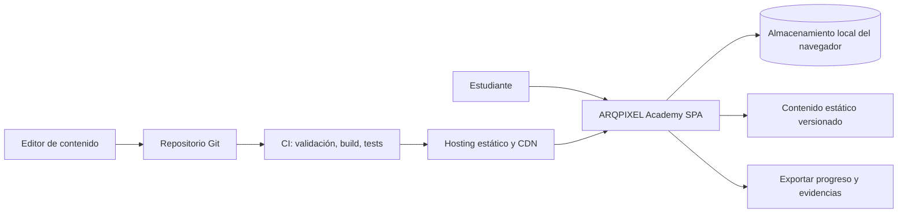

# ARQPIXEL ACADEMY — MASTER SPEC V1.0

> **Documento maestro de producto, experiencia, diseño visual, arquitectura técnica, currículo, laboratorios y Senior Mode dinámico.**
>
> **Objetivo:** construir una academia interactiva para aprender **Arquitectura de Software**, de fundamentos a decisiones de producción, **con el mismo lenguaje de diseño y experiencia de GoPixel Academy**, pero contenidos, ejercicios, simuladores y mascota propios.
>
> **Fecha:** 11 de noviembre de 2026. **Estado:** especificación / propuesta, **no aplicación terminada**.  
> **Producto:** **ARQPIXEL Academy**. **Mascota oficial:** **ArquiBot** (robot blanco y azul/cian aprobado en esta conversación). **TerraBot**, el personaje morado con casco Terraform, pertenece exclusivamente a TerraPixel y **no** debe usarse aquí.
>
> **Referencia visual aprobada:** imagen del usuario con robot blanco/azul de ojos cian delante de una arquitectura `UI → API → DOMAIN → DB` y `CLOUD`. Es **referencia de identidad visual**, no un diagrama de arquitectura universalmente correcto.  
> **Formato de esta entrega:** un único `.md` con especificaciones suficientes para guiar implementación, revisión, contenido y pruebas. Los assets PNG se gestionarán por separado al construir la plataforma.

---

## Índice

1. Visión y principios innegociables
2. Material fuente y decisiones de stack
3. Identidad de marca, ArquiBot y dirección de arte
4. Design system Modern Pixel
5. Mapa de pantallas, rutas y navegación
6. Experiencia de aprendizaje
7. Currículo completo: 54 módulos
8. Rutas especializadas y proyectos transversales
9. Laboratorios y simuladores nativos de arquitectura
10. Senior Mode: definición, activación y experiencia dinámica
11. Dieciocho misiones Senior de producción
12. Motor de escenarios, evaluación y evidencias
13. Ejemplo completo de misión Senior
14. Arquitectura de software de ARQPIXEL
15. Contratos de datos y esquemas TypeScript
16. Persistencia, progreso, logros y exportación
17. Arquitectura visual: diagramas, editor y herramientas
18. Seguridad, privacidad, accesibilidad y rendimiento
19. Testing, evidencia y gates de calidad
20. Plan de implementación y entregables
21. Criterios de aceptación por pantalla y función
22. Riesgos, decisiones arquitectónicas y NO objetivos
23. Backlog priorizado y definición de terminado
24. Prompts/briefs de trabajo para equipo o agente
25. Checklist final de lanzamiento
26. Apéndices: bibliografía interna, nombres y glosario

---

# 1. Visión y principios innegociables

## 1.1 Qué vamos a construir

Una plataforma educativa web, **visual, gamificada sin infantilizar, local-first y accesible**, donde un estudiante comprenda arquitectura de software no solo leyendo, sino **tomando decisiones**. La ruta completa debe enseñar a preguntar: ¿qué problema resolvemos?, ¿qué restricciones importan?, ¿qué responsabilidades separaremos?, ¿qué compromisos aceptamos?, ¿cómo probaremos nuestras hipótesis?, ¿qué fallará bajo carga?, ¿cómo evoluciona el sistema?

La plataforma **no** será un clon de contenidos Go. Será una **adaptación de la experiencia GoPixel** al pensamiento arquitectónico:

| En GoPixel | En ARQPIXEL |
|---|---|
| Lección de Go | Lección de diseño, modelado y trade-offs |
| Editor de código | Editor de decisiones, diagramas, contratos y fragmentos de código |
| Ejecutar código | Validar reglas del escenario, estructuras, casos de prueba y restricciones |
| Minijuego de sintaxis | Minijuego de dependencias, límites de contexto, patrones y fallos |
| Laboratorio Senior Go | Incidente/producto realista con arquitectura, ADR, pruebas y consecuencias |
| Gopher | **ArquiBot**, robot azul/cian independiente de TerraBot |
| Go blue | ARQPIXEL cyan/azul sobre navy, con pixel art controlado |

## 1.2 Objetivos educativos verificables

Al completar cada nivel, el alumno podrá:

- **Básico:** identificar actores, requisitos, componentes, dependencias, responsabilidades y diagramas simples.
- **Intermedio:** aplicar SOLID, patrones GoF, arquitectura en capas, MVC, puertos/adaptadores, C4 y fundamentos DDD con argumentos.
- **Avanzado:** elegir estilos arquitectónicos según restricciones; diseñar APIs, eventos, datos, seguridad, resiliencia, observabilidad y despliegue.
- **Senior:** producir ADR y diagramas justificables, evaluar costo/riesgo/evolución, manejar incidentes y planificar cambios sin romper contratos ni SLO.

## 1.3 Principios

1. **Concepto → ejemplo → visualización → práctica → retroalimentación → transferencia.**
2. **Diseño como conjunto de decisiones, no lista de modas.** No enseñar que microservicios, DDD o Clean Architecture son obligatorios.
3. **Fundamentar los trade-offs.** Cada solución tiene contexto de validez; evitar única respuesta cuando hay alternativas defendibles.
4. **Separar automático de humano.** Un verificador estructural no certifica calidad arquitectónica global.
5. **Progresión accesible.** Se puede empezar sin backend, Kubernetes, AWS ni editor IDE.
6. **Contenido portable.** Lecciones en Markdown y datos versionados; no contenido acoplado a JSX.
7. **V1 sin cuentas.** Progreso local con exportación/importación; backend opcional tras evidencia de necesidad.
8. **Mismo espíritu de GoPixel:** 80 % producto moderno, 20 % pixel art; mascotita contextual; dark/light; progreso sin banners intrusivos.
9. **Evitar simulaciones engañosas.** Mostrar siempre si un resultado proviene de reglas locales, datos de escenario, tests reales o revisión humana.
10. **Razonar antes de escalar.** Monolito modular primero cuando cumple requisitos; servicios separados solo por un motivo.

## 1.4 Audiencia

Estudiantes de ingeniería de software, desarrolladores frontend/backend, ingenieros que migran a roles de diseño técnico, tech leads y personas preparando entrevistas de System Design. Contenido en español como idioma fuente; localización posterior según calidad y validación.

---

# 2. Material fuente y decisiones de stack

## 2.1 Qué se revisó

**`index(1).zip` / GoPixel Academy:** `docs/design/UI_UX_ESPECIFICACION_PREVIA.md`, `docs/design/ASSETS_Y_PALETA.md`, `docs/design/COMPONENTES_UI.md`, `docs/architecture/ARQUITECTURA_OBJETIVO.md`, `docs/architecture/ROUTES_21.md`, `docs/content/CURRICULUM_MANIFEST.md`, `docs/content/SENIOR_MODE_18_LABS.md`, `docs/content/MINIJUEGOS_LIGEROS.md`, componentes de progreso y documentación de Senior Mode.

**`skills(20261111-124430).zip`:** guías de `vigilio-architecture-guide`, `architecture-traceability`, `vigilio-auto-senior`, `web-mfe-technologies`, `web-mfe-build-feature`, `web-mfe-testing`, `web-mfe-quality`, `ui-art-direction`, `ui-design-system`, `ux-game-experience`, `ux-accessibility` y otras afines. Estas son **referencias para desarrollar**, no dependencias que deban cargarse todas en el navegador.

**`vigilio-docs(10).zip`:** guías relevantes de frontend web-MFE, separación de responsabilidades, contratos, DDD en backend, ingeniería SOLID, pruebas semánticas, observabilidad, seguridad y trazabilidad. Su contenido sirve de criterio técnico; **no** copiamos un stack empresarial completo al sitio estático.

**Importante:** el ZIP de GoPixel documenta Preact/TypeScript/Vite, pero no garantiza que exista una copia íntegra y compilable del frontend original. El proyecto ARQPIXEL debe **inicializar su propia app real**, usar el material como referencia y comprobar cada dependencia.

## 2.2 Stack recomendado, decidido para el MVP

| Capa | Elección | Justificación | Condición |
|---|---|---|---|
| UI | **Preact + TypeScript estricto + Vite** | Fidelidad con diseño/stack documentado de GoPixel y superficie pequeña | Versiones actuales se verificarán al iniciar repo |
| Estilos | CSS modular + tokens CSS, componentes reutilizables | Mantiene Modern Pixel sin acoplarse a un framework | Tailwind solo si existen razones concretas |
| Rutas | Hash router tipado (`/#/`) | Hosting estático sin fallback obligatorio | Rutas/ids validadas |
| Contenido | Markdown + JSON/YAML tipado validado en build | Revisable, versionable, indexable | Render Markdown sanitizado |
| Diagramas C4 | SVG propio + layouts dirigidos, Mermaid para contenido de lectura | Interacción controlable y accesible | Mermaid no reemplaza el modelo semántico |
| Editor de texto | CodeMirror 6 o textarea accesible de respaldo | ADR, JSON de escenarios, código y DSL restringido | Syntax highlighting opcional |
| Estado | Preact hooks + stores por feature si se necesitan | Evita Redux innecesario | No estado global duplicado |
| Persistencia | `localStorage` versionado con validación y migración | Offline/local-first | Export/import explícito |
| Tests unitarios | Vitest | Contratos, scoring y reducers | Ejecutar en CI |
| Tests E2E | Playwright | Flujos por teclado, móvil y persistencia | CI con reportes |
| Accesibilidad | WCAG 2.2 AA objetivo | Aplicable desde el diseño | Auditoría manual + automatizada |
| Hosting | GitHub Pages, Cloudflare Pages o Vercel static | Bajo costo; no servidores para MVP | CI/preview y headers de seguridad |
| Telemetría | Sin analítica por defecto; opt-in futuro | Privacidad y simplicidad | No enviar respuestas sin consentimiento |

### 2.2.1 ¿Por qué NO NestJS, PostgreSQL o microservicios inicialmente?

Porque la academia base puede funcionar sin usuarios sincronizados ni cómputo remoto. La calidad educativa la determinan contenidos y validaciones, no la complejidad de infraestructura. El curso **sí enseñará** NestJS, Java/Spring, .NET, bases de datos, Kafka, Docker y Kubernetes mediante ejemplos, pero **usar tecnología como contenido no significa necesitarla para operar el MVP**.

### 2.2.2 Laboratorios reales opcionales

Para proyectos ejecutables del alumno, ofrecer **repositorios descargables**, uno o varios por stack:

- **TypeScript + Node.js/NestJS + PostgreSQL:** candidato para ejemplos DDD, APIs, CQRS y arquitectura hexagonal, alineado con material Vigilio.
- **C#/.NET + PostgreSQL o SQL Server:** ejemplos de SOLID, Clean Architecture, eventos y tests.
- **Java + Spring Boot + PostgreSQL:** ejemplo de módulos, dependencias, transacciones y arquitectura empresarial.
- **Go:** referencia complementaria para servicios y concurrencia, sin convertir la academia en un curso Go.

La plataforma no tiene que implementar los cuatro de inmediato: **un stack principal para el laboratorio de referencia (TypeScript + NestJS + PostgreSQL)**, y adaptaciones posteriores. Los archivos de laboratorio locales deben incluir `README`, comandos reproducibles, fixture, pruebas y matriz de evidencia.

---

# 3. Identidad de marca, ArquiBot y dirección de arte

## 3.1 Diferenciar proyectos para siempre

| Producto | Materia | Mascota | Identidad |
|---|---|---|---|
| GoPixel Academy | Go | Gopher | Azul Go, moderno + pixel art |
| TerraPixel Academy | Terraform e IaC | TerraBot | Traje morado, casco blanco, Terraform |
| **ARQPIXEL Academy** | **Arquitectura de Software** | **ArquiBot** | **Robot blanco/navy/cian, hologramas de sistemas** |

**Prohibido:** reutilizar en ARQPIXEL el casco blanco con logotipo de Terraform, ropa morada, mochila naranja o sprites de TerraBot. **ArquiBot** es el personaje aprobado: robot futurista sonriente con cara-pantalla azul oscuro, ojos luminosos cian, casco/cabeza blanca con detalles azules, audífonos laterales, traje tecnológico navy/blanco y plano de sistemas.

## 3.2 Especificación visual de ArquiBot

- **Silueta:** cabeza grande, cuerpo compacto tipo chibi, botas visibles, gesto reconocible a 64 px.
- **Rostro:** pantalla navy/negra; ojos y boca cian; emociones legibles sin texto.
- **Colores:** blanco frío, azul eléctrico, cian y navy; evitar púrpura Terraform como dominante.
- **Emblema:** tres bloques/cubos isométricos propios de ARQPIXEL; no reproducir marcas de terceros.
- **Accesorios contextuales:** plano de arquitectura, tableta con diagrama, holograma C4, nodos/API, cable lógico, monitor, insignia Senior.
- **Estética:** portada hero en estilo 3D/isométrico luminoso, sprites de interfaz en pixel art, conservando la **misma identidad del personaje** (no dos mascotas diferentes).
- **Usos:** hero landing, empty states, pistas, comentarios de corrección, celebración, conflictos, Senior Mode y certificados internos.

### 3.2.1 Inventario de assets PNG previsto

```text
public/assets/arquibot/
  arquibot-hero.png              # visual premium de portada
  arquibot-idle.png              # PNG RGBA transparente
  arquibot-saludo.png
  arquibot-pensando.png
  arquibot-explicando.png
  arquibot-diagrama.png
  arquibot-codigo.png
  arquibot-libro.png
  arquibot-laboratorio.png
  arquibot-error.png
  arquibot-exito.png
  arquibot-idea.png
  arquibot-debug.png
  arquibot-senior.png
  arquibot-graduado.png
  arquibot-spritesheet.png        # atlas opcional
```

**Estado:** nombres y especificación planificados; la existencia del archivo o PNG transparente se verificará al agregar cada asset. Usar como **referencia exacta de identidad** la imagen azul/cian ya aprobada. Las dos ilustraciones previas de ArquiBot son concept art, no un pipeline de sprites validado.

### 3.2.2 Requisitos técnicos de assets

- Sprites **PNG RGBA transparente real**, no patrón cuadriculado pintado como fondo.
- Arte exportado al menos 512×512 para poses individuales; master 1024×1024 cuando sea útil.
- PNG comprimido sin pérdida y WebP/AVIF derivados opcionales en web; conservar PNG fuente.
- `image-rendering: pixelated` **solo** en sprites concebidos como pixel art, no hero 3D.
- Manifest de assets con `id`, `src`, `alt`, `width`, `height`, `theme`, `usage`.
- Si un logo de otro producto aparece en diagramas, verificar permiso de uso; priorizar iconos conceptuales.

## 3.3 Nombre y lenguaje

**ARQPIXEL** (marca visual). Línea principal: **«Diseña sistemas. Explica decisiones. Construye con criterio.»**. Secundario: «Arquitectura de Software, de los fundamentos a producción». El microcopy es claro, en español: «Explorar ruta», «Continuar», «Comparar alternativas», «Validar diagrama», «Explicar decisión», «Revisar arquitectura», «Abrir Senior Mode». Nada de «100 % arquitecto certificado».

---

# 4. Design system Modern Pixel

## 4.1 Principio visual

**Misma experiencia GoPixel, nuevo dominio y personaje**: 80 % interfaces limpias/técnicas, 20 % elementos pixelados; tarjetas redondeadas, tipografía legible, dark/light, estados claros, navegación consistente, diagramas interactivos y responsive.

### Tokens propuestos (se contrastarán en ambos temas)

```css
:root {
  --arq-bg: #071327;
  --arq-surface: #0d2038;
  --arq-elevated: #122a46;
  --arq-text: #f4f9ff;
  --arq-muted: #a8bfd5;
  --arq-cyan: #18d8ed;
  --arq-blue: #338cff;
  --arq-focus: #ffe07b;
  --arq-success: #47d4a4;
  --arq-warning: #ffbd60;
  --arq-error: #ff7890;
  --arq-border: #294f71;
  --arq-radius-card: 16px;
  --arq-radius-control: 10px;
  --arq-content-max: 1280px;
  --arq-font-ui: Inter, system-ui, sans-serif;
  --arq-font-code: ui-monospace, SFMono-Regular, Menlo, Consolas, monospace;
}
[data-theme='light'] {
  --arq-bg: #f4f9ff;
  --arq-surface: #ffffff;
  --arq-elevated: #e9f4fb;
  --arq-text: #142638;
  --arq-muted: #456278;
  --arq-border: #bdcfdd;
}
```

**Nota:** tokens son intención visual, no sustituyen la medición real de contraste y legibilidad.

## 4.2 Componentes UI mínimos

`AppShell`, `SiteHeader`, `MobileNav`, `Breadcrumb`, `ThemeSwitcher`, `SearchCommand`, `Hero`, `ArquiBot`, `LevelCard`, `CourseCard`, `ProgressRing`, `LearningPathMap`, `LessonShell`, `LessonSidebar`, `RichMarkdown`, `InfoCallout`, `ArchitectureDiagram`, `DependencyGraph`, `DomainModelCanvas`, `CodeEditor`, `DecisionEditor`, `ADRComposer`, `ConstraintPanel`, `ScenarioSimulator`, `EvidencePanel`, `RubricPanel`, `HintDrawer`, `SolutionReveal`, `MiniGameFrame`, `AchievementToast`, `SeniorModeToggle`, `SeniorDashboard`, `LabWorkspace`, `ResultSummary`, `ExportProgressDialog`, `SettingsPage`.

### Estados obligatorios de todo componente interactivo

`idle`, `hover`, `focus-visible`, `disabled`, `loading`, `success`, `error`, `empty` y `reduced-motion` donde aplique. Una respuesta validada no debe depender exclusivamente de color o animación.

## 4.3 Portada de referencia

Diseño de escritorio:

```text
┌─────────────────────────────────────────────────────────────────────────────┐
│ ◈ ARQPIXEL   Inicio   Rutas   Laboratorios   Recursos   Senior  [Empezar] │
├─────────────────────────────────────────────────────────────────────────────┤
│ Academia de Arquitectura de Software                                     │
│ ARQUITECTURA DE                                                        │
│ SOFTWARE                [ ArquiBot blanco/azul ]  ┌─ UI ────────────┐     │
│ Aprende a diseñar sistemas [robot holográfico] → │ API / SERVICIOS│     │
│ y justificar decisiones.                       → │ DOMINIO        │     │
│ [Explorar ruta] [Ver laboratorios]                │ DATOS / CLOUD  │     │
│                                                └──────────────────┘     │
│ [SOLID] [PATRONES] [DDD] [CLEAN] [SYSTEM DESIGN] [DISTRIBUIDOS]          │
├────────────────────────┬────────────────────────┬───────────────────────┤
│ Rutas de aprendizaje   │ Laboratorios           │ Modo Senior           │
└────────────────────────┴────────────────────────┴───────────────────────┘
```

**Versión móvil:** hero apilado, CTA en zona visible, personaje bajo el título o junto a él sin tapar texto; menú accesible; diagramas con zoom/resumen textual.

## 4.4 Otras pantallas

**Mapa:** nodos por niveles conectados, progreso, prerequisitos y resumen. **Lección:** sidebar de módulos, zona central contenido+visualizador, lateral opcional pista/rúbrica. **Lab:** brief a izquierda, herramienta de trabajo al centro, resultados y evidencia a derecha; en móvil, pestañas accesibles `Contexto / Trabajo / Validación`.

## 4.5 Movimiento

Microanimaciones de 150–250 ms máximo por defecto, sin bloquear interacción; usar transform/opacity; no mover diagramas mientras alguien lee; respetar `prefers-reduced-motion`. ArquiBot reacciona solo a acciones significativas, nunca interrumpe al escribir.

---

# 5. Mapa de pantallas, rutas y navegación

| Ruta SPA | Pantalla | Función |
|---|---|---|
| `/#/` | Landing | Mensaje, ArquiBot, ruta y CTA |
| `/#/mapa` | Mapa curricular | 54 módulos, prerrequisitos y progreso |
| `/#/rutas` | Catálogo de rutas | Especializaciones y prerequisitos |
| `/#/rutas/:id` | Ruta | Descripción, módulos y proyecto |
| `/#/aprender/:moduleId` | Aula | Contenido, ejemplo y actividad |
| `/#/aprender/:moduleId?senior=1` | Aula Senior contextual | Mismo tema con restricciones avanzadas |
| `/#/laboratorios` | Laboratorios | Buscador, filtros y dificultades |
| `/#/laboratorios/:labId` | Lab Workspace | Escenario, editor/canvas, evidencias |
| `/#/minijuegos` | Minijuegos | Cinco actividades visuales |
| `/#/senior` | Senior Dashboard | 18 misiones y avance por competencias |
| `/#/senior/:missionId` | Brief Senior | Caso, contexto y preparación |
| `/#/senior/:missionId/:challengeId` | Reto Senior | Decisión dinámica, simulación y evaluación |
| `/#/proyectos` | Casos integradores | Proyecto por nivel / capstone |
| `/#/recursos` | Recursos | Glosario, patrones, diagramas, ADR |
| `/#/recursos/patrones/:id` | Ficha de patrón | Intención, cuándo no usar, ejemplo |
| `/#/recursos/adr` | Plantillas ADR | Ejemplos y editor |
| `/#/logros` | Insignias | Logros transparentes y exportables |
| `/#/ajustes` | Ajustes | Tema, accesibilidad, export/import, borrar |
| `/#/sobre` | Sobre | Método, límites, atribuciones y privacidad |

**Rutas inválidas:** 404 dentro de la SPA con opciones para volver. **Accesibilidad:** salto al contenido, landmarks y foco restaurado tras navegación. **Búsqueda:** por conceptos (`aggregates`, `CQRS`, `latencia`, `hexagonal`) y etiquetas, nunca solo títulos.

---

# 6. Experiencia de aprendizaje

## 6.1 Anatomía de una lección

1. **Problema:** ejemplo práctico de empresa o producto.
2. **Objetivo:** al final podrás explicar/hacer X.
3. **Concepto:** lenguaje simple y preciso, sin saltar pasos.
4. **Visual:** esquema de responsabilidades o flujo.
5. **Comparación:** solución A/B y trade-offs.
6. **Actividad:** ordenar capas, diseñar API, modelar agregado, detectar acoplamiento, escribir ADR.
7. **Validación:** resultado de checks estructurales + criterios no automatizables.
8. **Reflexión:** «¿qué cambiaría si la escala o las restricciones fueran distintas?».
9. **Transferencia:** aplicar el concepto al caso integrador.

Duración orientativa por módulo: teoría 10–20 min, práctica 15–45 min y desafío opcional 30–90 min. Evitar cifras fijas en UI si el contenido no está medido.

## 6.2 Tipos de actividades

- Selección de responsabilidades para un componente.
- **Dependency Puzzle:** construir flechas válidas entre capas y detectar ciclos.
- **Pattern Match:** situación → patrón → justificación → anti-patrón.
- **Context Mapper:** definir bounded contexts y relaciones de equipos.
- **Domain Model Builder:** entidades, Value Objects, agregados e invariantes.
- **C4 Builder:** contexto, contenedores y componentes, sin confundir nivel con despliegue.
- **API Contract Review:** versionado, códigos de error, idempotencia y semántica.
- **ADR Editor:** decisión, contexto, opciones, criterios, consecuencias.
- **Incident Simulator:** eventos, métricas, hipótesis y mitigaciones.
- **Capacity Planner:** estimaciones con supuestos editables.

## 6.3 Aprendizaje sin imponer un lenguaje

El **núcleo** es independiente del stack: decisiones y diagramas. En laboratorios ejecutables, los ejemplos pueden verse en TypeScript, C# y Java mediante pestañas; **solo declarar implementada una versión cuando exista y se pruebe**. La versión principal inicial será TypeScript/NestJS, por alineación con las guías backend consultadas, sin forzar NestJS para explicar teoría.

## 6.4 Reglas pedagógicas

- Cada concepto debe mostrar **«qué es / cuándo conviene / cuándo no conviene / errores comunes»**.
- DDD estratégico y táctico no se mezclan: bounded contexts y lenguaje ubicuo primero; agregados y repositorios después.
- Clean Architecture, Onion y Hexagonal se comparan, no se presentan como sinónimos exactos.
- SOLID se enseña con problemas reales, no recetas de «más interfaces siempre».
- No llamar un proyecto «microservicios» por tener carpetas separadas.
- Las estimaciones de costo/capacidad deben mostrar fórmulas, hipótesis y rangos de incertidumbre.
- Un sistema «más complejo» no equivale a un diseño mejor.

---

# 7. Currículo completo: 54 módulos

**Estructura equivalente a GoPixel:** **12 Básicos + 12 Intermedios + 12 Avanzados + 18 Senior = 54 módulos**. Los 18 Senior están desarrollados en la sección 11 y son también accesibles por Senior Mode independiente. Este catálogo es **objetivo de contenido**, no afirmación de que ya existen 54 lecciones completas.

## 7.1 Básico (B01–B12) — entender y representar sistemas

| ID | Módulo | Conceptos / resultado concreto | Actividad principal |
|---|---|---|---|
| B01 | ¿Qué es arquitectura de software? | Estructura, decisiones, atributos de calidad, restricciones | Identificar decisiones en una app |
| B02 | Requisitos funcionales y no funcionales | Casos de uso, escenarios de calidad, stakeholders | Separar RF/RNF y priorizar |
| B03 | Componentes, módulos y responsabilidades | Cohesión, acoplamiento, límites | Organizar un ecommerce simple |
| B04 | Diagramas de arquitectura | C4 L1/L2, flujo y secuencia intro | Dibujar contexto y contenedores |
| B05 | Cliente-servidor y web moderna | UI, API, datos, redes | Seguir flujo de una compra |
| B06 | Arquitectura en capas | Presentación, aplicación, dominio, infraestructura | Armar diagrama de dependencias |
| B07 | MVC y separación de concerns | Modelo/vista/controlador y límites | Refactorizar responsabilidades |
| B08 | POO para arquitectos | Encapsulación, composición, interfaces | Detectar clases con demasiadas tareas |
| B09 | Cohesión, acoplamiento y modularidad | Cambios locales, módulos estables | Comparar dos diseños |
| B10 | Introducción a SOLID | Cinco principios, aplicación contextual | Detectar violaciones básicas |
| B11 | Introducción a patrones | Problema recurrente, patrón vs antipatrón | Elegir Strategy, Factory o Observer |
| B12 | Proyecto básico: App de reservas | Requisitos, C4, capas, ADR simple | Entregar diseño defendible |

**Gate básico:** un C4 contexto+contenedores con componentes correctos, responsabilidades coherentes y al menos un trade-off explicable; mínimo de actividades completadas configurable por política.

## 7.2 Intermedio (I01–I12) — patrones, límites y dominio

| ID | Módulo | Conceptos / resultado concreto | Actividad principal |
|---|---|---|---|
| I01 | SOLID aplicado | DIP, ISP, OCP, SRP, LSP con límites | Reparar dependencias y tests |
| I02 | Patrones creacionales | Factory Method, Abstract Factory, Builder | Elegir según variación |
| I03 | Patrones estructurales | Adapter, Facade, Decorator, Composite | Integrar API legado |
| I04 | Patrones de comportamiento | Strategy, Observer, Command, State | Flujo de pagos extensible |
| I05 | Repository, Unit of Work y transacciones | Persistencia vs dominio | Separar capa de acceso a datos |
| I06 | Clean Architecture | Dependencias hacia reglas de negocio | Reordenar imports/capas |
| I07 | Arquitectura hexagonal | Puertos, adaptadores, test doubles | Sustituir proveedor de pagos |
| I08 | DDD estratégico | Dominio, subdominios, lenguaje ubicuo | Event storming básico |
| I09 | Bounded Contexts y context mapping | Upstream/downstream, anticorruption layer | Dividir ventas/inventario |
| I10 | DDD táctico | Entidades, VO, agregados, domain services/events | Diseñar agregado Pedido |
| I11 | Diseño de APIs y contratos | REST, HTTP, errores, versionado, OpenAPI | Revisar API de reservas |
| I12 | Proyecto intermedio: Monolito modular | DDD + Clean/Hexagonal + ADR | Diseño modular con pruebas |

**Gate intermedio:** distinguir correctamente patrón GoF, estilo arquitectónico y patrón de persistencia; producir modelo de dominio con invariantes; arquitectura que no dependa directamente de infraestructura desde el dominio.

## 7.3 Avanzado (A01–A12) — sistemas, operaciones y evolución

| ID | Módulo | Conceptos / resultado concreto | Actividad principal |
|---|---|---|---|
| A01 | System Design y estimación | Carga, throughput, storage, latencia, presupuestos | Capacity planner de URLs |
| A02 | Monolito modular vs microservicios | Límites, ownership, despliegue, costos | Árbol de decisión por contexto |
| A03 | Comunicación síncrona y asíncrona | HTTP/gRPC, mensajería, colas | Elegir protocolo para un flujo |
| A04 | CQRS y Event-Driven | Modelos de lectura/escritura, proyecciones | Diseñar read model |
| A05 | Consistencia y transacciones distribuidas | Eventual consistency, outbox, saga, idempotencia | Resolver doble cobro |
| A06 | Datos, caché y escalabilidad | SQL/NoSQL, índices, partición, caché | Elegir almacenamiento y TTL |
| A07 | Resiliencia | Timeouts, retries, jitter, circuit breaker, backpressure | Simular fallos parciales |
| A08 | Seguridad de arquitectura | Threat modeling, authn/authz, secretos, confianza | Corregir flujos inseguros |
| A09 | Observabilidad y SLO | Logs, métricas, trazas, SLIs, error budget | Investigar degradación |
| A10 | Despliegue y arquitectura cloud | Contenedores, CI/CD, infraestructura y rollback | Diseñar pipeline seguro |
| A11 | Evolución y modernización | Strangler, migraciones, compatibilidad | Planear salida de monolito legado |
| A12 | Proyecto avanzado: Plataforma de pedidos | Diseño end-to-end con trade-offs | Arquitectura + ADR + pruebas |

**Gate avanzado:** proponer alternativas sustentadas, estimaciones con supuestos, plan de fallos, seguridad, observabilidad y evolución; no basta dibujar cajas.

## 7.4 Senior (S01–S18)

No es «otro nivel con preguntas difíciles»: es **un simulador de decisiones arquitectónicas**. Ver sección 11 para los 18 briefs completos de alcance, dificultades variables, pruebas y evidencia.

---

# 8. Rutas especializadas y proyectos transversales

## 8.1 Ocho rutas complementarias

| Ruta | Núcleo | Capstone | Prerrequisitos |
|---|---|---|---|
| R01 · SOLID y GoF | OOP, patrones y extensibilidad | Motor de descuentos | B08–B11, I01–I04 |
| R02 · Clean y Hexagonal | Capas y puertos | API de reservas desacoplada | B06–B10, I06–I07 |
| R03 · DDD de principio a fin | Estratégico, táctico y eventos | Marketplace modular | I08–I10, I12 |
| R04 · Diseño de APIs | Contratos, compatibilidad, auth | API pública de pedidos | I11, A08 |
| R05 · System Design | Carga, cachés, consistencia | Acortador de URL o feed | A01, A03, A06 |
| R06 · Microservicios y eventos | Ownership, sagas y observabilidad | Plataforma de pagos | A02–A09 |
| R07 · Cloud y operación | SLO, despliegues, resiliencia | Servicio multizona | A07–A10 |
| R08 · Arquitectura Senior | ADR, evolución, incidentes, liderazgo | Revisión ejecutiva de plataforma | A01–A12, Senior |

La ruta R08 no es obligatoria para aprender fundamentos. Una ruta puede referenciar un módulo ya completado sin duplicar su progreso.

## 8.2 Caso hilo conductor: tienda «NexoShop»

La misma empresa ficticia aparece en varios niveles:

- **Básico:** e-commerce con productos, usuarios, carrito, pagos.
- **Intermedio:** dominio de pedidos, inventario, pagos; bounded contexts y puertos.
- **Avanzado:** pico de tráfico, consistencia, outbox, colas, observabilidad.
- **Senior:** reestructuración organizativa, SLAs, incidente, crecimiento internacional, auditoría, costos y migración sin downtime.

Regla: cada nivel tendrá un **estado inicial reproducible**; conservar decisiones del alumno será opcional, pues no se debe bloquear aprendizaje por una mala elección inicial.

## 8.3 Entregables por proyecto

`context.md` con requisitos, `architecture.md` con diagramas, `decisions/ADR-xxx.md`, contratos de API, matriz de riesgos, pruebas diseñadas y reflexión. Exportar como paquete descargable o Markdown/JSON; no presentar artefactos autoevaluados como revisados por expertos.

---

# 9. Laboratorios y simuladores nativos de arquitectura

## 9.1 Los simuladores centrales

### LAB-A · Dependency Graph Builder

**Interacción:** arrastrar nodos por capas, unir flechas, inspeccionar dependencias; incluir modo teclado con selector origen/destino.  
**Validación:** ciclos, dependencias prohibidas, capas ausentes, acoplamiento excesivo, violación de DIP.  
**Caso:** `OrderController → OrderUseCase → OrderRepositoryPort ← PostgresAdapter`.  
**Resultado:** visual + reporte determinista; **no** afirmar que se compilaron proyectos backend.

### LAB-B · C4 Studio

**Interacción:** colocar personas, sistemas, contenedores y componentes; editar límites y relaciones; export SVG/PNG/Mermaid, con resumen textual.  
**Validación:** tipo de nodo válido por nivel C4, relaciones explicadas, elementos huérfanos, nivel coherente.  
**Limitación:** la calidad global del modelo y la corrección del negocio requieren revisión humana.

### LAB-C · DDD Workshop

**Interacción:** clasificar términos del negocio, proponer contextos, aggregates, eventos, comandos e invariantes.  
**Validación:** reglas explícitas del escenario (por ejemplo, `PedidoConfirmado` no puede ocurrir antes de `PagoAutorizado` en esta variante), consistencia de decisiones.  
**Importante:** no existe una única partición correcta de bounded contexts para toda organización.

### LAB-D · Pattern & Refactoring Clinic

**Interacción:** comparar código acoplado vs variante con Strategy, Factory, Adapter, Observer u otro patrón; anotar impacto en tests y mantenimiento.  
**Validación:** checks de import/estructura + preguntas situacionales. **Nunca** premiar patrones gratuitos.

### LAB-E · API Contract Lab

**Interacción:** OpenAPI reducido, ejemplos request/response, errores, idempotencia y compatibilidad.  
**Validación:** schemas, breaking changes, códigos HTTP, `Idempotency-Key`, manejo de retries según fixture.

### LAB-F · Distributed Systems Simulator

**Interacción:** tráfico, número de réplicas, cola, latencia, duplicados, caídas parciales y reintentos; gráficos deterministas.  
**Validación:** invariantes de negocio, límites y eventos; estimaciones modeladas con fórmulas transparentes.  
**Nota:** los números **simulados** no son benchmarks de cloud real.

### LAB-G · Architecture Decision Record Studio

**Interacción:** escribir contexto, drivers, alternativas, pros/contras, decisión y consecuencias; comparar versiones.  
**Validación:** campos requeridos, restricciones cubiertas, consistencia lógica básica; las justificaciones abiertas requieren revisión humana.

### LAB-H · Incident & Reliability Lab

**Interacción:** timeline de incidentes, hipótesis, telemetría ficticia etiquetada, mitigaciones y postmortem.  
**Validación:** secuencia de diagnóstico, seguridad operacional, impacto sobre SLO, reversibilidad de acciones.

## 9.2 Minijuegos ligeros, cinco

1. **Arquitectura Tetris:** encajar responsabilidades en capas (sin implicar que hay una arquitectura universal).
2. **Caza del Acoplamiento:** identificar ciclos, imports indebidos y dependencias ocultas.
3. **Patrón Correcto:** elegir Strategy/Adapter/Factory/Observer o «ningún patrón».
4. **Dominio Dividido:** agrupar conceptos en bounded contexts y explicar excepciones.
5. **Incidente en 60 pasos:** identificar causa probable entre eventos ordenados, sin cronómetro obligatorio.

Los minijuegos no sustituyen evaluaciones profundas; son práctica de recuerdo/transferencia.

## 9.3 Niveles de fidelidad

| Tipo | Dónde se ejecuta | Qué demuestra | Qué NO demuestra |
|---|---|---|---|
| Regla local | Navegador | Estructura/consistencia contra fixtures | Corrección general de arquitectura |
| Modelo determinista | Navegador | Consecuencia de hipótesis configuradas | Rendimiento real de proveedores |
| Código de ejemplo | Repo local del estudiante | Tests y compilación del proyecto de muestra | Aprobación del producto en producción |
| Revisión humana | Docente/pares/usuario | Argumentación y trade-offs | Verificación automática |
| Runner remoto (futuro) | Sandbox aislado | Ejecución real controlada | Seguridad sin controles de recursos |

## 9.4 Seguridad de ejecución

En MVP no se ejecutan snippets arbitrarios en el servidor ni se evalúan scripts del alumno con `eval`/`new Function`; se aplican validadores de AST/DSL/JSON restringidos y predefinidos. Cualquier runner futuro requiere sandbox, cuotas, límites, egress controlado, restricciones de tiempo, auditoría y autenticación.

---

# 10. Senior Mode: definición, activación y experiencia dinámica

## 10.1 Dos formas de acceso

**A. Sección `/senior`:** 18 misiones profesionales con briefing, retos y competencia.  
**B. Toggle transversal `Senior Mode`:** cambia **solo las lecciones compatibles** introduciendo restricciones nuevas, requerimientos de seguridad, SLO, costo, operaciones y decisiones. Las lecciones incompatibles muestran por qué el modo no aplica; no fingir que todos los botones hacen algo.

## 10.2 ¿Qué significa «dinámico»?

No significa «preguntas aleatorias sin criterio» ni IA que inventa respuestas. Significa que cada escenario contiene **variables tipadas y restricciones reproducibles** que cambian el problema, las consecuencias y las comprobaciones. Por ejemplo:

- Escala: 500 → 50.000 solicitudes/min según variante.
- Disponibilidad requerida: 99,5 % → 99,95 %.
- Consistencia: se tolera latencia de propagación o se exige atomicidad.
- Equipo: 3 ingenieros vs 30; cambia la carga operativa de microservicios.
- Datos: PII, residencia, retención, auditoría.
- Presupuesto: restringido vs amplio.
- Dependencias: API externa confiable vs con picos de error.
- Incidente: caída DB, latencia red, cola saturada, esquema incompatible.

Un `seed` estable genera la misma misión; el motor registra variante, supuestos y versión del evaluador. **No** se crean criterios diferentes después de que el estudiante responda.

## 10.3 Flujo de un reto Senior

```text
Brief y contexto
   ↓
Objetivos y restricciones (visibles)
   ↓
Explorar señales, requisitos y datos de escenario
   ↓
Proponer arquitectura, diagramas, ADR y/o contratos
   ↓
Validación local determinista de invariantes
   ↓
Simulación de consecuencias (si aplica)
   ↓
Feedback: automático / estimación / revisión humana
   ↓
Iteración + evidencia + reflexión de trade-offs
   ↓
Resultado y próximos pasos
```

## 10.4 Tipos de desafío (cinco motores)

1. **Architecture Builder:** nodos, relaciones, restricciones de capa, consistencia.
2. **Decision / ADR Challenge:** alternativas, costos, riesgos, justificación y evidencia.
3. **Incident Response:** señales, timeline, mitigación segura, postmortem.
4. **Contract / Code Review:** cambios incompatibles, anti-patterns, pruebas y seguridad.
5. **Capacity / Reliability Simulator:** estimaciones, fallos y SLO bajo hipótesis explícitas.

Estos motores pueden combinarse en una misión. **18 misiones × 5 actividades mínimas diseñadas = 90 actividades objetivo**, pero no todas tendrán cinco motores distintos si no corresponde.

## 10.5 Niveles de ayuda

- **Pista 1:** recordar un principio, sin revelar respuesta.
- **Pista 2:** señalar restricción relevante.
- **Pista 3:** sugerir una comparación de alternativas.
- **Solución razonada:** visible después de intentar o voluntariamente, marcada como referencia **no única**.
- **Debrief:** qué funciona, bajo qué supuestos, qué cambia en otra variante.

## 10.6 Progreso Senior honesto

Las pruebas automáticas devuelven `PASS/FAIL`, las no ejecutadas `NOT_RUN`, las que no se pueden ejecutar `BLOCKED`. Las decisiones de arquitectura abiertas reciben `REQUIRES_REVIEW`, salvo criterios mecánicos verificables. Insignias Senior de aprendizaje reflejan **actividades completadas**, **no certificaciones profesionales ni evaluación humana inexistente**.

---

# 11. Dieciocho misiones Senior de producción

Cada misión tendrá **5 actividades objetivo**: diagnóstico/brief, diseño, decisión ADR, verificación y transferencia/retro. Se requieren fixtures, criterios claros, variantes `seed` y al menos un caso negativo antes de declarar una misión implementada.

| ID | Misión | Situación realista | Decisión y trade-off principal | Evidencias / verificaciones |
|---|---|---|---|---|
| S01 | Auditoría de monolito legado | App de ventas con despliegues frágiles | Modularizar sin reescribir todo | Mapa dependencias, hotspots, plan incremental, ADR |
| S02 | SOLID bajo presión | Servicio de descuentos que cambia semanalmente | Abstracción adecuada vs sobreingeniería | Review, tests de regresión, justificación |
| S03 | Selección de patrones GoF | Integración con múltiples proveedores | Strategy/Adapter/Factory o simplicidad | Refactor estructural, comparación de mantenimiento |
| S04 | Clean vs Hexagonal | Backend acoplado a ORM y HTTP | Puertos, casos de uso, límites de dominio | Grafo de imports, tests aislables, ADR |
| S05 | DDD estratégico | Marketplace con equipos en conflicto | Bounded contexts, ownership y lenguaje | Context map, glosario, políticas de integración |
| S06 | Diseño de agregados | Sobreventa y estados inválidos | Invariantes, consistencia y tamaño agregado | State machine, reglas, casos negativos |
| S07 | API pública evolutiva | Clientes móviles antiguos siguen activos | Versionado y compatibilidad | Contrato diff, ejemplos, plan de deprecación |
| S08 | Monolito o microservicios | Crecimiento y nuevos equipos | Coste operacional vs autonomía | Árbol de decisión, split proposal y ADR |
| S09 | Pedido y pago distribuido | Reintentos y duplicados | Outbox, idempotencia, saga o transacción | Timeline, invariantes, deduplicación |
| S10 | Datos y consistencia | Lecturas desfasadas de inventario | Modelo de consistencia y UX | Secuencia, ventanas de inconsistencia y mitigación |
| S11 | Escalabilidad de plataforma | 20× tráfico y latencia variable | Caché/colas/escalado y límites | Capacity worksheet, escenarios y supuestos |
| S12 | Seguridad por diseño | Exposición de PII y permisos amplios | Threat model y trust boundaries | Mapa amenazas, autorización y mitigaciones |
| S13 | Resiliencia de dependencias | Proveedor externo falla de forma intermitente | Retry/jitter/timeout/circuit breaker | Simulación de fallos, presupuesto de retries |
| S14 | Observabilidad y SLO | P95 aumenta sin errores visibles | SLIs, traces, señales e hipótesis | Diagnóstico, dashboard propuesto y runbook |
| S15 | Estrategia de despliegue | Release rompe contratos | Canary, flags, rollback y migraciones | Secuencia, precondiciones y plan de reversión |
| S16 | Modernización sin downtime | Migración de BD/API con legado activo | Strangler, dual read/write, corte seguro | Plan por fases, invariantes, rollback |
| S17 | Costos y gobierno técnico | Infraestructura crece sin control | SLO vs costo vs complejidad | Estimación explícita, riesgos y decisiones |
| S18 | Consejo de arquitectura / capstone | Crisis multi-equipo con metas incompatibles | Priorizar decisión, comunicar, operar y evolucionar | Paquete ADR, C4, plan, evidencia, postmortem |

## 11.1 Ejemplos de variantes por grupo

**S01–S04:** tamaño de base de código; frecuencia de cambio; equipo; deuda técnica; ORM inflexible; tests existentes.  
**S05–S06:** catálogos de dominio; equipos con vocabularios distintos; invariantes fuertes o débiles; concurrencia.  
**S07–S10:** cantidad de clientes; reintentos duplicados; eventos retrasados; compatibilidad exigida; auditoría.  
**S11–S14:** RPS, p95, colas, retries, caída parcial, presupuestos de error, volumen de logs.  
**S15–S18:** ventana de despliegue, dependencia de datos, presupuesto, compliance, equipos, crisis organizacional.

## 11.2 Cuaderno de evidencia por misión

```text
mission-id/
  context.md                 # restricciones y supuestos
  alternatives.md            # opciones consideradas
  architecture.md            # diagrama y relaciones
  decisions/ADR-001.md       # decisión y consecuencias
  validation.json            # checks automáticos reproducibles
  evidence.md                # qué se verificó y qué NO
  retrospective.md           # riesgos y mejoras
```

**No generar archivos físicos por misión en el MVP si no hay export:** guardar el esquema como datos locales y exportar al solicitarlo.

---

# 12. Motor de escenarios, evaluación y evidencias

## 12.1 Fuente de verdad

Los escenarios se definen por `manifest.json` tipado y versión de evaluador; la interfaz **no calcula puntajes por su cuenta**. Un motor puro toma `scenario + submittedSolution`, devuelve hallazgos trazables y no depende del reloj, red ni orden de render.

```ts
type EvidenceStatus = 'PASS' | 'FAIL' | 'NOT_RUN' | 'BLOCKED' | 'REQUIRES_REVIEW';
type CheckKind = 'graph' | 'schema' | 'constraint' | 'simulation' | 'manual';

interface ScenarioVariant {
  id: string;
  seed: string;
  factors: Record<string, string | number | boolean>;
  evaluatorVersion: string;
}
interface EvaluationItem {
  criterionId: string;
  kind: CheckKind;
  status: EvidenceStatus;
  message: string;
  evidenceRefs: string[];
  severity: 'info' | 'warning' | 'critical';
}
interface EvaluationResult {
  missionId: string;
  variantId: string;
  checks: EvaluationItem[];
  computedAt: string;
  automaticScore?: number; // Solo criterios con pesos y checks reales
  humanReviewRequired: boolean;
}
```

## 12.2 Regla de puntuación

- `automaticScore = Σ(peso_check × resultado_check) / Σ(peso_checks_aplicables) × 100`.
- Excluir `NOT_RUN`, `BLOCKED` y `REQUIRES_REVIEW` del denominador **y mostrarlos por separado**; no convertirlos en «aprobado».
- Los checks críticos pueden bloquear una **insignia de escenario** aunque el score sea alto.
- Mostrar la cobertura: `X de Y criterios automáticos comprobados`.
- Cualquier score es **educativo**, no medición universal de aptitud arquitectónica.
- La IA, si se incorpora más adelante, puede dar sugerencias explicativas, pero **no** cambiar la rúbrica ni declarar una evaluación formal automáticamente sin controles.

## 12.3 Generación de variantes reproducibles

`variant = generateVariant(templateId, seed, version)`. Selecciones en PRNG determinista, universo de valores limitado y validado, fixtures con soluciones admisibles. La solución óptima puede variar entre escenarios; en casos abiertos validar **restricciones mínimas**, no obligar a una única arquitectura canónica.

## 12.4 Feedback constructivo

No mostrar «Incorrecto, usa microservicios»; sí: «Elegiste servicios separados con equipo de 3 personas y presupuesto limitado; compara este costo de operación y justifica cómo sostendrás despliegue/observabilidad». La evaluación debe decir **qué regla fue verificada** y **qué aspecto queda para revisión**.

---

# 13. Ejemplo completo: misión S09 — pagos distribuidos

## 13.1 Brief

«NexoShop ha duplicado cargos de algunas compras durante reintentos de la pasarela de pagos. La API recibe 2.000 solicitudes/min en hora pico, la pasarela falla intermitentemente y el negocio exige no crear dos cobros para un mismo pedido. No puedes apagar todo el servicio para corregirlo».

**Variables de escenario:** tasa de duplicados, latencia de pasarela, ventanas de retry, tolerancia a inconsistencias, estrategia de persistencia. **Datos simulados**, todos etiquetados.

## 13.2 Objetivos

1. Identificar la invariante `a lo sumo un cargo efectivo por operación de negocio` en la simulación.
2. Diseñar una API de inicio de pago con idempotencia definida.
3. Elegir forma de publicar eventos de manera fiable, por ejemplo outbox, y explicar límites.
4. Separar pasos síncronos y compensaciones; describir errores y recuperación.
5. Redactar un ADR y un plan de migración gradual.

## 13.3 Experiencia de interfaz

```text
┌ S09 Pagos distribuidos ─────────── Variante: V-04 ────────────────┐
│ CONTEXTO                │ WORKSPACE             │ EVIDENCIA       │
│ - 2k req/min           │ [Secuencia eventos]    │ Idempotencia ✓  │
│ - Pasarela inestable   │ [API contract]         │ Duplicados  ✕   │
│ - Sin downtime         │ [ADR editor]           │ ADR revisión    │
│ - Invariante negocio   │ [Simular 100 eventos]  │ Retry policy ✓  │
│ [Pista]                │ [Comparar alternativas] │ [Exportar]      │
└────────────────────────┴───────────────────────┴─────────────────┘
```

## 13.4 Comprobaciones concretas

- **C01 / automático:** un identificador idempotente estable por operación.
- **C02 / automático:** ante N reintentos simulados la operación lógica no crea más de un cargo exitoso.
- **C03 / automático:** los eventos mantienen relación `paymentId → orderId`; se detectan duplicados.
- **C04 / automático:** se contempla fallo entre persistencia y publicación (fixture outbox o justificación equivalente verificable).
- **C05 / revisión humana:** coherencia entre límites de servicio, dominio, costo operacional, seguridad y UX.

**Resultado de ejemplo, nunca preasignado:** `C01 PASS`, `C02 FAIL`, `C03 PASS`, `C04 NOT_RUN`, `C05 REQUIRES_REVIEW` solo si ese resultado sale de la ejecución real del evaluador. No mostrar estados inventados como resultado de un alumno.

## 13.5 Ejemplo ADR modelo

```markdown
# ADR-009 — Control de duplicación de pagos
Estado: Propuesto
Contexto: Los retries de la pasarela pueden repetir solicitudes.
Drivers: No duplicar cargos, recuperación, auditabilidad, bajo downtime.
Opciones:
  A. Lock en memoria del proceso.
  B. Clave de idempotencia persistente + índice único.
  C. Cola sin idempotencia de consumidor.
Decisión: B y publicación fiable de eventos según restricciones.
Consecuencias: requiere modelar estado y expiración de claves, índices
únicos y semántica clara ante solicitud concurrente.
Verificación: pruebas de reintentos concurrentes e incidentes.
```

**Nota:** el ejemplo debe ser discutido, no enseñado como única implementación posible.

---

# 14. Arquitectura de software de ARQPIXEL

## 14.1 Contexto (C4 Nivel 1)



No hay backend ni cuentas en MVP; almacenamiento local **no equivale** a sincronización entre dispositivos. La aplicación debe poder funcionar después de carga inicial para contenido cacheado; no prometer offline total sin implementar/service-worker testado.

## 14.2 Contenedores / features

```text
arqpixel-academy/
├── README.md
├── package.json
├── pnpm-lock.yaml                # si se elige pnpm, lockfile reproducible
├── vite.config.ts
├── tsconfig.json
├── .github/workflows/
│   ├── ci.yml
│   └── deploy.yml
├── docs/
│   ├── adr/
│   ├── content-model/
│   ├── design/
│   ├── quality/
│   └── runbooks/
├── public/
│   ├── assets/arquibot/
│   ├── assets/diagrams/
│   ├── assets/badges/
│   └── manifest.webmanifest       # opcional PWA cuando esté validado
├── content/
│   ├── manifest.json
│   ├── basics/{B01...B12}/
│   ├── intermediate/{I01...I12}/
│   ├── advanced/{A01...A12}/
│   ├── senior/{S01...S18}/
│   ├── labs/
│   ├── patterns/
│   ├── examples/
│   └── glossary/
├── src/
│   ├── app/
│   │   ├── App.tsx
│   │   ├── router.ts
│   │   ├── bootstrap.ts
│   │   └── layout/
│   ├── shared/
│   │   ├── ui/
│   │   ├── lib/
│   │   ├── types/
│   │   ├── accessibility/
│   │   └── errors/
│   ├── features/
│   │   ├── landing/
│   │   ├── curriculum/
│   │   ├── learning/
│   │   ├── labs/
│   │   ├── diagrams/
│   │   ├── domain-model/
│   │   ├── decisions/
│   │   ├── senior/
│   │   ├── evaluation/
│   │   ├── minigames/
│   │   ├── progress/
│   │   ├── resources/
│   │   └── settings/
│   ├── content/
│   │   ├── loader.ts
│   │   ├── schemas.ts
│   │   └── rendered-markdown.ts
│   └── styles/
│       ├── tokens.css
│       ├── global.css
│       └── utilities.css
├── scripts/
│   ├── validate-content.ts
│   ├── validate-assets.ts
│   └── verify-links.ts
├── tests/
│   ├── unit/
│   ├── contracts/
│   ├── scenarios/
│   ├── e2e/
│   └── accessibility/
└── examples/
    └── nestjs-modular-monolith/  # ejemplo opcional, fuera del bundle SPA
```

## 14.3 Responsabilidad por feature

| Feature | Posee | No debe poseer |
|---|---|---|
| `curriculum` | catálogo, prerrequisitos, rutas | almacenamiento local |
| `learning` | aula, navegación por lecciones | lógica de scoring |
| `labs` | workspace y actividades | definiciones UI de otros features |
| `diagrams` | modelo de nodos/aristas, SVG, exportación | decisiones pedagógicas del curso |
| `domain-model` | entidades y reglas modeladas por alumno | persistencia de progreso global |
| `decisions` | ADR y comparativas | criterios secretos de evaluador |
| `senior` | briefs, variantes, orquestación | scoring ad hoc por componente |
| `evaluation` | validadores puros y evidencia | estado visual de pantallas |
| `progress` | guardar, restaurar, migrar, exportar | lógica curricular y contenido |
| `shared/ui` | primitivas accesibles | lógica de negocio de cursos |

**Import rules:** `shared` no importa desde `features`; features usan contratos explícitos y no importan internals de otros features; `app` compone features. Para evitar dependencia circular, los tipos comunes se mantienen en `shared/types` solo si realmente son compartidos.

## 14.4 Diseño modular de evaluación

```text
SeniorRoute
  → ScenarioLoader (contenido validado)
  → VariantGenerator (puro + seed)
  → StudentWorkspace (datos editables)
  → EvaluationEngine (puro; reglas con IDs)
  → EvidencePresenter (UI)
  → ProgressRepository (adaptador local)
```

En el bundle, el evaluador corre preferentemente en Web Worker cuando la tarea pueda bloquear UI. El worker recibe mensajes serializables, cancela evaluaciones obsoletas y tiene límites de trabajo; no ejecuta código externo.

---

# 15. Contratos de datos y esquemas TypeScript

## 15.1 Catálogo y módulo

```ts
type Level = 'basic' | 'intermediate' | 'advanced' | 'senior';
type ActivityType =
  | 'quiz' | 'dependency-graph' | 'c4-builder' | 'domain-model'
  | 'pattern-match' | 'api-contract' | 'adr' | 'incident'
  | 'capacity' | 'code-review';

interface ModuleManifest {
  id: string;               // B01, I01, A01, S01
  slug: string;
  level: Level;
  title: string;
  summary: string;
  outcomes: string[];
  prerequisites: string[];
  tags: string[];
  contentPath: string;
  activityIds: string[];
  seniorVariantId?: string;
  estimatedMinutes?: number;
  contentVersion: number;
}

interface ActivityDefinition {
  id: string;
  moduleId: string;
  type: ActivityType;
  title: string;
  scenarioPath: string;
  evaluatorId: string;
  schemaVersion: number;
  reviewCriteria: string[];
}
```

No permitir `contentPath` arbitrario inyectado por el usuario. Las rutas son del manifiesto compilado, resueltas contra catálogo permitido. Validar unicidad de IDs, inexistencia de ciclos de prerrequisitos, referencias de imágenes y labs.

## 15.2 Modelo de grafo

```ts
interface GraphNode {
  id: string;
  kind: 'person' | 'system' | 'container' | 'component' | 'domain' | 'data';
  label: string;
  boundaryId?: string;
  metadata?: Record<string, string>;
}
interface GraphEdge {
  id: string;
  sourceId: string;
  targetId: string;
  relation: 'calls' | 'uses' | 'publishes' | 'subscribes' | 'depends-on';
  label?: string;
}
interface ArchitectureGraph {
  notation: 'C4' | 'layers' | 'domain' | 'custom';
  level?: 1 | 2 | 3;
  nodes: GraphNode[];
  edges: GraphEdge[];
}
```

Implementar comprobación de aristas huérfanas, IDs duplicados, dependencia circular por escenario y tipos de nodo admitidos. Detección de ciclos en algunos sistemas es advertencia (no sentencia universal): deben configurarse **restricciones por escenario**.

## 15.3 Persistencia

```ts
interface PersistedProgressV1 {
  schemaVersion: 1;
  contentVersion: string;
  completedModuleIds: string[];
  activityAttempts: Record<string, {
    attemptCount: number;
    lastStatus: 'PASS' | 'FAIL' | 'PARTIAL' | 'NOT_RUN';
    updatedAt: string;
  }>;
  drafts: Record<string, unknown>;
  seniorRuns: Record<string, {
    missionId: string;
    variantId: string;
    seed: string;
    evaluatorVersion: string;
  }>;
  settings: { theme: 'system' | 'light' | 'dark'; motion: 'system' | 'reduced' };
}
```

**LocalStorage key:** `arqpixel:progress:v1`. Validar importaciones con schema, tamaño máximo, campos permitidos, versionado y migración; no confiar en JSON externo. Evitar secretos/PII en exportaciones. Borrado explícito desde ajustes, con confirmación y sin enviar nada al servidor.

---

# 16. Persistencia, progreso, logros y exportación

## 16.1 Progreso

- Lección `opened`, `in-progress`, `completed`; actividad `attempted`, `passed`, `needs-review`.
- Un módulo no queda aprobado por abrirlo, leer un párrafo o presionar «Siguiente».
- Sin iniciar sesión: guardar localmente, sin avisos repetitivos «Guardado en localStorage».
- Exportar JSON con `schemaVersion`, fecha, checksum informativo y contenido; importar con vista previa de cambios.
- Si cambian criterios por versión, preservar evidencia vieja etiquetada y pedir revalidación cuando corresponda.
- Un import no debe sobrescribir borradores sin informar al estudiante.

## 16.2 Insignias

- **Fundamentos de arquitectura:** 12 módulos básicos y proyecto.
- **Diseñador modular:** 12 intermedios y diagramas validados.
- **Diseñador de sistemas:** 12 avanzados y proyecto.
- **Decisor Senior:** 18 briefs/actividades completadas con cobertura explícita.
- **Especialista DDD**, **Clean/Hexagonal**, **API Design**, **Reliability**: hitos de ruta.

Insignias ≠ certificado profesional, acreditación universitaria ni evaluación por expertos.

## 16.3 Motivación

Progreso visual por ruta, feedback inmediato verificable, pistas graduadas, «volver a intentar» sin castigo y celebración corta con ArquiBot. No usar cronómetros que perjudican accesibilidad ni penalizaciones arbitrarias por aprender más lento.

---

# 17. Arquitectura visual: diagramas, editor y herramientas

## 17.1 C4 y diagramas

- Modelo semántico de nodos primero; render después.
- Escala y paneo accesibles; alternativa de lista jerárquica para lector de pantalla.
- Exportar a SVG seguro y Mermaid/texto cuando se pueda; no prometer que export Mermaid cubrirá todas las relaciones sofisticadas.
- Validación por tipo de diagrama, no por apariencia.
- En documentación, Mermaid sanitizado/restringido y CSP que minimice riesgos.

## 17.2 Editor de decisiones

Campos obligatorios: contexto, drivers, opciones, decisión, consecuencias, riesgos y validación. Botón «Comparar» muestra matriz, no «mejor arquitectura absoluta». Borrador automático, historial corto por misión y exportación Markdown. **No** depender de IA para que funcione.

## 17.3 Ejemplos de código

MVP: código de lectura con resaltado y comentarios. Opcional: ejercicio de edición sobre un subconjunto seguro/DSL o descarga de proyecto; compilación real de TypeScript/.NET/Java se ejecutará **fuera del navegador** salvo que se implemente y pruebe un runner dedicado.

## 17.4 Fichas comparativas obligatorias

| Comparación | Pregunta pedagógica |
|---|---|
| Capas vs Clean vs Hexagonal | ¿Qué regla de dependencias y adaptabilidad necesitamos? |
| Monolito modular vs microservicios | ¿Qué dolor real justifica separación y costo operativo? |
| REST vs gRPC vs eventos | ¿Qué latencia, compatibilidad, acoplamiento y fiabilidad importan? |
| Repository vs acceso directo | ¿Aporta aislamiento útil o es abstracción innecesaria? |
| CQRS vs CRUD convencional | ¿Existe presión real de modelos de lectura/escritura? |
| Saga vs transacción local | ¿Cuál es el límite de consistencia y compensación? |
| Caché vs DB indexada | ¿Qué problema real, invalidación y coherencia hay? |
| DDD táctico vs CRUD simple | ¿El dominio tiene invariantes complejas que lo justifiquen? |

---

# 18. Seguridad, privacidad, accesibilidad y rendimiento

## 18.1 Threat model mínimo

| Riesgo | Mitigación prevista |
|---|---|
| XSS en Markdown/diagramas | Sanitización, renderer restrictivo, CSP, escape por defecto |
| Inyección por import JSON | Schema estricto, límites de tamaño, sin ejecución dinámica |
| Abuso de evaluaciones pesadas | Cuotas de cómputo/worker y cancelación |
| Pérdida de progreso | Export/import, migraciones versionadas, aviso antes de reset |
| Confusión «verificado» vs simulado | Etiquetado por tipo de evidencia |
| Supply-chain | Lockfile, escaneo deps y actualización deliberada |
| Privacidad y métricas | Sin analytics por defecto, sin credenciales solicitadas |
| Accesibilidad del canvas | Edición de grafo por teclado + lista textual |

## 18.2 Accesibilidad

Meta WCAG 2.2 AA. Navegación completa por teclado, foco visible, labels asociados, ARIA solo si aporta, contraste auditado en temas light/dark, preferencias de movimiento, lector de pantalla para grafos, no arrastrar como única forma de operar, zoom 200–400 %, touch targets adecuados y mensajes de error comprensibles. Auditar el **resultado real** en navegador, no declarar cumplimiento por agregar atributos.

## 18.3 Rendimiento

Objetivos de ingeniería (se medirán con hardware/red definidos): navegación fluida; lazy-load de visualizadores grandes; sprites con dimensiones y compresión; bundle por rutas; evitar re-render de todo el canvas ante cada pulsación; diagramas muy grandes con fallback textual; no instalar librerías de gráficos pesadas por decoración. Presupuestos numéricos se fijarán tras baseline medido.

## 18.4 Internacionalización

Español inicial con IDs estables y sin texto duro oculto en lógica. Inglés como segundo idioma solo si hay QA lingüístico; GoPixel contemplaba es/en/ja/zh/pt/fr, pero aquí no prometer seis idiomas sin traducir contenido y variantes de labs.

---

# 19. Testing, evidencia y gates de calidad

## 19.1 Pirámide de pruebas

| Capa | Pruebas obligatorias |
|---|---|
| Contenido | IDs únicos, rutas válidas, títulos, prerequisitos acíclicos, Markdown seguro, assets presentes |
| Motor puro | Seeds reproducibles, checks deterministas, invariantes, score, casos negativos |
| Componentes | Navegación, tema, foco, estados vacíos, errores, editores |
| Integración | Aula + persistencia + evaluador + export/import |
| E2E | Primer ingreso, 1 ruta completa, un lab DDD, un lab C4, una misión Senior, restore, mobile |
| Accesibilidad | Axe automatizado + recorrido humano teclado/lector de pantalla |
| Seguridad | XSS fixtures, import malicioso, CSP, dependencias, límites de payload |
| Visual | Capturas comparadas dark/light, móvil/tablet/desktop, ArquiBot sin clipping |

## 19.2 Fixtures de evaluación

Para cada lab:

- `valid-solution.json` debe pasar checks aplicables.
- `invalid-layering.json` o equivalente debe fallar.
- `incomplete-solution.json` debe mostrar feedback accionable.
- `edge-cases.json` explora límites/tipos.
- `seed-regression.json` fija resultados reproducibles.

Un test que solo confirma que se renderiza una tarjeta no valida un concepto de arquitectura.

## 19.3 Comandos objetivo (cuando se cree el repo)

```bash
pnpm install --frozen-lockfile
pnpm lint
pnpm typecheck
pnpm test
pnpm test:content
pnpm test:scenarios
pnpm test:e2e
pnpm build
```

Estos comandos **son el contrato de CI propuesto, no comandos ejecutados exitosamente en esta entrega**. Crear sus scripts reales antes de usar el repo en CI; no añadirlos al README como funcionales hasta probarlos.

## 19.4 Matriz de evidencia

`PASS = verificado en ejecución real`, `FAIL = ejecución detectó incumplimiento`, `NOT_RUN = pendiente`, `BLOCKED = imposibilidad técnica`, `REQUIRES_REVIEW = criterio cualitativo`. En release reportar qué pruebas pasaron y con qué versión de build. No inventar porcentajes de cobertura.

---

# 20. Plan de implementación y entregables

**No hay promesa de tiempo fijo**: trabajar por gates y aceptación; cada etapa produce software demostrable antes de escalar contenido.

## Fase 0 — Preflight y diseño

- Inventariar assets aprobados y licencias; elegir nombre final.
- Extraer tokens, navegación, estados y convenciones útiles de GoPixel.
- Confirmar runtime/paquetes compatibles actuales y lockfile real.
- ADR inicial: estático, Preact, diseño local-first, renderer de diagramas.
- Resultado: UI wireframes, estructura repo y contratos listos.

**Gate:** diseño y arquitectura aceptados, referencias verificadas, riesgos registrados.

## Fase 1 — Shell y diseño de alta fidelidad

- Crear Vite + Preact + TypeScript estricto.
- Header, hero con **ArquiBot**, rutas, cards, footer, tema claro/oscuro y responsive.
- Tokens y componentes UI; accesibilidad básica.
- Primeras capturas: desktop/light/dark/mobile.

**Gate:** todas las rutas navegables, sin 404 en hosting hash, botones reales, contraste y foco revisados.

## Fase 2 — Engine de contenido y progreso

- Manifiesto tipado, Markdown seguro, sidebar y mapa.
- Crear **B01 y B02 completos** como contenido de referencia, no solo fichas.
- Guardado local versionado, export/import, ajustes y estados.

**Gate:** usuario puede terminar B01, recargar, conservar avance y exportarlo.

## Fase 3 — Laboratorios interactivos base

- Implementar Dependency Graph Builder y C4 Studio.
- Luego Pattern Match y ADR Composer.
- Validadores reales por fixture, teclado y accesibilidad del canvas.

**Gate:** al menos cuatro labs totalmente verificables, con casos de error.

## Fase 4 — Currículo básico e intermedio

- Producir B01–B12 completos, con actividades verificables.
- Producir I01–I12, centrados en SOLID/GoF/Clean/Hexagonal/DDD.
- Proyecto intermedio de monolito modular.

**Gate:** 24 módulos entregados con contenido, práctica, feedback y gates.

## Fase 5 — Avanzado y simuladores

- Producir A01–A12.
- API Contract Lab, Domain Model Builder, Distributed Simulator, Incident Lab.
- Casos de carga, consistencia y seguridad con supuestos explícitos.

**Gate:** 36 módulos y proyectos, 8 laboratorios funcionales, e2e representativos.

## Fase 6 — Senior Mode dinámico

- Motor de seeds/variantes, rúbricas y evidencias.
- Senior toggle contextual real.
- Construir S01, S04, S05, S09 y S14 como **pilotos verticales completos**.
- Completar los 18 módulos de manera incremental, 5 actividades/misión objetivo.
- Pruebas de regresión y consistencia en múltiples variantes.

**Gate:** 18 misiones con actividades reales, no solamente pantallas de formulario; resultados reproducibles.

## Fase 7 — Pulido y publicación

- Cinco minijuegos, logros, 8 rutas especializadas, recursos y glosario.
- Optimizar assets y performance, QA a11y, revisión de seguridad.
- CI/CD, despliegue estático, documentación de operación y licencias.

**Gate:** release checklist completo sin fallos críticos.

## Fase 8 — Futuro (no MVP)

- Sincronización de cuentas opcional con backend y consentimiento.
- Revisión colaborativa de diagramas/ADR.
- Evaluación asistida por IA, siempre con rótulo y criterio humano.
- Runners seguros aislados para ejemplos TypeScript/.NET/Java.
- Tutoría, cohortes, instructor dashboards y certificados verificables sujetos a diseño legal/educativo.

---

# 21. Criterios de aceptación por pantalla y función

## 21.1 Landing

- [ ] Logo ARQPIXEL, texto correcto y **ArquiBot azul/cian**, nunca TerraBot morado.
- [ ] CTA «Explorar la ruta» navega a `/#/mapa`.
- [ ] Tarjetas de fundamentos, labs y Senior con navegación real.
- [ ] Dark/light funcional y persistido; diseño responsive.
- [ ] Hero no contiene capas dibujadas como si fueran regla universal de arquitectura.

## 21.2 Mapa y aula

- [ ] 54 módulos objetivo en catálogo con IDs y prerequisitos validados.
- [ ] No se muestra «completado» sin criterio definido.
- [ ] Aula carga Markdown seguro, diagramas y actividades con estado.
- [ ] Sidebar navegable por teclado y accesible desde móvil.
- [ ] Un módulo sin contenido real se marca «próximamente», no «completo».

## 21.3 Laboratorios

- [ ] Simuladores etiquetan sus resultados y supuestos.
- [ ] Se puede editar diagramas sin drag-and-drop obligatorio.
- [ ] Hay feedback específico para cada fallo.
- [ ] Los diagramas se exportan sin scripts inyectados.
- [ ] Los fixtures tienen casos positivos, negativos y límite.

## 21.4 Senior Mode

- [ ] Toggle muestra desafío contextual solo donde se soporta.
- [ ] 18 misiones identificables con criterios separados.
- [ ] Seed guardado permite reproducir variante.
- [ ] El motor no altera los criterios tras entrega.
- [ ] Cada check indica `PASS/FAIL/NOT_RUN/BLOCKED/REQUIRES_REVIEW`.
- [ ] El usuario puede ver alternativas, consecuencias y justificación.
- [ ] Ningún check cualitativo se marca «aprobado por IA» sin revisión implementada.

## 21.5 Progreso y settings

- [ ] Recarga conserva borradores y progreso.
- [ ] Export/import funcionan con validación y manejo de error.
- [ ] Reset requiere confirmación.
- [ ] Actualización de schema migra o rechaza de forma explícita.

---

# 22. Riesgos, decisiones arquitectónicas y NO objetivos

| Riesgo | Impacto | Respuesta |
|---|---|---|
| «Mismo diseño» interpretado como copiar código/assets de GoPixel sin validación | Licencias, fallas de build | Adaptar sistema visual y UX; crear repo propio y comprobar permisos |
| Material de arquitectura presentado como verdad absoluta | Mala pedagogía | Enseñar restricciones, alternativas y contraejemplos |
| Evaluador sobreconfía en reglas de grafo | Falsos aprobados | Evidencia parcial clara y revisión humana |
| Diagrama difícil en móvil | Abandono/inaccesibilidad | Zoom, tabs, lista editable, teclado |
| 54 módulos vacíos | Producto aparente sin contenido | Gates verticales; revelar estado real |
| Motor dinámico no reproducible | Resultados inconsistentes | Seed + versiones + fixtures |
| Librerías pesadas de canvas/editor | Rendimiento deficiente | Lazy-load, renderer propio simple, mediciones |
| Datos perdidos al limpiar navegador | Frustración | Export/import, mensajes claros en ajustes |
| Confundir marca Terraform/ArquiBot | Identidad incoherente | Assets y colores estrictamente separados |

### ADR iniciales requeridos

- `ADR-001`: SPA estática sin backend en MVP.
- `ADR-002`: Preact/TypeScript/Vite como implementación de UI.
- `ADR-003`: Contenido Markdown + manifiestos tipados.
- `ADR-004`: Evaluación determinista y separación humano/automático.
- `ADR-005`: Diagramas como modelo semántico exportable.
- `ADR-006`: Progreso local versionado y exportable.
- `ADR-007`: Estructura por features y ownership.
- `ADR-008`: Política de assets de ArquiBot y marcas.

### No objetivos del MVP

No se construirán de entrada: IDE universal en navegador, compilador backend remoto, marketplace de cursos, usuarios multi-tenant, facturación, red social, microservicios de la propia academia, nube obligatoria, evaluador «arquitecto infalible» ni certificado de valor profesional garantizado.

---

# 23. Backlog priorizado y definición de terminado

## P0 — indispensables

Shell + temas + ArquiBot; rutas; contenido tipado; B01/B02 completos; mapa; progreso; export/import; primer Dependency Builder y C4 Studio; reglas de evaluación; tests; CI; accesibilidad base.

## P1 — primera academia completa

B01–B12 e I01–I12; SOLID/GoF/DDD/Clean/Hexagonal; ADR Editor; proyecto de monolito modular; minijuegos esenciales; validaciones integrales.

## P2 — avanzado y Senior

A01–A12; incidentes, capacidad, contratos, eventos; Senior engine y 18 misiones; proyectos y recursos; QA integral.

## P3 — mejoras

Más idiomas, múltiples stacks ejecutables, colaboración, analítica voluntaria, identidad de alumno, tutor asistido y runner aislado.

### Definition of Done para cada módulo

- [ ] Objetivos claros y prerequisitos correctos.
- [ ] Explicación técnica revisada; contraejemplos y límites.
- [ ] Al menos un visual y una actividad útil.
- [ ] Casos de prueba o rúbrica de revisión coherentes.
- [ ] Mobile, tema claro/oscuro y teclado revisados.
- [ ] Copys y errores útiles.
- [ ] Referencias y atribuciones donde corresponda.
- [ ] Contenido registrado como `implemented` **solo después** de verificarlo.

### Definition of Done para cada misión Senior

- [ ] Brief contextual, restricciones y outcome.
- [ ] Escenarios/seed reproducibles con fixtures.
- [ ] Cinco actividades objetivo implementadas y no decorativas.
- [ ] Casos de prueba positivos y negativos.
- [ ] `REQUIRES_REVIEW` para cuestiones abiertas.
- [ ] Exportación de decisiones/evidencias.
- [ ] Prueba E2E de una variante + regresión de otras semillas.
- [ ] Guía de solución razonada y alternativas defendibles.

---

# 24. Briefs de implementación para equipo o agente

Estos briefs orientan trabajo **real**, no significan que los entregables ya estén hechos.

## 24.1 Brief «UI Shell GoPixel-like ARQPIXEL»

> Construye AppShell de ARQPIXEL con Preact/TS/Vite, CSS tokens dark/light, navegación hash, hero ArquiBot azul/cian y tres tarjetas de aprendizaje. Reutiliza jerarquía y UX documentadas de GoPixel sin importar assets Terraform ni afirmar que las rutas vacías son funcionales. Añade accesibilidad, responsive, pruebas y screenshots.

## 24.2 Brief «Contenido y currículo»

> Implementa schema del manifiesto, loader Markdown seguro, prerrequisitos, estado y módulos B01/B02 con actividad real, feedback verificable y exportación de progreso. No generar fichas vacías con estados engañosos. Añade validación en build y pruebas de enlaces y assets.

## 24.3 Brief «Laboratorio C4 / dependencias»

> Construye un grafo tipado (nodos/aristas), editor visual y teclado, validación de nivel y checks por escenario; añade export SVG seguro y fixtures válidos/inválidos. Separa modelo semántico, renderizado y evaluación; no uses Canvas como única opción.

## 24.4 Brief «Senior engine»

> Desarrolla generador determinista de variantes con seed, rúbricas versionadas y estados `PASS/FAIL/NOT_RUN/BLOCKED/REQUIRES_REVIEW`. Implementa S09 de punta a punta con diagramas, contrato de API, evento duplicado, ADR, simulación transparente y export. Garantiza que una evaluación igual produce el mismo resultado al repetirla.

## 24.5 Brief «Auditoría independiente»

> Verifica comportamiento real en navegador; prueba teclado y lector de pantalla; confirma que cada CTA hace lo que dice, cada resultado deriva de un check y el progreso sobrevive al refresh. Reporta PASS/FAIL/NOT_RUN/BLOCKED; revisa dependencias, contenido, licencias y accesibilidad. No confundir capturas con evidencia de funcionalidad.

---

# 25. Checklist final de lanzamiento

- [ ] Marca ARQPIXEL y ArquiBot consistente en todas las pantallas.
- [ ] No existe asset TerraBot/identidad Terraform por error.
- [ ] Build reproducible desde checkout limpio.
- [ ] Navegación completa; enlaces directos y 404 manejados.
- [ ] Light/dark/responsive probados con screenshots.
- [ ] Manifest curricular validado y módulos incompletos etiquetados.
- [ ] Actividades y labs reportan evidencias honestas.
- [ ] Motor Senior reproducible y checks de seguridad.
- [ ] Import/export y migraciones de progreso verificadas.
- [ ] Markdown/diagramas sin XSS; CSP apropiada.
- [ ] Accesibilidad manual y automatizada registrada.
- [ ] Optimización y fallos de carga comprobados.
- [ ] Licencias, privacidad y términos de uso claros.
- [ ] Informe de release con PASS/FAIL/NOT_RUN/BLOCKED auténticos.

---

# 26. Apéndices

## 26.1 Bibliografía interna de la planificación

Referencias **suministradas por el usuario**, utilizadas como criterios, no como código copiado íntegramente:

- `index(1).zip/docs/design/UI_UX_ESPECIFICACION_PREVIA.md`
- `index(1).zip/docs/design/ASSETS_Y_PALETA.md`
- `index(1).zip/docs/design/COMPONENTES_UI.md`
- `index(1).zip/docs/architecture/ARQUITECTURA_OBJETIVO.md`
- `index(1).zip/docs/architecture/ROUTES_21.md`
- `index(1).zip/docs/content/CURRICULUM_MANIFEST.md`
- `index(1).zip/docs/content/SENIOR_MODE_18_LABS.md`
- `skills(20261111-124430).zip/skills/vigilio-architecture-guide/`
- `skills(20261111-124430).zip/skills/architecture-traceability/`
- `skills(20261111-124430).zip/skills/vigilio-auto-senior/`
- `skills(20261111-124430).zip/skills/web-mfe-build-feature/`
- `skills(20261111-124430).zip/skills/ui-design-system/`
- `skills(20261111-124430).zip/skills/ux-accessibility/`
- `vigilio-docs(10).zip/vigilio-docs/_site/standards/engineering/solid-data-access.md`
- `vigilio-docs(10).zip/vigilio-docs/_site/standards/testing/semantic-ddd-contract-gates.md`
- `vigilio-docs(10).zip/vigilio-docs/_site/stacks/backend/nestjs/architecture/ddd-implementation.md`
- `vigilio-docs(10).zip/vigilio-docs/_site/stacks/backend/nestjs/architecture/project-structure.md`
- `vigilio-docs(10).zip/vigilio-docs/_site/stacks/frontend/web-mfe/architecture/3-arquitectura-estructura-estado.md`
- `vigilio-docs(10).zip/vigilio-docs/_site/standards/observability/slo-runbooks.md`

## 26.2 Glosario esencial

- **Architecture Decision Record (ADR):** registro del contexto, opciones, decisión y consecuencias.
- **DDD:** enfoque para modelar sistemas alrededor del dominio y el lenguaje del negocio.
- **Bounded Context:** límite dentro del que un modelo tiene significado consistente.
- **Aggregate:** frontera de consistencia de invariantes del dominio; no es cualquier conjunto de tablas.
- **Clean Architecture:** enfoque para dirigir dependencias hacia las políticas y casos de uso.
- **Hexagonal:** separar lógica del sistema de entradas/salidas mediante puertos y adaptadores.
- **SOLID:** cinco principios de diseño orientado a objetos; herramientas, no dogmas.
- **GoF:** familia de patrones de diseño creacionales, estructurales y de comportamiento.
- **CQRS:** separar modelos/responsabilidades de lectura y escritura cuando aporta valor.
- **SLO/SLI:** objetivo/indicador cuantificado de calidad del servicio.
- **Outbox:** patrón para coordinar cambio persistente y publicación de eventos con garantías acotadas.
- **C4:** notación multinivel para visualizar contexto, contenedores, componentes y código.
- **Trade-off:** costo aceptado al optimizar alguna propiedad bajo restricciones.

## 26.3 Declaración final del proyecto

**ARQPIXEL Academy será la academia visual e interactiva de Arquitectura de Software con la experiencia de GoPixel y una identidad independiente.** ArquiBot guiará al estudiante desde la primera decisión estructural hasta casos Senior de producción; el estudiante aprenderá a **modelar, diseñar, comparar, verificar y defender** soluciones, no a memorizar diagramas por moda.

**Estado de verificación al crear este documento:** la especificación existe; el sitio ARQPIXEL, sus 54 módulos implementados, los 18 simuladores operativos y sus pruebas todavía **no** han sido construidos ni ejecutados. La implementación deberá demostrar cada resultado mediante evidencias verificables.
