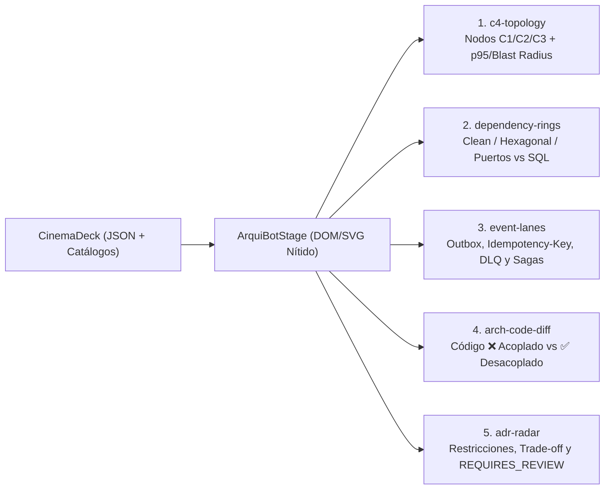

# Propuesta Arquitectónica Senior/Staff — ARQPIXEL Interactive Cinema & Studio Audio HD

- **Estado:** Propuesta técnica verificada sobre evidencia real (`READY_FOR_APPROVAL`)
- **Repositorio consumidor:** `ARQPIXEL Academy` (`TypeScript ES2022` + DOM nativo sin framework + `Three.js` lazy + CSP estricta `style-src 'self'`)
- **Fuentes reales inspeccionadas:**
  - `RustPixel/.agents/skills/vigilio/.vigilio-docs/standards/experience/interactive-cinema-and-studio-audio.md`
  - `RustPixel/.agents/skills/vigilio/.vigilio-docs/playbooks/interactive-video-intro-and-studio-audio.md`
  - `RustPixel/.agents/skills/vigilio/ux-interactive-cinema/SKILL.md` y `references/execution.md`
  - `RustPixel/.agents/skills/ferris-pixel-cinema/SKILL.md`
  - `RustPixel/src/features/cinema/{FerrisPlayer.tsx,storyboards.ts,audio-manifest.json}` y `scripts/generate-cinema-audio.py`
  - `ARQPIXEL/{index.html,public/_headers,data/modules.json,data/deep-dives.json,data/senior.json,docs/adr/README.md}`
- **Preflight del entorno local (medido):**
  - `Python 3.14.7`: disponible (`OK`)
  - `edge-tts`: instalado y operativo (`OK`)
  - `ffmpeg` (`imageio_ffmpeg` estático `v9.0.2` con `libmp3lame`): instalado y operativo (`OK`)
  - Medición empírica real en `RustPixel/public/audio/*.mp3` (`24` pistas estéreo `24 kHz` `80 kbps`): **`8,161.7 KB` totales (`7.97 MB`)**, promedio real de **`340.1 KB` por video** (rango `100.4 KB – 449.8 KB`).

---

## 1. Resumen Ejecutivo y Recomendación Senior/Staff

Adoptar el patrón **Interactive Cinema de Cuadro Único + Audio Neuronal Conversacional a 2 Voces** en `ARQPIXEL Academy` es **altamente recomendable**, porque multiplica la retención pedagógica de conceptos abstractos (C4, inversión de dependencias, DDD, Outbox, Sagas, SLOs y STRIDE) con **`0` gasto de tokens LLM en runtime**, **`0 MB` de archivos `.mp4` borrosos** y nitidez vectorial perfecta en pantallas Retina y móviles.

Sin embargo, **no debe copiarse literalmente el código Preact de `RustPixel`**. Para respetar los ADRs vigentes de `ARQPIXEL` (`ADR-0001` a `ADR-0006`) y su identidad visual `Slate + Warm Amber`, recomendamos:

1. **Alcance óptimo recomendado (`56` videos HD en Fase Principal, ampliable a `72` en Cobertura 360°):**
   - Crear un motor declarativo único **`ArquiBotPlayer`** alimentado por los catálogos validados (`modules.json`, `deep-dives.json`, `senior.json`, `SENIOR_PLAYBOOKS`, `SENIOR_THREATS`) y pre-generar **las `56` pistas `.mp3` de estudio** (`1` Intro Portada + `36` Clases `B01–A12` + `1` Intro Senior + `18` Misiones `S01–S18`).
   - **Peso total estimado en repositorio:** **`~18.4 MB`** (`56 × ~330 KB`), con **`0 KB` descargados al abrir la app** gracias a `<audio preload="metadata">` y carga diferida `import('./features/cinema/arquibot-cinema.js')`.
2. **Adaptación obligatoria a 5 invariantes propios de `ARQPIXEL`:**
   - **DOM nativo TypeScript (`ADR-0001`)** en lugar de `Preact` (`FerrisPlayer.tsx`).
   - **CSP estricta (`ADR-0004` / `ADR-0005`)**: registrar **`ADR-0007`** para añadir `media-src 'self' data:` y construir el `scrubber` con `<progress>` + `<input type="range">` + `<svg>` (**cero atributos `style="..."`**).
   - **5 pizarras semánticas específicas de Arquitectura de Software** (en vez de `stack-heap` de punteros Rust).
   - **2 voces neuronales con roles pedagógicos de arquitectura:** `Sofía` (`es-CO-SalomeNeural`, Tech Lead / Product Engineer que plantea el síntoma de negocio en NexoShop) + `ArquiBot Mentor` (`es-ES-AlvaroNeural`, Principal Software Architect que desglosa límites, contratos y *trade-offs*).
   - **Honestidad de evaluación (`ADR-0003`):** los cierres de misiones Senior distinguen explícitamente entre invariantes deterministas (`PASS / FAIL`) y juicio arquitectónico abierto (`REQUIRES_REVIEW`).

---

## 2. ¿Cuántos Videos Podemos Crear Exactamente? (Inventario y Pesos Reales)

Tomando como base empírica los **`340.1 KB` promedio por cápsula de `~34 s`** medidos en `RustPixel` (`24 kHz`, estéreo, `80 kbps` con pad armónico DSP y compresión vocal), así escala cada nivel de cobertura en `ARQPIXEL Academy`:

### Tabla Comparativa de Opciones de Cobertura

| Nivel / Estrategia | Qué incluye exactamente | Cantidad de Videos | Duración Total Aprox. | Peso Total `.mp3` en Git | Impacto en Boot Inicial (`index.html` + `app.js`) | Recomendación |
|---|---|---:|---:|---:|---:|---|
| **Nivel 1 · Pack Esencial** *(igual a `RustPixel`)* | `1` Portada + `1` Intro Senior + `3` Clases ancla (`B01`, `I01`, `A01`) + `18` Misiones Senior (`S01–S18`). *(Las otras 33 clases usan storyboard visual + reloj determinista).* | **23 videos HD** *(+33 visuales)* | ~13.5 min | **~7.8 MB** | **`0 KB`** *(lazy chunk)* | Útil como MVP rápido en 1 iteración |
| **Nivel 2 · Currículo + Senior 100 %** | `1` Portada + **`36` Clases completas (`B01–B12`, `I01–I12`, `A01–A12`)** + `1` Intro Senior + **`18` Misiones Senior (`S01–S18`)**. **Toda clase y toda misión tiene audio neuronal HD a 2 voces.** | **56 videos HD** | ~31.0 min | **~18.4 MB** | **`0 KB`** *(lazy chunk + `preload="metadata"`)* | **⭐ RECOMENDADO (Experiencia uniforme al 100 %)** |
| **Nivel 3 · Academia 360° Total** | Los `56` anteriores + **`8` Estudios de Laboratorio** (`dependencias`, `c4`, `ddd`, `patterns`, `api`, `distributed`, `incident`, `adr`) + **`8` Rutas de Especialización / Capstones (`R01–R08`)**. | **72 videos HD** | ~38.5 min | **~23.2 MB** | **`0 KB`** *(lazy chunk + `preload="metadata"`)* | Ideal como Fase 2 tras validar los 56 principales |

> **Comparativa de ingeniería:** `72` videos tradicionales en `.mp4` (1080p) ocuparían entre **`950 MB` y `1.4 GB`**, superando el umbral recomendado de GitHub Pages (`1 GB`) y degradando la nitidez del código en pantallas 4K/móviles. Con `DOM/SVG + MP3 80 kbps`, los **`72` videos completos pesan `~23.2 MB`** (menos que un solo minuto de video MP4) y el texto es 100 % seleccionable, accesible y vectorial.

---

### Desglose Detallado del Catálogo Completo (`56` base → `72` 360°)

| Bloque | IDs de `CinemaDeck` | Ruta donde vive en `ARQPIXEL` | Escenas por video | Duración objetivo | Qué enseña visual y conversacionalmente |
|---|---|---|---:|---:|---|
| **1. Trailer Principal** (`1`) | `HOME-INTRO` | `#/inicio` (debajo del Hero o integrado en sección Showcase) | 4 escenas | `38–42 s` | `01` El caos del monolito acoplado → `02` Pensar en límites C4, DDD y Hexagonal → `03` Laboratorios y mundos 3D → `04` Senior Mode con semillas reproducibles y `REQUIRES_REVIEW`. |
| **2. Nivel Básico** (`12`) | `CLASS-B01` .. `CLASS-B12` | `#/aprender/B01..B12` y `#/modulo/B01..B12` | 3 escenas | `26–32 s` | `01` Caso cotidiano en NexoShop (`Host`) → `02` Concepto estructural + diagrama de fronteras (`Mentor`) → `03` Métrica verificable y pregunta clave antes del banco práctico 2/4. |
| **3. Nivel Intermedio** (`12`) | `CLASS-I01` .. `CLASS-I12` | `#/aprender/I01..I12` y `#/modulo/I01..I12` | 3 escenas | `30–35 s` | `01` Dolor de mantenimiento (SOLID, GoF sin sobreingeniería, Bounded Contexts, Agregados) → `02` Diff arquitectónico `❌ Antes vs ✅ Después` → `03` Regla de oro y cuándo NO aplicarlo. |
| **4. Nivel Avanzado** (`12`) | `CLASS-A01` .. `CLASS-A12` | `#/aprender/A01..A12` y `#/modulo/A01..A12` | 3 escenas | `32–38 s` | `01` Falla distribuida bajo carga (Outbox, Sagas, Idempotencia, SLO Burn Rate, STRIDE, FinOps) → `02` Carriles de eventos paso a paso → `03` Salvaguarda operativa y trade-off de coste. |
| **5. Guía Senior Mode** (`1`) | `SENIOR-OVERVIEW` | `#/senior` | 3 escenas | `26–30 s` | Cómo abordar los 6 retos conectados + Fase 2 encadenada + semillas FNV-1a + diferencia honesta entre `PASS` mecánico y `REQUIRES_REVIEW` humano. |
| **6. Briefings Senior** (`18`) | `SENIOR-S01` .. `SENIOR-S18` | `#/mision/S01..S18` y `#/taller-senior/S01..S18` | 3 escenas | `35–42 s` | `01` Incidente en vivo y restricciones de tráfico/SLO → `02` Punto crítico de acoplamiento y componentes esenciales → `03` Amenaza STRIDE, entregable ADR y criterios de verificación. |
| **7. Laboratorios** *(Opcional +8)* | `LAB-dependencias` .. `LAB-adr` | `#/laboratorio/:id` | 2–3 escenas | `22–28 s` | Mini-demostración de 25 s mostrando cómo usar los fixtures Positivo/Negativo/Límite y qué exportar (`.json`, `.mmd`, `.svg`, `.png`, `.md`). |
| **8. Especializaciones** *(Opcional +8)* | `SPEC-R01` .. `SPEC-R08` | `#/rutas/R01..R08` y `#/proyectos/:id` | 2–3 escenas | `22–28 s` | Hoja de ruta del perfil objetivo, secuencia de módulos compartidos y expectativas de revisión humana en el Capstone `CAP-R01..R08`. |

---

## 3. ¿Cómo Quedaría en `ARQPIXEL`? (Diseño UX/UI de Cuadro Único)

Siguiendo estrictamente la **Regla de Cuadro Único Minimalista (`ux-interactive-cinema`)** y la paleta **Slate + Warm Amber (`#090f1c` / `#101a2b` / `#ff9900`)** de `ARQPIXEL`:

- **Prohibido** añadir cajas periféricas fuera del reproductor (nada de cajas de transcripción sueltas debajo ni grillas de botones externas).
- **Todo ocurre dentro de un único contenedor `.cinema-screen` (`aspect-ratio: 16 / 9` en desktop, adaptable sin corte ni scroll horizontal en `320px–390px`):**

### 3.1 Estado `idle` (Póster Cinematográfico Listo para Pulsar `▶`)

```text
┌──────────────────────────────────────────────────────────────────────────────┐
│  [• CLASE INTERACTIVA HD · A05]                                    [00:34]   │
│                                                                              │
│                  (Vista previa difuminada de la pizarra C4/Outbox)           │
│                                                                              │
│                                  ╭───────╮                                   │
│                                  │   ▶   │  ← Botón ámbar sólido (#ff9900)   │
│                                  ╰───────╯                                   │
│                    Patrón Transactional Outbox e Idempotencia                │
│               Audio Estudio HD · Sofía & ArquiBot · 3 escenas                │
│                                                                              │
└──────────────────────────────────────────────────────────────────────────────┘
```

### 3.2 Estado `playing | paused` (Escenario Vectorial + Voz + Subtítulos `CC` Integrados)

```text
┌──────────────────────────────────────────────────────────────────────────────┐
│  [🤖 ArquiBot Mentor · ılılı]                      [01 · Problema] [02] [03] │
│                                                                              │
│   ┌──────────────┐     1. TX ACID Local     ┌────────────────────────────┐   │
│   │  Order API   │ ───────────────────────▶ │ PostgreSQL (orders+outbox) │   │
│   └──────────────┘                          └─────────────┬──────────────┘   │
│                                                           │ 2. Relay         │
│   Métrica: Eventos perdidos  [ 4.2% ⚠ ] ──▶ [ 0.0% ✓ ]   ▼                  │
│                                             ┌────────────────────────────┐   │
│                                             │ Broker + Inbox Idempotente │   │
│                                             └────────────────────────────┘   │
│                                                                              │
│     «Si guardas el pedido en base de datos y publicas al broker por          │
│      separado, una caída intermedia deja cobros fantasma sin evento.»        │
│                                                                              │
│  ━━━━━━━━━━━━━━━━━━━━━━━●──────|─────────────|─────────────────────────────  │
│  [⏸]  00:14 / 00:34                          [CC]  [1x]  [🔊]  [⛶]          │
└──────────────────────────────────────────────────────────────────────────────┘
```

### 3.3 Las 5 Pizarras Semánticas Exclusivas de `ARQPIXEL` (`StageVisual`)

En lugar de las pizarras de memoria Rust (`stack-heap`), `ARQPIXEL` tendrá **5 pizarras DOM/CSS/SVG propias del dominio de Arquitectura de Software**:



1. **`c4-topology`:** Nodos arquitectónicos con estados `normal | coupled (coral) | isolated (esmeralda)`, flechas animadas (`.arch-flow-edge`) y tira comparativa de atributo de calidad (`Antes → Después`).
2. **`dependency-rings`:** Visualización concéntrica `Presentación → Aplicación → Dominio ← Infraestructura` que ilumina en rojo cualquier flecha hacia afuera (`Dominio → ORM`) y en verde la inversión mediante `Puerto` (`Interface`).
3. **`event-lanes`:** Dos o tres carriles paralelos sincronizados con el avance intra-escena (`progress 0..1`) para explicar `Transactional Outbox`, `Saga Compensatoria`, `Circuit Breaker`, `Canary Rollout` y concurrencia optimista (`version`).
4. **`arch-code-diff`:** Comparador limpio en `JetBrains Mono` que resalta progresivamente el refactor entre código acoplado y arquitectura limpia (alineado con `examples/nexoshop-reference-nestjs`).
5. **`adr-radar`:** Ficha ejecutiva `Contexto + SLO → Decisión → Coste aceptado → Gate verificable`, reforzando `ADR-0003` (`PASS` estructural vs `REQUIRES_REVIEW` humano).

---

## 4. Arquitectura Técnica Limpia y Cumplimiento CSP / Seguridad en `ARQPIXEL`

### 4.1 Estructura de Archivos Propuesta (`symbol-ownership-architecture`)

```text
ARQPIXEL/
├── .agents/
│   └── skills/
│       ├── ux-interactive-cinema/          # Skill transversal Vigilio (SKILL.md + references/execution.md)
│       └── arquibot-pixel-cinema/          # Skill de dominio ARQPIXEL (gobierna ArquiBotPlayer y 56 audios)
├── docs/
│   ├── PROPUESTA_ARQPIXEL_CINEMA_INTERACTIVO.md
│   └── adr/
│       └── 0007-cinema-interactivo-media-csp-y-audio-offline.md
├── public/
│   └── audio/                              # Pistas .mp3 estéreo 24kHz 80kbps (~330 KB c/u)
│       ├── home-intro.mp3
│       ├── senior-overview.mp3
│       ├── class-b01.mp3 ... class-a12.mp3
│       └── senior-s01.mp3 ... senior-s18.mp3
├── data/
│   └── audio-manifest.json                 # { src, totalSec, cues[], speakers[] } validado con schema
├── scripts/
│   └── generate-cinema-audio.py            # Síntesis edge-tts 2 voces + pad armónico 24kHz + mastering ffmpeg
└── src/
    └── features/
        └── cinema/
            ├── constants/
            │   └── cinema.constants.ts     # UPPER_SNAKE_CASE: velocidades, tiempos de stall, paletas
            ├── schemas/
            │   └── cinema.schema.ts        # Validación de borde para audio-manifest.json + tipos inferidos
            ├── arquibot-storyboards.ts     # Generador determinista de los 56/72 CinemaDecks desde data/*.json
            └── arquibot-player.ts          # Reproductor DOM nativo + reloj dual + WebVTT + 0 inline styles
```

### 4.2 Solución Exacta a los 3 Retos Técnicos Críticos de `ARQPIXEL`

1. **CSP `default-src 'none'` y `media-src` (`ADR-0007`):**
   - Actualmente `index.html` y `public/_headers` definen `default-src 'none'` sin `media-src`. Sin actualizar la directiva, el navegador bloquearía `<audio src="./audio/...">` y `<track src="data:text/vtt,...">`.
   - **Solución limpia:** añadir `media-src 'self' data:` en `index.html`, `public/_headers`, `scripts/serve-dist-with-headers.mjs` y `scripts/check-security-headers.mjs`, manteniendo prohibidos todos los orígenes externos (`https:` bloqueado en runtime).
2. **Prohibición total de `style="..."` (`ADR-0005`):**
   - En vez de `style="width: 42%"` en la barra de tiempo, `arquibot-player.ts` combinará:
     - `<progress class="cinema-scrubber-fill" max="1000" value="420"></progress>` para el relleno visual continuo.
     - `<input type="range" class="cinema-scrubber-slider" min="0" max="1000" value="420" aria-label="Posición del video" />` superpuesto con transparencia para arrastrar con ratón/táctil y navegar con `ArrowLeft` / `ArrowRight` / `Home` / `End`.
     - `<svg class="cinema-cue-markers" viewBox="0 0 1000 10">` con `<line x1="..." y1="0" x2="..." y2="10" />` para dibujar las marcas exactas de cada capítulo sin un solo atributo `style`.
3. **Diccionario Fonético de Arquitectura (`clean_for_speech` en `generate-cinema-audio.py`):**
   - Antes de pasar cada parlamento a `edge-tts`, convierte siglas y rutas técnicas a español hablado natural mientras el subtítulo `WebVTT` muestra la grafía exacta:
     - `C4` → `"modelo ce cuatro"`, `DDD` → `"de de de"`, `SOLID` → `"principios sólid"`, `GoF` → `"patrones Gang of Four"`, `CQRS` → `"ce cu erre ese"`, `SLO` → `"objetivo de nivel de servicio"`, `p95` → `"percentil noventa y cinco"`, `RPO/RTO` → `"erre pe o y erre te o"`, `STRIDE` → `"modelo estraid"`, `IDOR` → `"acceso cruzado ídor"`, `DLQ` → `"cola de mensajes fallidos"`, `Outbox` → `"Transactional Outbox"`, `S09` → `"misión ese cero nueve"`, `B01` → `"módulo be cero uno"`.

---

## 5. Plan de Implementación por Fases y Gates de Verificación

Si apruebas avanzar a implementación (`BUILD`), recomendamos ejecutarlo en **2 entregas verificables**:

1. **Entrega 1 — Motor `ArquiBotPlayer` + Skills + `ADR-0007` + Primer lote de `23` o `56` audios HD:**
   - Crear `.agents/skills/ux-interactive-cinema/` y `.agents/skills/arquibot-pixel-cinema/`.
   - Registrar `docs/adr/0007-cinema-interactivo-media-csp-y-audio-offline.md` y habilitar `media-src 'self' data:`.
   - Implementar `src/features/cinema/` con carga diferida (`import()`) e integrarlo en `#/inicio`, `#/aprender/:id`, `#/senior`, `#/mision/:id` y `#/taller-senior/:id`.
   - Ejecutar `python scripts/generate-cinema-audio.py` para sintetizar y masterizar las **56 pistas `.mp3`** + `data/audio-manifest.json`.
2. **Entrega 2 — Pruebas BDD, Accesibilidad WCAG 2.2 AA, Playwright Multi-Motor y Despliegue a GitHub Pages:**
   - Suite unitaria/BDD (`tests/cinema-storyboards-and-manifest.test.mjs`): valida que las `56` pistas `.mp3` existan en `dist/audio/`, `cues.length === scenes.length`, `totalSec > 0`, `0` atributos `style=` y sanitización fonética completa.
   - Suite E2E Playwright (`Chromium + WebKit` + `@axe-core/playwright`): verifica póster `idle` → click `▶` → transición a `playing` (con reloj de respaldo en CI sin tarjeta de sonido) → salto de escena → `<track kind="captions">` → ausencia de scroll horizontal en `320px / 375px` → `0` violaciones WCAG 2.2 AA en `dark`, `light` y `high-contrast`.
   - Despliegue automático y verificación en vivo en `https://vigilioyonatan.github.io/arqpixel-academy/`.
